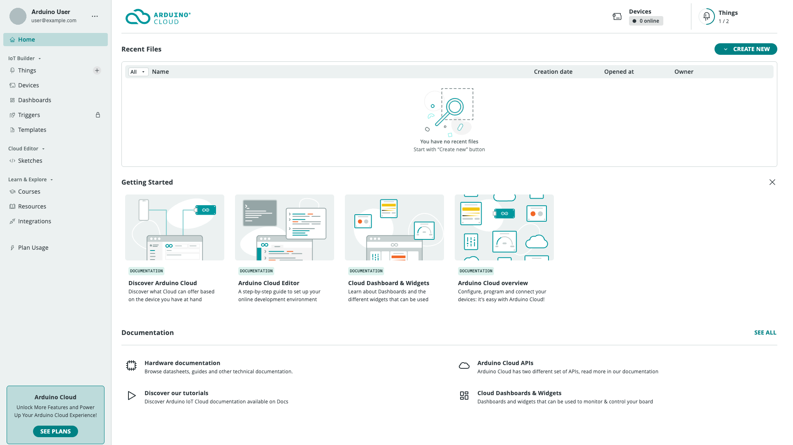

[Arduino Cloud](https://app.arduino.cc/) is a platform for developing IoT
projects and connecting them to the world. It handles the parts that are
usually hardest to build yourself — secure device connectivity, data storage,
and a real-time link between your hardware and a user interface — so you can
focus on your project's actual logic.

It works with official Arduino boards over Wi-Fi®, LoRa®, Ethernet, and
Cellular, and with non-Arduino clients written in Python, MicroPython, and
JavaScript.

## The Components

Arduino Cloud is really several tools that share one account and one data
layer.

| Component | What it does |
|---|---|
| [Cloud Editor](/arduino-cloud/sketches-editor/cloud-editor-overview) | A browser-based code editor for writing and uploading sketches — no local installation required. |
| [IoT tools](/arduino-cloud/things-data/things) | Things, Cloud Variables, and the sync backend that keeps a value identical on the device and in the cloud. |
| [Dashboards](/arduino-cloud/dashboards/dashboards) | Drag-and-drop widgets to visualize and control your variables from any browser. |
| [IoT Remote app](/arduino-cloud/iot-remote-app/iot-remote-app-overview) | A mobile app that shows your dashboards and can turn a phone into a sensor-streaming device. |
| [APIs and CLI](/arduino-cloud/apis-cli/developer-overview) | A REST API, client SDKs, and a command-line tool for automating everything above at scale. |

## Who It Is For

- **Makers and hobbyists** who want to connect a board to the internet without
  writing networking code or hosting a server.
- **Educators and students** using shared spaces to run classroom projects.
- **Professional and business users** managing fleets of devices, with role
  based access, custom branding, and data export — see
  [Arduino Cloud for Business](/arduino-cloud/business).

## Handled For You

Networking, authentication, and data synchronization are managed by the
platform. When a variable changes on your board, it changes in the cloud and
on every open dashboard within moments — and the reverse is true when you move
a slider or flip a switch in a dashboard.

<Alert type="info">

The free plan is enough to build a complete project. Some features — such as
[Triggers](/arduino-cloud/automations/triggers-and-alerts) and a few advanced
dashboard widgets — require a paid plan. See the
[Plans and Feature Matrix](/arduino-cloud/reference/plans-feature-matrix).

</Alert>

## Next Steps

- [How Arduino Cloud Works](/arduino-cloud/get-started/how-arduino-cloud-works)
- [Quickstart: Your First IoT Project](/arduino-cloud/get-started/quickstart-first-project)
