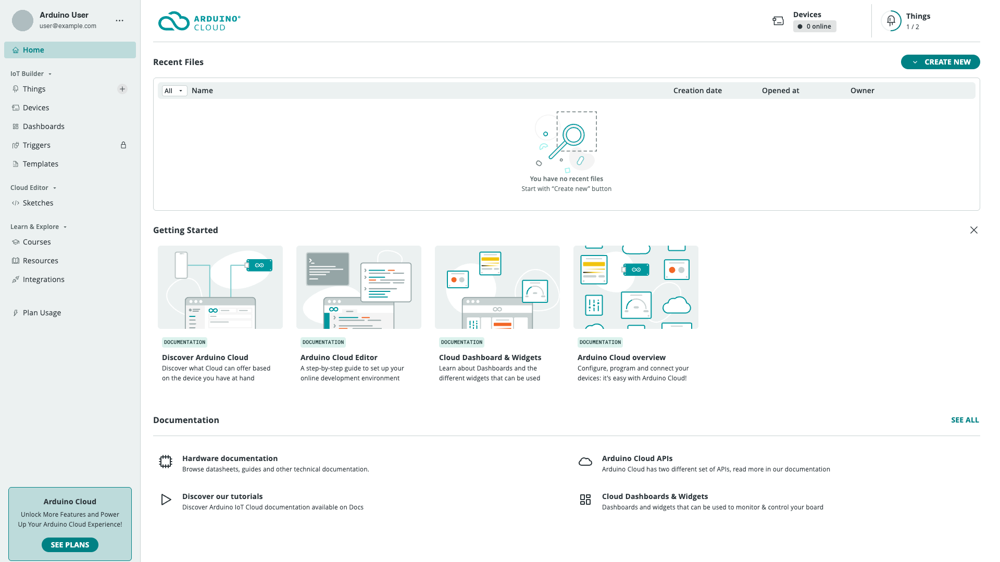

[Arduino Cloud](https://app.arduino.cc/) is a platform for developing IoT projects and connecting them to the world. It handles the parts that are usually hardest to build yourself — secure device connectivity, data storage, and a real-time link between your hardware and a user interface — so you can focus on your project's actual logic.

It works with official Arduino boards over Wi-Fi®, LoRa®, Ethernet, and Cellular, and with non-Arduino clients written in Python, MicroPython, and JavaScript.

## The Components

Arduino Cloud is really several tools that share one account and one data layer.

| Component | What it does |
|---|---|
| [Cloud Editor](/arduino-cloud/sketches-editor/cloud-editor-overview) | A browser-based code editor for writing and uploading sketches — no local installation required. |
| [IoT tools](/arduino-cloud/things-data/things) | Things, Cloud Variables, and the sync backend that keeps a value identical on the device and in the cloud. |
| [Dashboards](/arduino-cloud/dashboards/dashboards) | Drag-and-drop widgets to visualize and control your variables from any browser. |
| [IoT Remote app](/arduino-cloud/iot-remote-app/iot-remote-app-overview) | A mobile app that shows your dashboards and can turn a phone into a sensor-streaming device. |
| [APIs and CLI](/arduino-cloud/apis-cli/developer-overview) | A REST API, client SDKs, and a command-line tool for automating everything above at scale. |

Dashboards aren't tied to a single Thing or device, so one dashboard can control many boards.

## Navigating the Interface

Everything is reachable from the left navigation bar:

- **[Sketches](/arduino-cloud/sketches-editor/sketchbook-and-sketches)** — your stored programs.
- **[Devices](/arduino-cloud/devices/devices-overview)** — Arduino boards, ESP32 boards, and manual devices (Python, JavaScript, and more).
- **[Things](/arduino-cloud/things-data/things)** — project configurations: a device, its synced variables, and network credentials.
- **[Dashboards](/arduino-cloud/dashboards/dashboards)** — widgets to monitor and control your boards, also available in the [IoT Remote app](/arduino-cloud/iot-remote-app/iot-remote-app-overview).
- **[Triggers](/arduino-cloud/automations/triggers-and-alerts)** — email and push notifications on variable changes.
- **[Templates](/arduino-cloud/templates/use-templates)** — ready-made projects that configure a device and Thing for you.
- **[Integrations](/arduino-cloud/integrations/integrations-overview)** — connected third-party services.
- **Resources** and **Courses** — helpful links, and content tailored to specific products and kits.

## Compatible Boards

In these docs, a *board* is your hardware (or virtual Python/JavaScript client) and a *device* is its configuration in the Cloud. The Cloud Editor can program **any** official Arduino board and many third-party boards; IoT features need a board with a radio module (Wi-Fi®, LoRa®, Cellular) or Ethernet, including ESP32-based boards. You can also create a [manual device](/arduino-cloud/devices/add-manual-device) that runs on your computer with JavaScript, Python, or MicroPython.

See [Wi-Fi®](/arduino-cloud/devices/add-wifi-board), [LoRa®](/arduino-cloud/devices/add-lorawan-device), [Ethernet](/arduino-cloud/devices/add-ethernet-board), and [Cellular](/arduino-cloud/devices/add-cellular-board) boards, or the full [Supported Boards and Capabilities](/arduino-cloud/reference/supported-boards-capabilities) list.

## Who It Is For

- **Makers and hobbyists** who want to connect a board to the internet without writing networking code or hosting a server.
- **Educators and students** using shared spaces to run classroom projects.
- **Professional and business users** managing fleets of devices, with role based access, custom branding, and data export — see [Arduino Cloud for Business](/arduino-cloud/business).

## Handled For You

Networking, authentication, and data synchronization are managed by the platform. When a variable changes on your board, it changes in the cloud and on every open dashboard within moments — and the reverse is true when you move a slider or flip a switch in a dashboard.

<Alert type="info">

The free plan is enough to build a complete project. Some features — such as [Triggers](/arduino-cloud/automations/triggers-and-alerts) and a few advanced dashboard widgets — require a paid plan. See the [Plans and Feature Matrix](/arduino-cloud/reference/plans-feature-matrix).

</Alert>

## Next Steps

- [How Arduino Cloud Works](/arduino-cloud/get-started/how-arduino-cloud-works)
- [Quickstart: Your First IoT Project](/arduino-cloud/get-started/quickstart-first-project)
