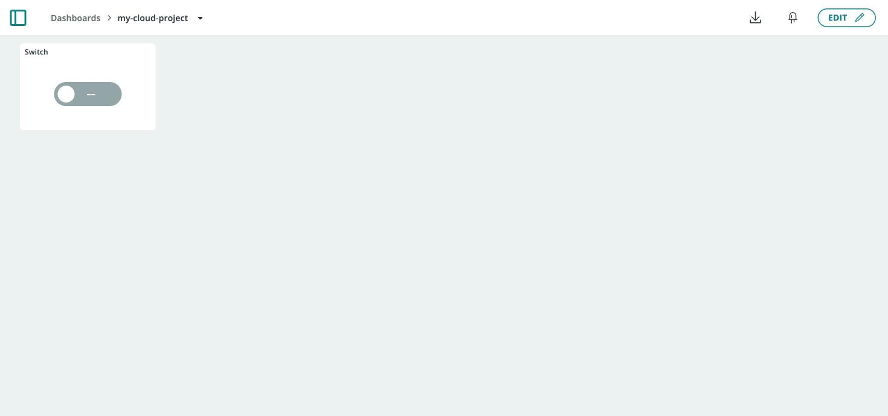
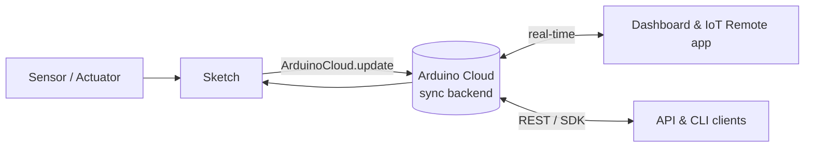

Before building anything, it helps to know the handful of concepts every
Arduino Cloud project is made of, and how a value travels from a sensor on
your board to a widget on your screen.

## The Core Concepts

| Concept | What it is |
|---|---|
| **Device** | A board (or a Python/JavaScript client) registered in Arduino Cloud, identified by a **Device ID** and a **Secret Key**. See [Devices](/arduino-cloud/devices/devices-overview). |
| **Thing** | The logical model of one project: a named container that holds your variables and links to a device. See [Things](/arduino-cloud/things-data/things). |
| **Cloud Variable** | A single value (temperature, an on/off state, a location) that stays in sync between the device and the cloud. See [Cloud Variables](/arduino-cloud/things-data/cloud-variables). |
| **Sketch** | The program running on the board. For Arduino/C++ devices it's generated from your Thing's variables. See [Sketchbook and Sketches](/arduino-cloud/sketches-editor/sketchbook-and-sketches). |
| **Dashboard** | A visual interface built from widgets, showing and controlling your variables. See [Dashboards](/arduino-cloud/dashboards/dashboards). |
| **Widget** | One control or display element on a dashboard (a gauge, switch, chart, map), bound to a variable. See [Add and Link Widgets](/arduino-cloud/dashboards/add-link-widgets). |
| **Trigger** | An automation that runs an action (email, push, webhook) when a condition is met. See [Triggers and Alerts](/arduino-cloud/automations/triggers-and-alerts). |
| **Space** | The account context that owns your resources — a personal space, or a shared space for a team or classroom. See [Spaces](/arduino-cloud/spaces-plans-account/spaces). |

A Thing holds the Cloud Variables for one project:

A dashboard widget is bound to one of those variables:

## How Data Flows

A Cloud Variable is the unit of exchange. When it changes on either side, the
platform propagates the new value to the other side and to any open dashboard.

- A **read** variable is updated by the device (a sensor reading) and displayed
  in dashboards.
- A **read/write** variable can be changed from either side — the device or a
  dashboard widget — and the change is mirrored back.
- Update policy controls how often a device pushes a value: **on change**, or
  **periodically** at a fixed interval. See
  [Cloud Variables](/arduino-cloud/things-data/cloud-variables).

## The Connection Lifecycle

An Arduino/C++ device moves through a predictable sequence each time it runs:

1. **Boot** — the sketch calls `initProperties()` to register its variables,
   then `ArduinoCloud.begin()`.
2. **Connect** — the connection handler brings up the network (Wi-Fi®, cellular,
   Ethernet) and opens a secure link to the cloud using the device's crypto
   credentials.
3. **Sync** — on connecting, the device and cloud reconcile the last known
   values of each variable.
4. **Run** — `ArduinoCloud.update()` in `loop()` sends changed values up,
   applies incoming changes, and services the connection.
5. **Reconnect** — if the network drops, the handler retries automatically and
   re-syncs on success.

<Alert type="info">

The device's connection status (online/offline and the reason for the last
state change) is visible on the device page and can drive alerts — see
[Device Status and Connection Lifecycle](/arduino-cloud/devices/device-status-lifecycle).

</Alert>

## Next Steps

- [Quickstart: Your First IoT Project](/arduino-cloud/get-started/quickstart-first-project)
- [Choose Your Setup Path](/arduino-cloud/get-started/choose-your-setup-path)
