This quickstart walks an official Arduino board with built-in connectivity (Wi-Fi®, Ethernet, or Cellular) from nothing to a working, controllable Cloud project. It's the shortest complete path through the platform; each step links to the reference page with the full detail.

<Alert type="info">

Using an ESP32/ESP8266, a Python/MicroPython/JavaScript client, or a LoRaWAN® device? The concepts are identical, but the setup differs — see [Choose Your Setup Path](/arduino-cloud/get-started/choose-your-setup-path).

</Alert>

## What You Need

- An official Arduino board with built-in connectivity, for example a UNO R4 WiFi, Nano ESP32, Nano 33 IoT, or MKR WiFi 1010. See [Supported Boards & Capabilities](/arduino-cloud/reference/supported-boards-capabilities).
- A USB cable that supports data transfer and fits your board.
- A 2.4 GHz Wi-Fi® network and its credentials (for Wi-Fi® boards).
- A computer with a supported browser and the [Cloud Agent](/arduino-cloud/devices/cloud-agent) installed. The Cloud Agent lets the browser talk to your board over USB. If it is missing, Arduino Cloud prompts you to install it the first time you add a device.

## Step 1 — Create an Account

To use Arduino Cloud, you need an Arduino account. [Create an account](https://login.arduino.cc/login) or sign in, then open [Arduino Cloud](https://app.arduino.cc/).

New accounts start on the **Free** plan, which is enough to complete this quickstart. You can upgrade later; see [Plans, Limits & Quotas](/arduino-cloud/spaces-plans-account/plans-limits-quotas).

## Step 2 — Add Your Device

Connect your board to your computer over USB, then open [Devices](/arduino-cloud/devices/devices-overview) and add it. The wizard detects the board through the [Cloud Agent](/arduino-cloud/devices/cloud-agent), registers it with a unique **Device ID**, and configures its credentials on the board for you. You don't need to copy or store any key for an official Arduino board.

<Alert type="info">

A **Secret Key** is only generated for devices without a secure element that you set up manually, such as third-party ESP32/ESP8266 boards and Python, MicroPython or JavaScript clients. See [Devices Overview](/arduino-cloud/devices/devices-overview#device-identity-and-credentials).

</Alert>

Select **+ Device** (or **Add Device**) and choose **Arduino boards** in the **Setup Device** dialog:

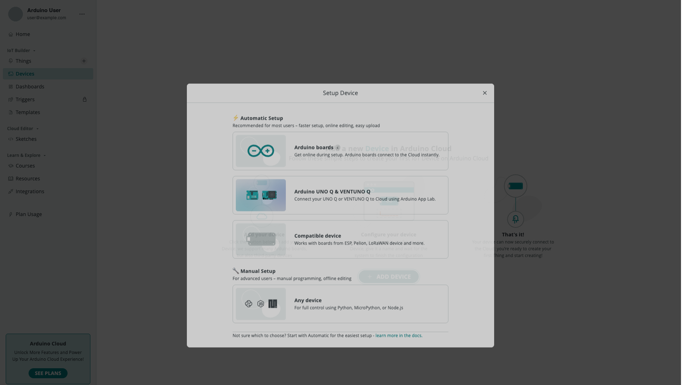

With the board connected over USB, it shows up in the detection list. Select it and follow the wizard to name the device:

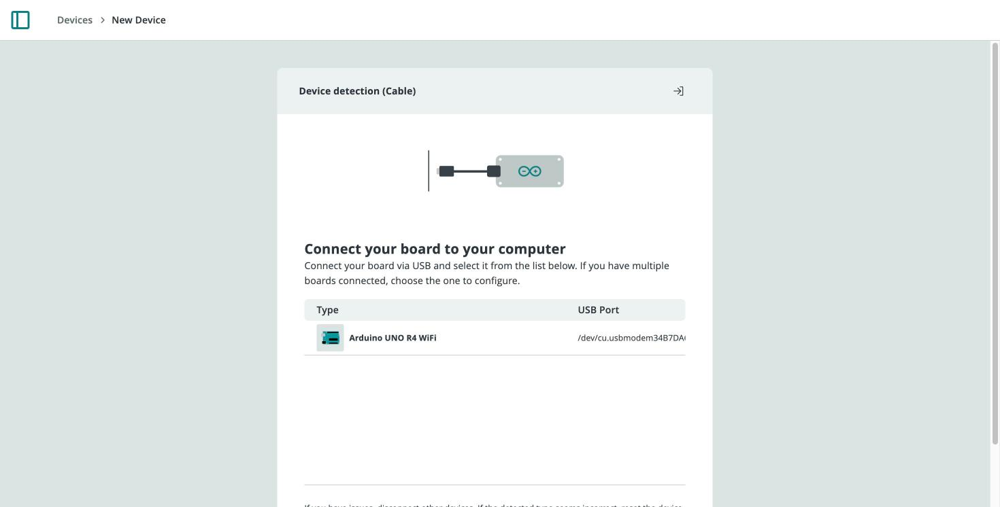

### Enter the Network Credentials

Your board needs network credentials to reach Arduino Cloud. How you enter them depends on the board's [provisioning version](/arduino-cloud/devices/network-configuration):

- **Provisioning 2.0** boards (for example, UNO R4 WiFi, Nano 33 IoT, MKR WiFi 1010, GIGA R1 WiFi): the wizard asks for the Wi-Fi® network name (SSID) and password and stores them on the board.
- **Provisioning 1.0** boards (for example, Nano ESP32): after you associate the device with a Thing in the next step, open the **Network** section on the device page and enter the Wi-Fi® SSID and password. The credentials are saved in the sketch's secrets file.

Arduino Cloud boards only connect to 2.4 GHz Wi-Fi® networks. See [Supported Wi-Fi Frequencies](/arduino-cloud/reference/supported-wifi-frequencies).

## Step 3 — Create a Thing and Add a Variable

A [Thing](/arduino-cloud/things-data/things) is the container for your project. Create one and associate the device you just provisioned from its **Device** panel.

Open **Things** and select **+ Thing**:

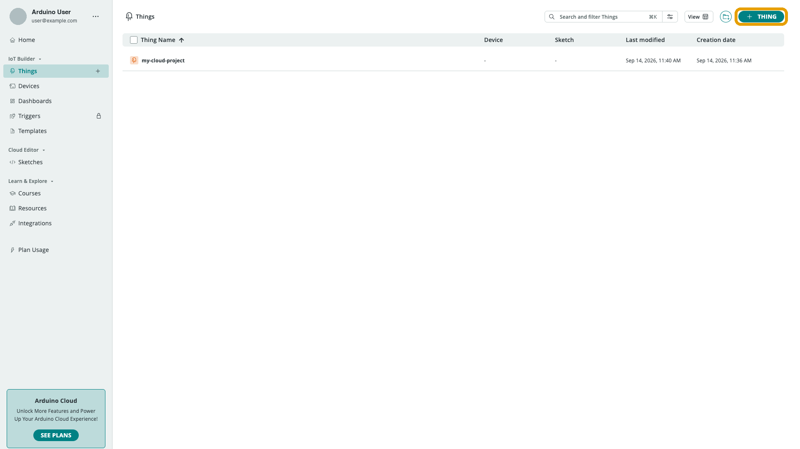

In the new Thing, open the **Device** panel from the left rail and pick **Choose from your list** to link the device from step 2:

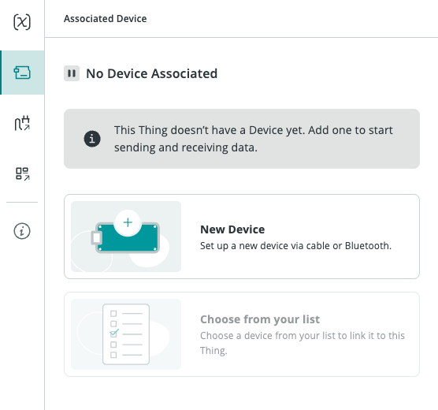

Next, in the Thing, add the [Cloud Variables](/arduino-cloud/things-data/cloud-variables) your project needs — for example a boolean `led` to control the on-board LED. Choose each variable's type, permission (read or read/write), and update policy.

Select **+ Variable** and pick a type — **Boolean** for the `led` example:

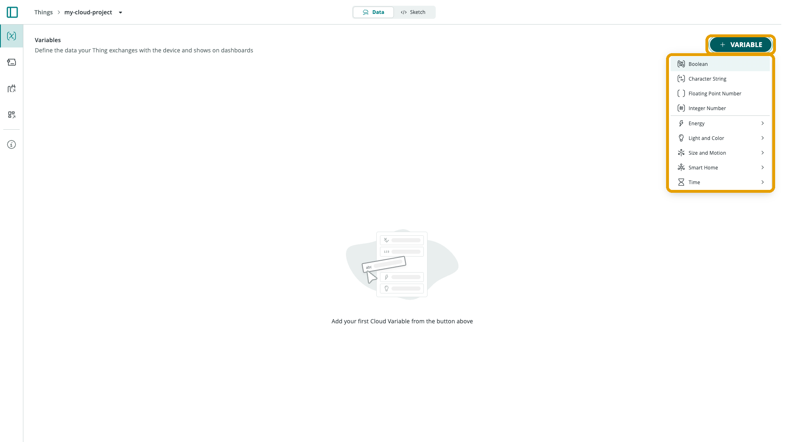

After naming it and selecting **Create**, the variable is listed on the Thing's **Data** tab:

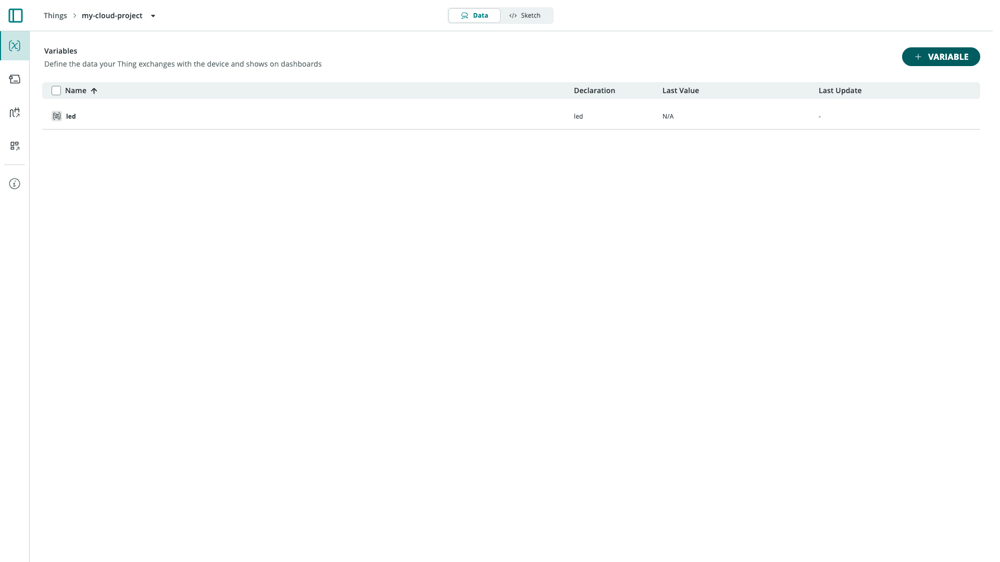

## Step 4 — Write and Upload the Sketch

Associating an Arduino/C++ device auto-generates a [sketch](/arduino-cloud/sketches-editor/sketchbook-and-sketches) wired to your variables. The sketch updates automatically whenever you change the Thing, for example when you add a variable. Open the Thing's **Sketch** tab and add your logic around the generated code:

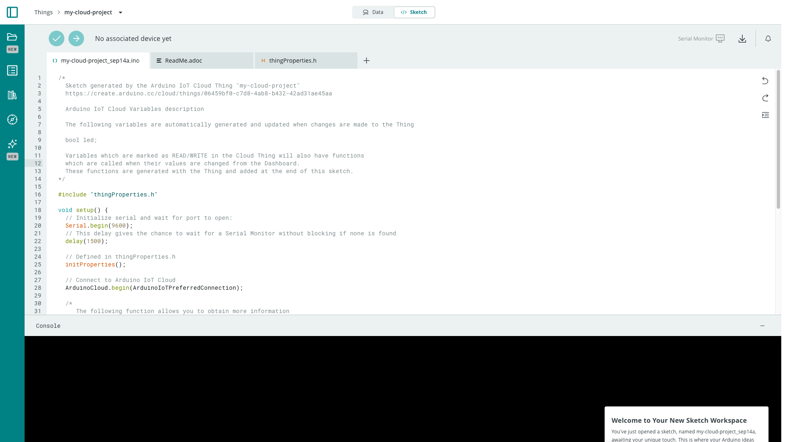

```arduino
#include "thingProperties.h"

void setup() {
  Serial.begin(9600);
  delay(1500);
  initProperties();
  ArduinoCloud.begin(ArduinoIoTPreferredConnection);
  pinMode(LED_BUILTIN, OUTPUT);
}

void loop() {
  ArduinoCloud.update();
}

void onLedChange() {
  digitalWrite(LED_BUILTIN, led);
}
```

- The `onLedChange()` callback is generated automatically for each read/write variable. Put the code that reacts to a change there.
- `ArduinoCloud.update()` synchronizes data between the board and Arduino Cloud. Keep it in `loop()` and avoid long `delay()` calls.
- If the sketch changes the `led` variable, the new value is sent to Arduino Cloud on the next synchronization.

To upload the sketch:

1. Check that the [Cloud Agent](/arduino-cloud/devices/cloud-agent) is running and that your board is connected over USB.
2. Check that the board and port are selected in the editor toolbar.
3. Select **Upload**. The editor compiles the sketch and flashes it to the board, which can take a moment for larger sketches.
4. Open the **Serial Monitor** to follow the connection. If the board fails to connect, the error messages are printed here.

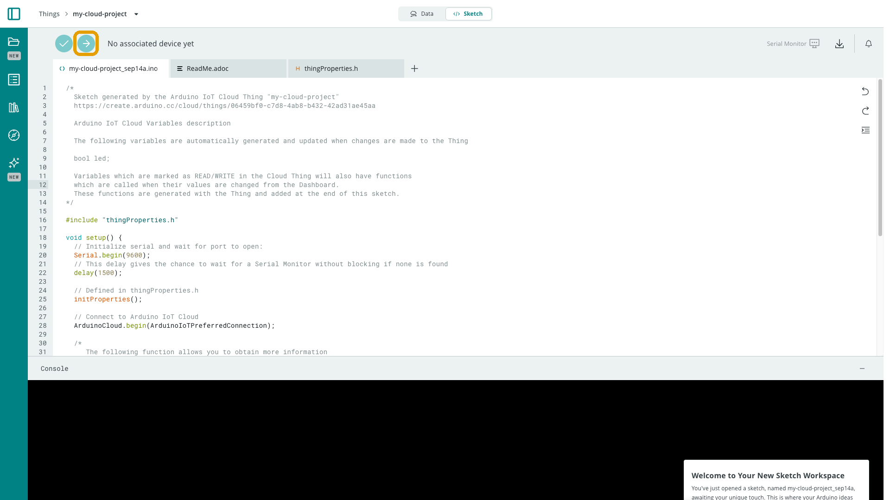

After the first USB upload, boards that support it can receive future updates [over the air](/arduino-cloud/sketches-editor/upload-over-the-air).

### Verify the Connection

Go back to the Thing. When the board is connected, its device status shows **Online**, and each variable shows its latest value and the time it was last updated. A board may take a minute or two to go online after the upload. If it stays offline, see [Troubleshoot Device Connections](/arduino-cloud/devices/troubleshoot-device-connections).

## Step 5 — Build a Dashboard

Create a [Dashboard](/arduino-cloud/dashboards/dashboards), add a **Switch** widget, and link it to your `led` variable. Toggle the switch and the on-board LED responds. If the value changes on the device, the widget updates too.

In the dashboard's edit mode, **Add** opens the widget picker:

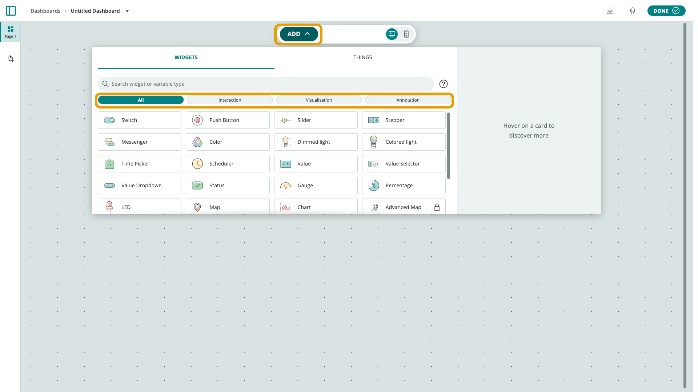

Choose **Switch**, then **Link Variable** and select the `led` variable from your Thing:

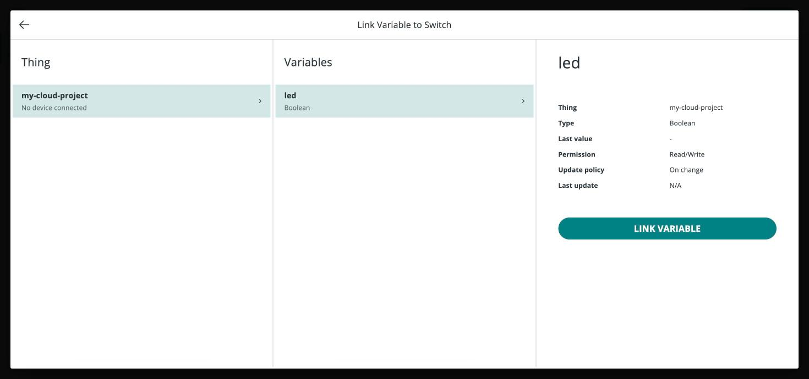

Select **Done** to leave edit mode. The Switch is now live on the dashboard:

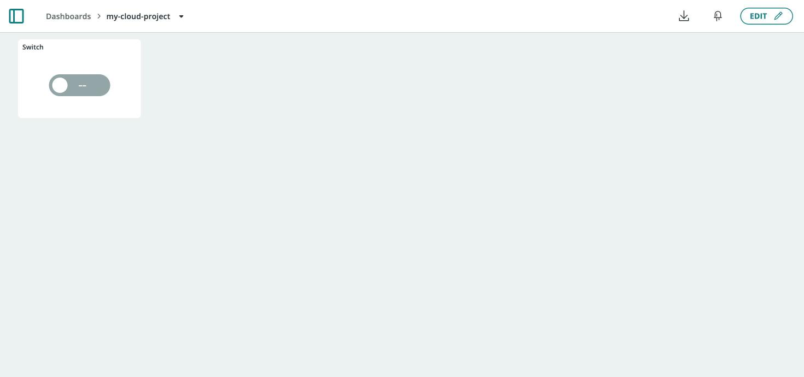

## Step 6 — Open the Dashboard on Your Phone

Install the [Arduino IoT Remote app](/arduino-cloud/iot-remote-app/iot-remote-app-overview) on your phone and sign in with the same Arduino account. Your dashboard appears in the app's dashboard list. Open it and toggle the switch to control the LED from your phone.

## Next Steps

- [Start From a Template](/arduino-cloud/get-started/start-from-a-template) — set up a complete project in one step
- [Dashboards](/arduino-cloud/dashboards/dashboards) — add more widgets
- [Automations & Notifications](/arduino-cloud/automations/choose-an-automation) — react to your data automatically
