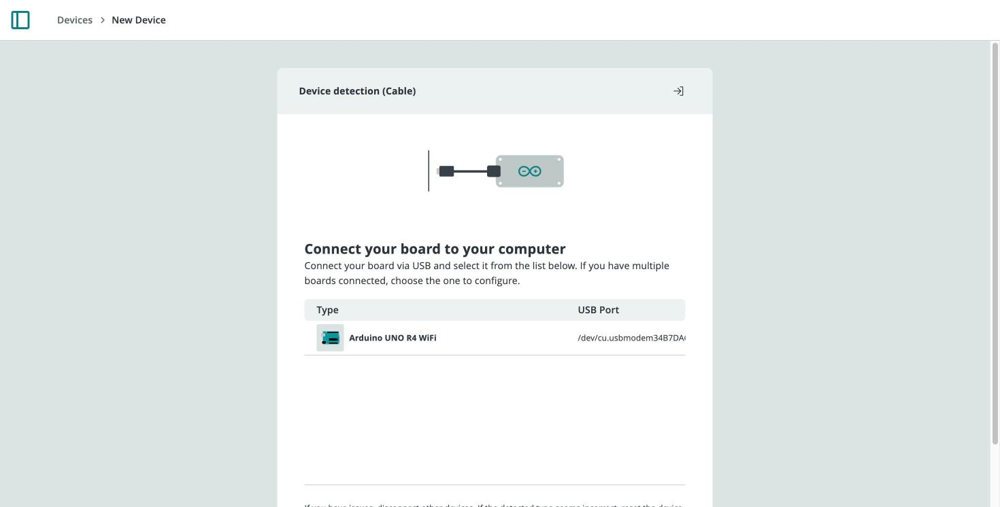
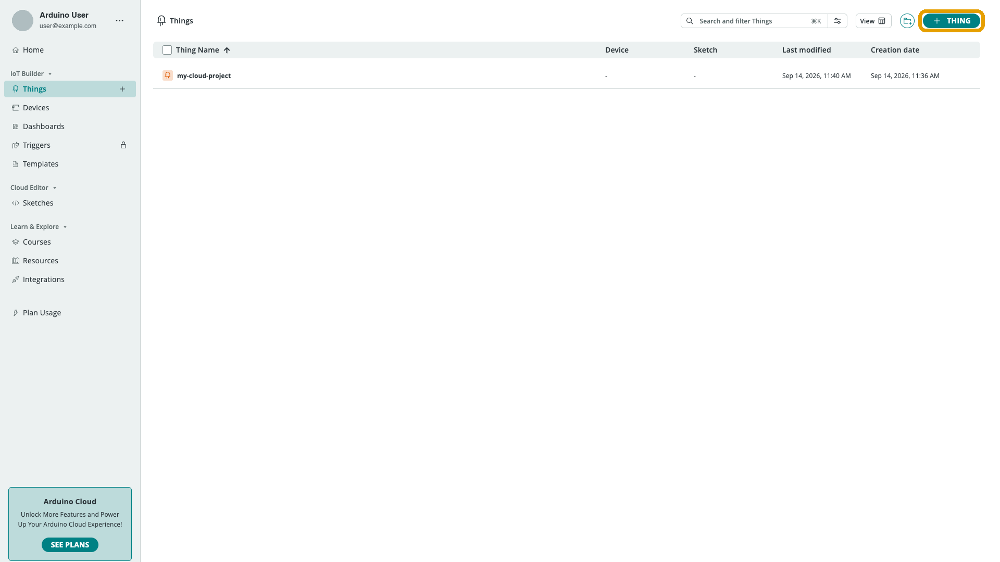
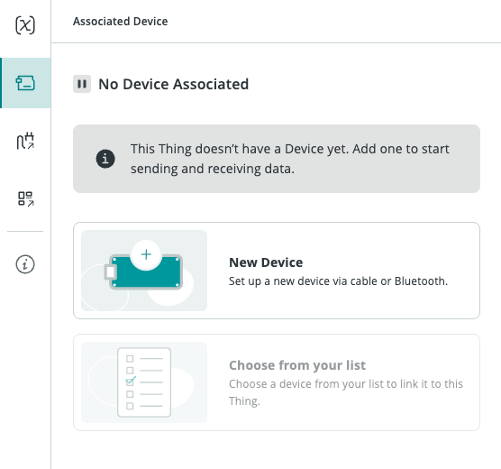
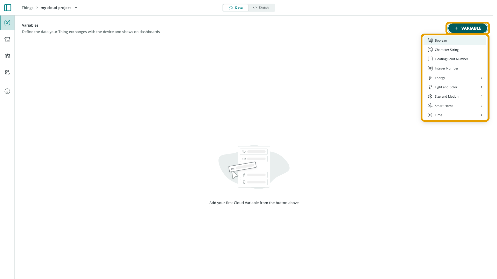
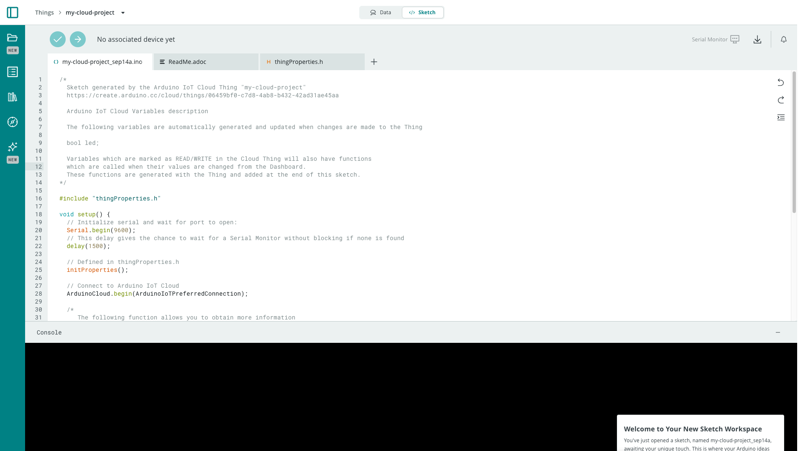
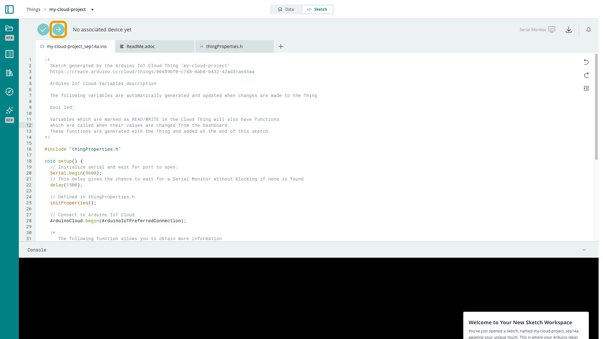
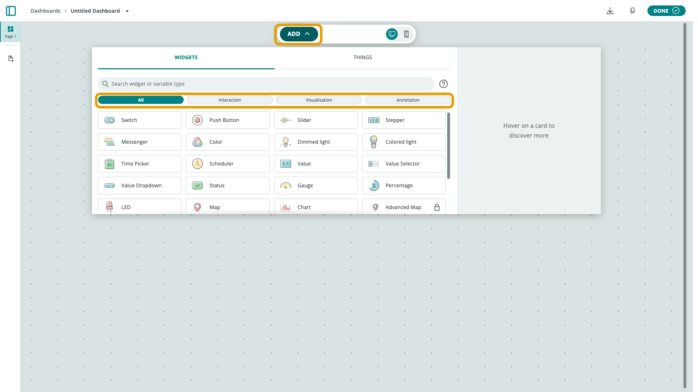
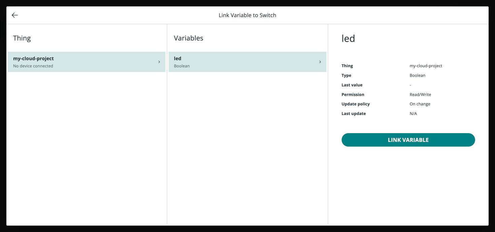

This quickstart walks an official Arduino board with built-in connectivity
(Wi-Fi®, Ethernet, or Cellular) from nothing to a working, controllable Cloud
project. It's the shortest complete path through the platform; each step links
to the reference page with the full detail.

<Alert type="info">

Using an ESP32/ESP8266, a Python/MicroPython/JavaScript client, or a LoRaWAN®
device? The concepts are identical, but the setup differs — see
[Choose Your Setup Path](/arduino-cloud/get-started/choose-your-setup-path).

</Alert>

## Step 1 — Provision Your Device

Open [Devices](/arduino-cloud/devices/devices-overview) and add your board.
The wizard detects a board connected over USB (through the
[Cloud Agent](/arduino-cloud/devices/cloud-agent)), configures its secure
credentials, and registers it with a **Device ID** and **Secret Key**.

Select **+ Device** (or **Add Device**) and choose **Arduino boards** in the
**Setup Device** dialog:


With the board connected over USB, it shows up in the detection list. Select
it and follow the wizard through naming the device and choosing its network:



## Step 2 — Create a Thing

A [Thing](/arduino-cloud/things-data/things) is the container for your project.
Create one and associate the device you just provisioned from its **Device**
panel.

Open **Things** and select **+ Thing**:



In the new Thing, open the **Device** panel from the left rail and pick
**Choose from your list** to link the device from step 1:



## Step 3 — Add Cloud Variables

In the Thing, add the [Cloud Variables](/arduino-cloud/things-data/cloud-variables)
your project needs — for example a boolean `led` to control the on-board LED.
Choose each variable's type, permission (read or read/write), and update
policy.

Select **+ Variable** and pick a type — **Boolean** for the `led` example:



After naming it and selecting **Create**, the variable is listed on the Thing's
**Data** tab:


## Step 4 — Write the Sketch

Associating an Arduino/C++ device auto-generates a
[sketch](/arduino-cloud/sketches-editor/sketchbook-and-sketches) wired to your
variables. Add your logic around the generated boilerplate:



```arduino
#include "thingProperties.h"

void setup() {
  Serial.begin(9600);
  delay(1500);
  initProperties();
  ArduinoCloud.begin(ArduinoIoTPreferredConnection);
  pinMode(LED_BUILTIN, OUTPUT);
}

void loop() {
  ArduinoCloud.update();
}

void onLedChange() {
  digitalWrite(LED_BUILTIN, led);
}
```

The `onLedChange()` callback is generated automatically for each read/write
variable — put the code that reacts to a change there.

## Step 5 — Upload

Use the Cloud Editor's **Upload** button to compile and flash over USB. After
the first USB upload, a Wi-Fi® or Ethernet board can also receive future
updates [over the air](/arduino-cloud/sketches-editor/upload-over-the-air).



## Step 6 — Build a Dashboard

Create a [Dashboard](/arduino-cloud/dashboards/dashboards), add a **Switch**
widget, and link it to your `led` variable. Toggle the switch and the on-board
LED responds — and the widget updates if the value changes on the device. Open
the same dashboard in the [IoT Remote app](/arduino-cloud/iot-remote-app/iot-remote-app-overview)
to control it from your phone.

In the dashboard's edit mode, **Add** opens the widget picker:



Choose **Switch**, then **Link Variable** and select the `led` variable from
your Thing:



Select **Done** to leave edit mode. The Switch is now live on the dashboard:


## Next Steps

- [Start From a Template](/arduino-cloud/get-started/start-from-a-template) — skip steps 1–6 with a ready-made project
- [Dashboards](/arduino-cloud/dashboards/dashboards) — add more widgets
- [Automations & Notifications](/arduino-cloud/automations/choose-an-automation) — react to your data automatically
