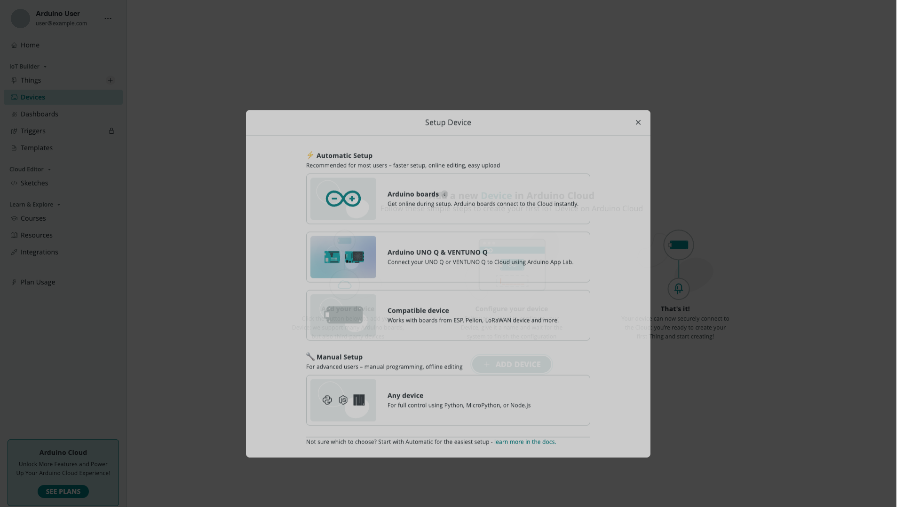

Arduino Cloud supports many kinds of hardware and clients, and each has a
slightly different way to connect. Use the tables below to jump straight to the
right guide.

## By Board or Client

| I'm using... | Start here |
|---|---|
| An official Arduino Wi-Fi® board | [Add an Arduino Wi-Fi Board](/arduino-cloud/devices/add-wifi-board) |
| An ESP32 or ESP8266 | [Add an ESP32 / ESP8266](/arduino-cloud/devices/add-esp32-esp8266) |
| An Arduino Ethernet board or shield | [Add an Ethernet Board](/arduino-cloud/devices/add-ethernet-board) |
| A cellular board (SIM-based) | [Add a Cellular Board](/arduino-cloud/devices/add-cellular-board) |
| A LoRaWAN® device | [Add a LoRaWAN Device](/arduino-cloud/devices/add-lorawan-device) |
| An Arduino UNO Q | [Add an UNO Q](/arduino-cloud/devices/add-uno-q) |
| Python, MicroPython, or Node.js | [Add a Manual Device](/arduino-cloud/devices/add-manual-device) |
| Just my phone | [Use Your Phone as a Device](/arduino-cloud/iot-remote-app/use-phone-as-device) |

The **Setup Device** dialog offers the same split when you add a device:

## By Programming Language

Once a device is connected, you write its logic with the matching library:

| Language | Library guide |
|---|---|
| Arduino / C++ | [Arduino / C++ (ArduinoIoTCloud)](/arduino-cloud/device-libraries/arduino-cpp) |
| MicroPython | [MicroPython](/arduino-cloud/device-libraries/micropython) |
| Python | [Python](/arduino-cloud/device-libraries/python) |
| JavaScript / Node.js | [JavaScript / Node.js](/arduino-cloud/device-libraries/javascript-nodejs) |

## By Goal

| I mainly want to... | Path |
|---|---|
| Get something working fastest | [Start From a Template](/arduino-cloud/get-started/start-from-a-template) |
| Provision many devices at once | [Manage Devices at Scale](/arduino-cloud/devices/manage-devices-at-scale) |
| Automate the whole setup in code | [Developer Overview](/arduino-cloud/apis-cli/developer-overview) |

## Next Steps

- [Quickstart: Your First IoT Project](/arduino-cloud/get-started/quickstart-first-project)
- [Devices Overview](/arduino-cloud/devices/devices-overview)
