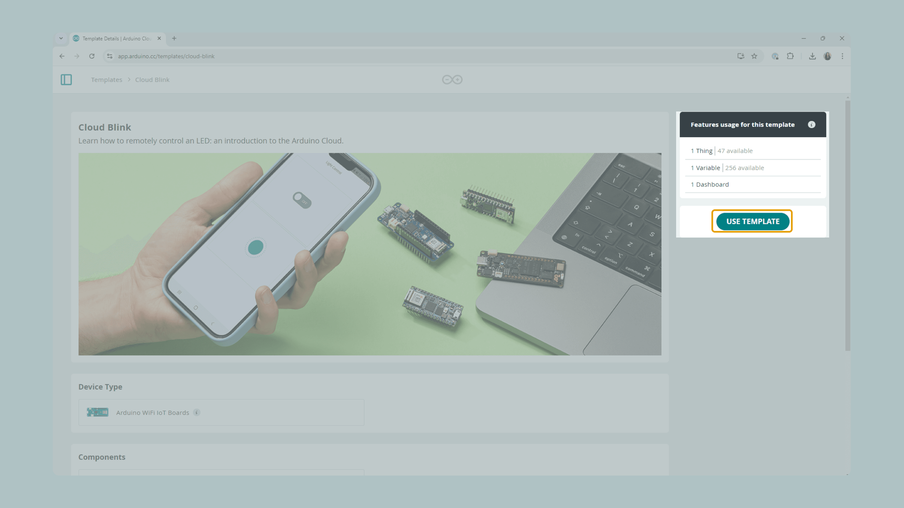

A **Template** bundles a Thing's variable layout with a matching Dashboard, so
you can spin up a complete, working project in one step instead of building it
by hand. Official templates cover common starter projects — such as "Cloud
Blink," a simple remote LED switch — and are the fastest way to see Arduino
Cloud end to end.

## Browsing the Gallery

Open **Templates** in the left navigation (`/templates`) to see official
templates grouped by category and compatible board:

Each template's page describes what the project does, the hardware it needs,
and how many Things, Variables, and Dashboards it will create.

## Applying a Template

With a compatible board connected over USB, **Use Template** provisions
everything automatically — the Device and its network credentials, the
Thing(s) and Variables, the generated sketch, and the Dashboard(s):

<Alert type="note">

A free-plan account is limited to two Things at a time. If you're already at
that limit, **Use Template** is disabled until you delete an existing Thing or
upgrade your plan.

</Alert>

## Editing an Applied Template

Once applied, the template's Thing and Dashboard are regular, fully editable
resources. Add or remove widgets from the Dashboard's Edit mode, or open the
matching Thing to add variables or change its sketch — everything you'd do when
building from scratch.

## Next Steps

- [Quickstart: Your First IoT Project](/arduino-cloud/get-started/quickstart-first-project)
- [Use Arduino Templates](/arduino-cloud/templates/use-templates) — the full reference, including custom templates
- [Create and Share Custom Templates](/arduino-cloud/templates/custom-templates)
