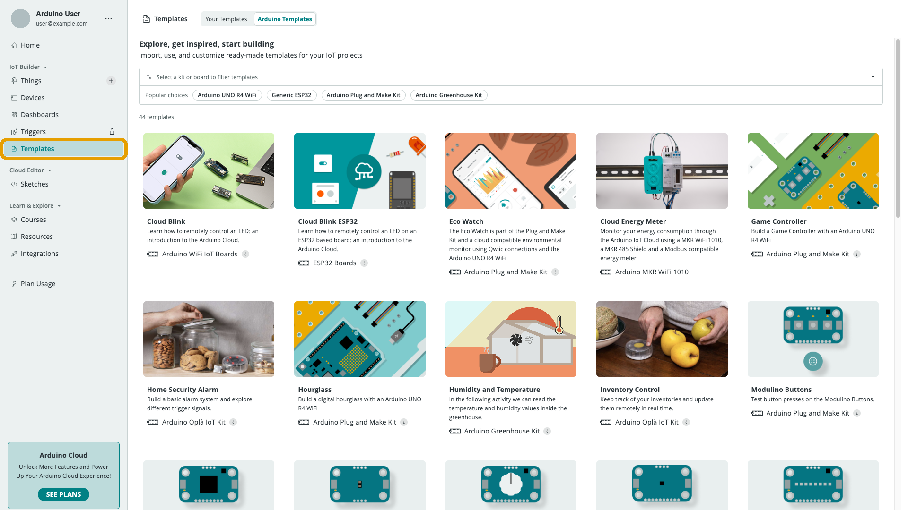
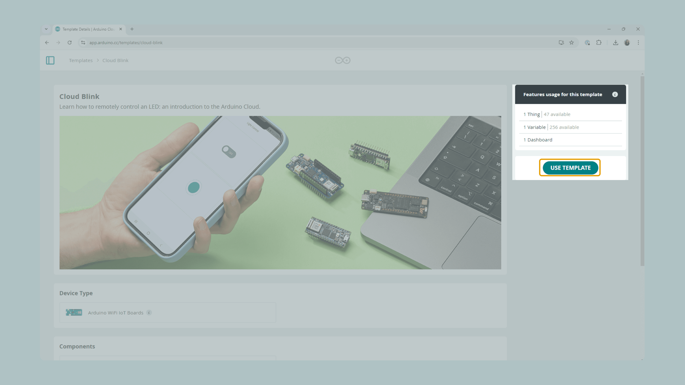

A **Template** is a pre-configured project. It bundles one or more Things and their variables with matching Dashboards and, where the project needs them, [Triggers](/arduino-cloud/automations/triggers-and-alerts). You can spin up a complete, working project in one step instead of building it by hand. Official templates cover common starter projects, such as "Cloud Blink," a simple remote LED switch, and are the fastest way to see Arduino Cloud end to end.

## Before You Start

- An [Arduino account](https://login.arduino.cc/login).
- A board that the template supports. Most templates use an Arduino Wi-Fi® board; each template page lists its compatible boards.
- A USB cable that supports data transfer and fits your board.
- A stable internet connection and a 2.4 GHz Wi-Fi® network for the board.
- The [Cloud Agent](/arduino-cloud/devices/cloud-agent). If it is not installed, Arduino Cloud prompts you to install it the first time you use a template.
- Optional: the sensors and actuators listed on the template page.
- Optional: a [shared space](/arduino-cloud/spaces-plans-account/spaces) if you are working in a group.

## Browsing the Gallery

Open **Templates** in the left navigation and select **Arduino Templates** to see official templates grouped by category and compatible board:

Each template's page describes what the project does, the hardware and components it needs, and how many Things, Variables, Dashboards and Triggers it will create.

## Applying a Template

Connect your board over USB, then select **Use Template**. If no device is connected yet, Arduino Cloud guides you through connecting one. The template then sets up everything automatically:

1. Adds your board to Arduino Cloud as a device.
2. Creates the Thing(s) and their variables.
3. Assigns the network credentials to the device.
4. Generates the sketch and uploads it to the board.
5. Builds the Dashboard(s) with the right widgets.
6. Creates any Triggers included in the template.

<Alert type="warning">

The process can take up to 5 minutes. Do not unplug the board or close your laptop while the template is being applied.

</Alert>

<Alert type="note">

A free-plan account is limited to two Things at a time. If you're already at that limit, **Use Template** is disabled until you delete an existing Thing or upgrade your plan.

</Alert>

When the setup is complete, the project is operational. With "Cloud Blink," for example, you can now switch the board's LED on and off from the dashboard.

## Editing an Applied Template

Once applied, the template's resources are regular, fully editable resources:

- **Dashboard**: open it, select the edit icon, and use **Add** to add or remove widgets.
- **Thing**: open the Thing with the same name as the template to add variables or change the sketch.
- **Device and network**: the device and its network settings are on the device page.
- **Triggers**: open **Triggers** to change the conditions or actions of any Triggers the template created.

## Troubleshooting

- **Use Template is disabled**: you have reached the Things limit of your plan. Delete a Thing or upgrade your plan.
- **The board is not detected**: check that the Cloud Agent is running, that the USB cable supports data transfer, and that the board is connected directly to the computer. See [Troubleshoot Device Connections](/arduino-cloud/devices/troubleshoot-device-connections).
- **The board does not connect after the upload**: check the network requirements in [Configure your network for Arduino Cloud](https://support.arduino.cc/hc/en-us/articles/360017279260-Configure-your-network-for-Arduino-Cloud) and the steps in [If your device can't be added or won't connect to Arduino Cloud](https://support.arduino.cc/hc/en-us/articles/360019355679-If-your-device-can-t-be-added-or-won-t-connect-to-Arduino-Cloud).
- **"We were not able to upload the template sketch"**: follow the steps in the [Help Center article for this error](https://support.arduino.cc/hc/en-us/articles/4408887422994--We-were-not-able-to-upload-the-template-sketch-in-Arduino-Cloud).

## Next Steps

- [Quickstart: Your First IoT Project](/arduino-cloud/get-started/quickstart-first-project)
- [Use Arduino Templates](/arduino-cloud/templates/use-templates) — the full reference, including custom templates
- [Create and Share Custom Templates](/arduino-cloud/templates/custom-templates)
