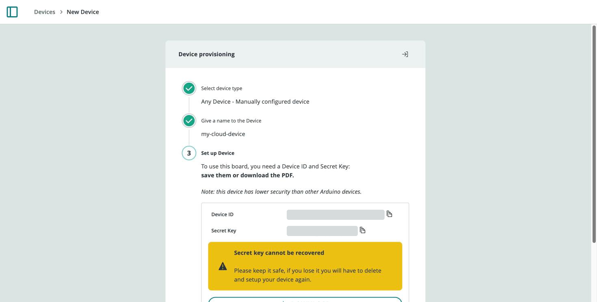
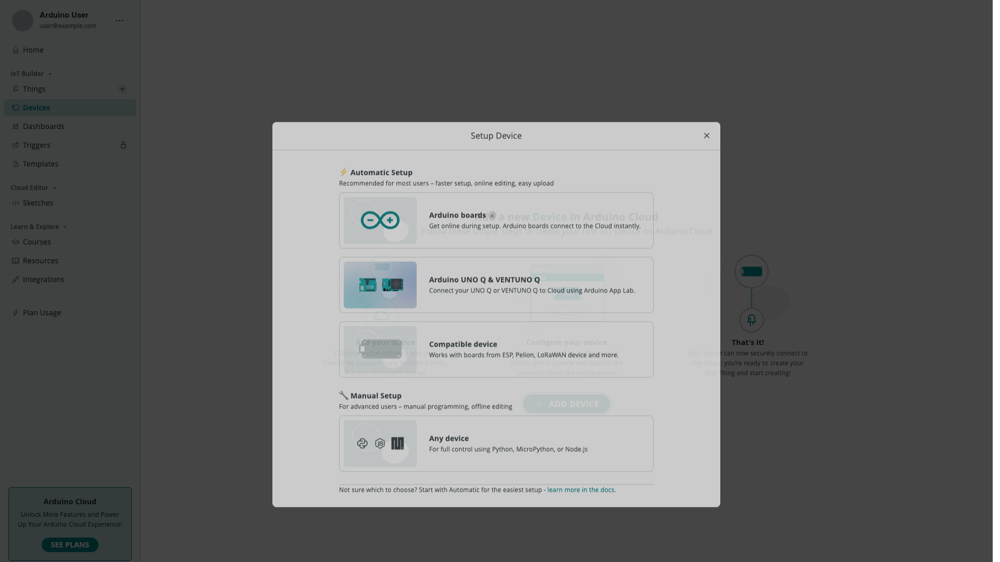

A **device** is the physical (or virtual) hardware that runs your code and talks to Arduino Cloud. It is the "virtual twin" of your board. You manage every device from **Devices** in the left navigation, where each one is listed with its name, status, and linked Things.

## Device Identity and Credentials

Every device gets a unique **Device ID** when it is registered. How the device proves its identity to Arduino Cloud depends on the type of device, and this decides whether you ever see a **Secret Key**:

| Device type | Credentials | What you need to do |
|---|---|---|
| Official Arduino boards set up with **Automatic Setup** (Wi-Fi®, Ethernet, Cellular) | A certificate and private key in the board's secure element or, on boards without one, credentials configured by the wizard | Nothing. The wizard configures the credentials on the board, and no Secret Key is shown. |
| LoRaWAN® boards | LoRaWAN® join credentials (AppEUI and AppKey) | Nothing. They are configured automatically during setup. |
| UNO Q / VENTUNO Q | Managed by the board's Cloud connector | Nothing. The board is provisioned when you connect it from App Lab. |
| Third-party ESP32/ESP8266 boards and **Manual** devices (Python, MicroPython, JavaScript) | **Device ID** + **Secret Key** | Save the Secret Key when the wizard shows it. You enter it in the device's network settings or in your client code. |

### The Secret Key

The Secret Key is generated only for devices without a secure element that you set up through the third-party ESP32/ESP8266 or Manual path. It is shown only once, at the end of the setup. Download or copy it before you close the window: it cannot be retrieved later.

If you lose the Secret Key, delete the device and add it again to generate a new Device ID and Secret Key.

## Device Types

| Type | Connectivity | Setup path |
|---|---|---|
| Official Arduino (Wi-Fi®) | Wi-Fi® | [Add a Wi-Fi Board](/arduino-cloud/devices/add-wifi-board) |
| Official Arduino (Ethernet) | Wired | [Add an Ethernet Board](/arduino-cloud/devices/add-ethernet-board) |
| Official Arduino (Cellular) | GSM / LTE-M / NB-IoT | [Add a Cellular Board](/arduino-cloud/devices/add-cellular-board) |
| Official Arduino (LoRaWAN®) | LoRaWAN® | [Add a LoRaWAN Device](/arduino-cloud/devices/add-lorawan-device) |
| Third-party (ESP32 / ESP8266) | Wi-Fi® | [Add an ESP32/ESP8266](/arduino-cloud/devices/add-esp32-esp8266) |
| UNO Q / Ventuno Q (Linux) | Wi-Fi® (via App Lab) | [Add an UNO Q](/arduino-cloud/devices/add-uno-q) |
| Manual / generic | Software client | [Add a Manual Device](/arduino-cloud/devices/add-manual-device) |

## Adding a Device

Select **+ Device** (or **ADD DEVICE**) to open the **Setup Device** dialog, split into two paths:

| Path | For |
|---|---|
| **Automatic Setup** | Arduino boards and compatible ESP32/ESP8266/LoRaWAN® boards, provisioned through a guided wizard |
| **Manual Setup** | Any device — generates credentials for a [generic/virtual device](/arduino-cloud/devices/add-manual-device) with no sketch |

For scriptable, repeatable provisioning, [arduino-cloud-cli](/arduino-cloud/apis-cli/cli-devices) is a fully equivalent alternative to the web wizard.

### Limits by Plan

The number of devices and Things you can have, and features such as OTA updates, depend on your plan. See [Plans, Limits & Quotas](/arduino-cloud/spaces-plans-account/plans-limits-quotas) for the current limits.

## The Device Page

Select a device in the **Devices** list to open its device page. From here you can rename the device, attach it to a [Thing](/arduino-cloud/things-data/things), change its [network configuration](/arduino-cloud/devices/network-configuration), and delete it.

The device page shows the following information. Some fields only appear for certain device types:

| Field | Description |
|---|---|
| **ID** | The device's unique ID. You need it to connect manual devices and to reference the device from the API and CLI. |
| **Type** | The board name or type, for example MKR WiFi 1010. |
| **Connection Type** | How the device connects, for example Wi-Fi®, Ethernet, Cellular or LoRaWAN®. |
| **FQBN** | The fully qualified board name used to compile for the board, for example `arduino:samd:mkrwifi1010`. |
| **Serial Number** | The board's serial number, registered when you set up an official board. |
| **Connectivity Module Firmware** | Wi-Fi® boards only: the firmware version of the board's radio module. |
| **Thing** | The Thing associated with the device. |
| **Status** | The connection status of the device. See [Device Status & Lifecycle](/arduino-cloud/devices/device-status-lifecycle). |
| **Last Activity** | The time of the device's last synchronization with Arduino Cloud. |
| **Added** | The date the device was added to Arduino Cloud. |
| **Network** | The configured network name or type. Select it to change the credentials. |

The page also includes the **Device Status History**, which shows how the status has changed over time. For physical boards, the **Lock to this account** setting controls whether the board stays tied to your account or can be handed over to someone else (see [Lock a Device to Your Account](/arduino-cloud/devices/device-lock)).

<Alert type="info">

A device must be associated with a Thing before it can exchange Cloud Variables. See [Things & Data](/arduino-cloud/things-data/things).

</Alert>

## Next Steps

- [Add a Wi-Fi Board](/arduino-cloud/devices/add-wifi-board)
- [Provisioning & Network Configuration](/arduino-cloud/devices/network-configuration)
- [Device Status & Lifecycle](/arduino-cloud/devices/device-status-lifecycle)
