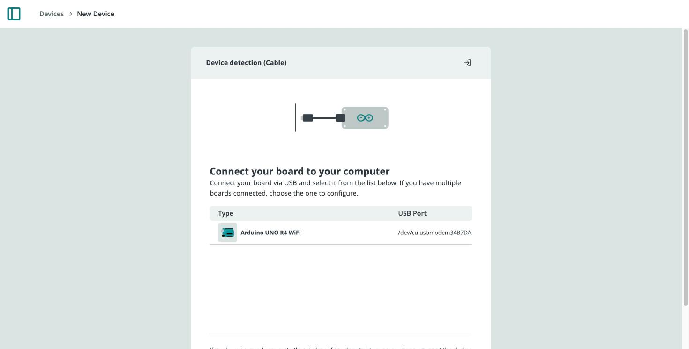

Wi-Fi® is the most common way to connect an official Arduino board to Arduino Cloud. It suits short-range projects, where the board connects through your home, work or school router. Provisioning registers the board, stores its credentials securely, and generates a sketch that connects it to the platform.

## Before You Start

- An [Arduino account](https://login.arduino.cc/login).
- A supported board (see below) and a USB cable that supports data transfer.
- The [Cloud Agent](/arduino-cloud/devices/cloud-agent) installed on your computer.
- The name (SSID) and password of a 2.4 GHz Wi-Fi® network. Official Arduino boards only support the 2.4 GHz band; see [Supported Wi-Fi Frequencies](/arduino-cloud/reference/supported-wifi-frequencies).

## Supported Boards

Per [ArduinoIoTCloud](https://github.com/arduino-libraries/ArduinoIoTCloud?tab=readme-ov-file#what):

- MKR 1000 WiFi
- MKR WiFi 1010
- Nano 33 IoT
- Nano RP2040 Connect
- Nano ESP32
- Nicla Vision
- GIGA R1 WiFi
- Portenta H7 and Portenta H7 Lite Connected
- Portenta Machine Control
- Portenta C33
- Opta WiFi
- UNO R4 WiFi

Third-party ESP32/ESP8266 boards use a different setup path; see [Add an ESP32/ESP8266](/arduino-cloud/devices/add-esp32-esp8266). For connectivity, OTA and provisioning support per board, see [Supported Boards & Capabilities](/arduino-cloud/reference/supported-boards-capabilities).

## Authentication Methods

The method depends on whether the board has a secure element. In both cases the wizard configures the credentials for you:

| Method | Boards | Where credentials live |
|---|---|---|
| **Certificate + private key** | MKR 1000 WiFi, MKR WiFi 1010, Nano 33 IoT, Portenta H7, Portenta Machine Control, Nano RP2040 Connect, Nicla Vision, Opta WiFi, GIGA R1 WiFi, Portenta C33 | Hardware secure element (provisioned once) |
| **Device ID + secret key** | UNO R4 WiFi, Nano ESP32 | Configured automatically by the wizard; you don't need to copy the key |

## Provisioning the Board

1. Connect the board to your computer over USB. The first time, install the [Cloud Agent](/arduino-cloud/devices/cloud-agent) so the browser can reach the board.
2. Go to **Devices**, select **+ Device**, and choose **Arduino boards** under **Automatic Setup**.
3. When the Cloud Agent detects the board, select **Configure**, name it, and choose the Wi-Fi® connection type.
4. Wait while the wizard uploads a provisioning sketch and configures the board's credentials. This can take a few minutes; keep the board connected.
5. When the wizard finishes, the device is listed in **Devices** with its **Device ID**.



The equivalent from the terminal is `arduino-cloud-cli device create --fqbn <board-fqbn> --connection wifi` — see [Managing Devices from the CLI](/arduino-cloud/apis-cli/cli-devices).

## Sketch Pattern

Once the device is associated with a [Thing](/arduino-cloud/things-data/things) and network credentials are set, a sketch is generated automatically:

```arduino
#include "thingProperties.h"

void setup() {
  Serial.begin(9600);
  initProperties();
  ArduinoCloud.begin(ArduinoIoTPreferredConnection);
}

void loop() {
  ArduinoCloud.update();
}
```

`ArduinoIoTPreferredConnection` is a `WiFiConnectionHandler` configured with your network SSID and password, generated into `thingProperties.h`.

## Next Steps

- [Provisioning & Network Configuration](/arduino-cloud/devices/network-configuration)
- [Arduino C++ Library](/arduino-cloud/device-libraries/arduino-cpp)
- [Quickstart: Your First IoT Project](/arduino-cloud/get-started/quickstart-first-project)
