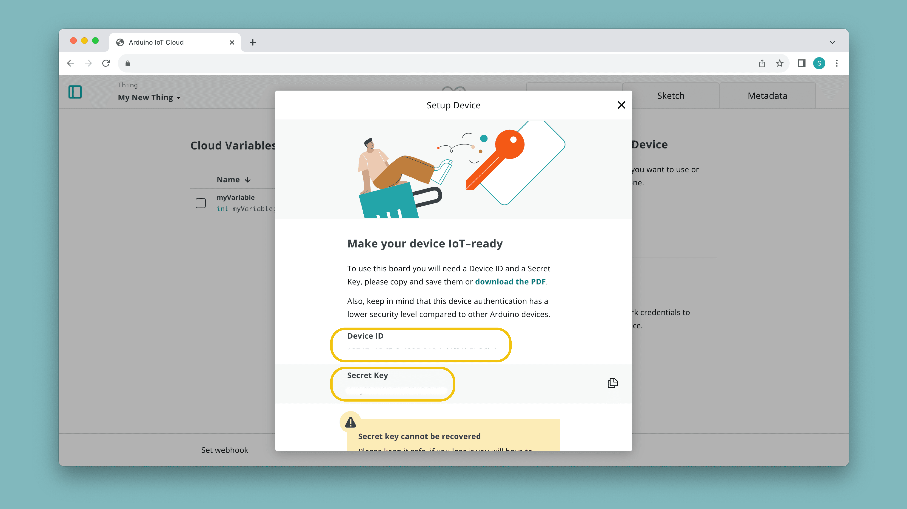
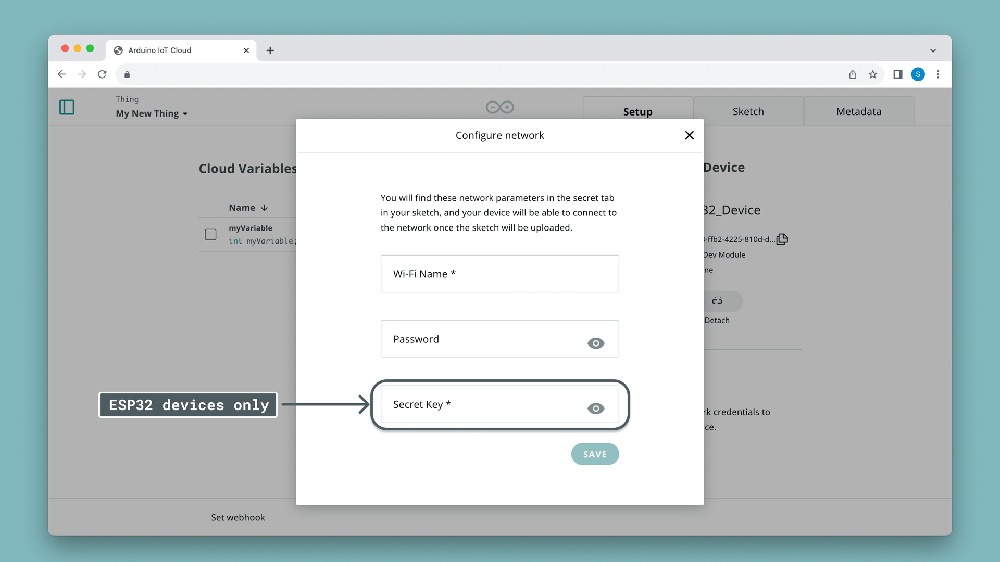
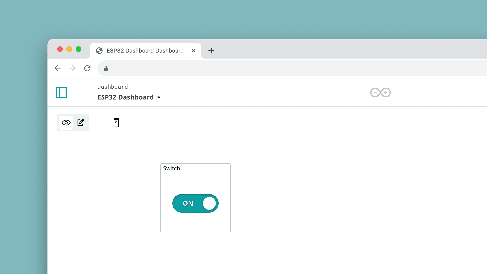

Arduino Cloud supports a wide range of ESP32 and ESP8266 based boards. They connect over Wi-Fi® and are programmed in the Arduino language (C++), just like official boards — the difference is the authentication method, which uses a **Device ID** and **Secret Key** together with your Wi-Fi® credentials.

<Alert type="note">

ESP32 and ESP8266 are third-party boards. Arduino Cloud supports both families, but cannot guarantee that every board built on these SoCs works.

</Alert>

## Add the Device

1. Go to **Devices → + Device → Compatible device** (Automatic Setup).
2. Choose your device type — **ESP32** or **ESP8266** — then pick the specific board from the dropdown (if yours isn't listed, choose a close match such as `ESP32S3 Dev Board`).
3. Name the device, e.g. `Device_ESP32_LivingRoom`.
4. Save the generated **Device ID** and **Secret Key**. You can download them as a PDF or copy them. The Secret Key is shown only once and cannot be retrieved after you close the window.



<Alert type="warning">

If you lose the Secret Key, it cannot be recovered or regenerated. Delete the device from **Devices** and add it again to generate a new Device ID and Secret Key, then enter the new Secret Key in the device's network settings.

</Alert>

## Configure the Thing and Network

Create a [Thing](/arduino-cloud/things-data/things), associate the device, and add your [Cloud Variables](/arduino-cloud/things-data/cloud-variables). In the device's **Network** section, enter your Wi-Fi® SSID, password, and the **Secret Key** from the previous step.



## Sketch Pattern

Associating the device generates a sketch with a callback for each read/write variable. The example below toggles the built-in LED whenever a boolean variable `test` changes:

```arduino
#include "thingProperties.h"

void setup() {
  pinMode(LED_BUILTIN, OUTPUT);
  Serial.begin(9600);
  delay(1500);
  initProperties();
  ArduinoCloud.begin(ArduinoIoTPreferredConnection);
  setDebugMessageLevel(2);
  ArduinoCloud.printDebugInfo();
}

void loop() {
  ArduinoCloud.update();
}

void onTestChange() {
  digitalWrite(LED_BUILTIN, test ? HIGH : LOW);
}
```

## Upload and Verify

Install the [Cloud Agent](/arduino-cloud/devices/cloud-agent), confirm the board and port are selected, and use **Upload**. Open the Serial Monitor to watch for connection debug messages — if the board fails to connect, errors print here.

To verify the connection:

1. Open the Thing. When the board is connected, the device status shows **Online** and each variable shows its latest value and timestamp.
2. Go to **Dashboards** and create a new dashboard.
3. Select the edit icon, then **Add**. Select your Thing and then **Create Widgets**. A switch widget is generated for the `test` variable.
4. Toggle the switch. The board's built-in LED turns on and off.



## Verified ESP32 Boards Supporting OTA

Over-the-air (OTA) updates let you upload sketches remotely, without a USB connection. The following ESP32 boards have been tested and verified to support [OTA](/arduino-cloud/sketches-editor/upload-over-the-air):

- ESP32-S2-DevKitC
- NODEMCU-32-S2
- WEMOS LOLIN D32
- ESP32-S3-DevKitC
- ESP32-CAM
- NodeMCU-32S
- Freenove ESP32 WROVER
- ESP32-DevKitC32E
- DOIT ESP32 DevKit v1

Other ESP32 boards may also support OTA, but have not been verified.

## Next Steps

- [Add a Manual Device](/arduino-cloud/devices/add-manual-device)
- [Arduino C++ Library](/arduino-cloud/device-libraries/arduino-cpp)
- [Troubleshoot Device Connections](/arduino-cloud/devices/troubleshoot-device-connections)
