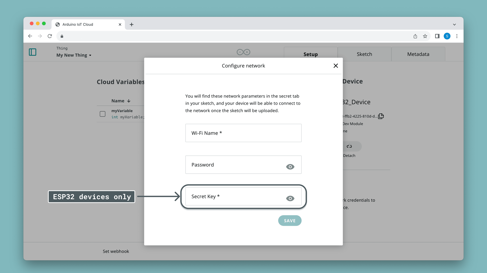

Arduino Cloud supports a wide range of ESP32 and ESP8266 based boards. They
connect over Wi-Fi® and are programmed in the Arduino language (C++), just like
official boards — the difference is the authentication method, which uses a
**Device ID** and **Secret Key** together with your Wi-Fi® credentials.

<Alert type="note">

ESP32 and ESP8266 are third-party boards. Arduino Cloud supports both
families, but cannot guarantee that every board built on these SoCs works.

</Alert>

## Add the Device

1. Go to **Devices → + Device → Compatible device** (Automatic Setup).
2. Choose your device type — **ESP32** or **ESP8266** — then pick the specific
   board from the dropdown (if yours isn't listed, choose a close match such
   as `ESP32S3 Dev Board`).
3. Name the device, e.g. `Device_ESP32_LivingRoom`.
4. Save the generated **Device ID** and **Secret Key** — the key is shown only
   once.

## Configure the Thing and Network

Create a [Thing](/arduino-cloud/things-data/things), associate the device, and
add your [Cloud Variables](/arduino-cloud/things-data/things). In the device's
**Network** section, enter your Wi-Fi® SSID, password, and the **Secret Key**
from the previous step.



## Sketch Pattern

Associating the device generates a sketch with a callback for each read/write
variable. The example below toggles the built-in LED whenever a boolean
variable `test` changes:

```arduino
#include "thingProperties.h"

void setup() {
  pinMode(LED_BUILTIN, OUTPUT);
  Serial.begin(9600);
  delay(1500);
  initProperties();
  ArduinoCloud.begin(ArduinoIoTPreferredConnection);
  setDebugMessageLevel(2);
  ArduinoCloud.printDebugInfo();
}

void loop() {
  ArduinoCloud.update();
}

void onTestChange() {
  digitalWrite(LED_BUILTIN, test ? HIGH : LOW);
}
```

## Upload and Verify

Install the [Cloud Agent](/arduino-cloud/devices/cloud-agent), confirm the
board is selected, and use **Upload**. Open the Serial Monitor to watch for
connection debug messages — if the board fails to connect, errors print here.
Once connected, the device shows as online and its variables sync.

## Next Steps

- [Add a Manual Device](/arduino-cloud/devices/add-manual-device)
- [Arduino C++ Library](/arduino-cloud/device-libraries/arduino-cpp)
- [Troubleshoot Device Connections](/arduino-cloud/devices/troubleshoot-device-connections)
