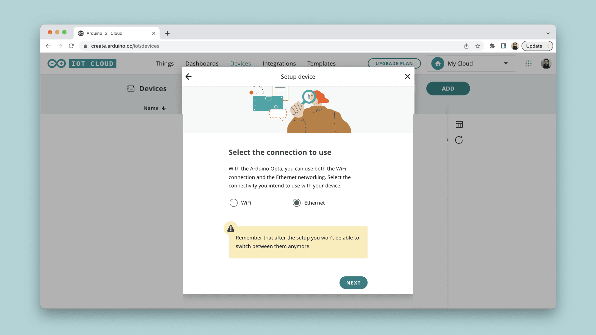

Ethernet is used when Wi-Fi® isn't practical — industrial settings, reliability requirements, or locations without wireless coverage. A wired board provisions the same way as its Wi-Fi® counterpart; only the connection type differs.

## Supported Boards

Per [ArduinoIoTCloud](https://github.com/arduino-libraries/ArduinoIoTCloud):

- **Portenta H7** with the Vision Shield Ethernet, Portenta Max Carrier, Portenta Breakout, or Portenta Machine Control.
- **Opta Wi-Fi®**, **Opta RS485**, and **Opta Lite**.
- **Portenta C33** with the Vision Shield Ethernet.

Authentication uses the same certificate + private key method as the equivalent Wi-Fi® boards in the same family.

<Alert type="note">

Older Ethernet hardware, such as the [Ethernet Shield Rev2](https://store.arduino.cc/products/arduino-ethernet-shield-2) and the [MKR ETH Shield](https://store.arduino.cc/products/arduino-mkr-eth-shield), is not supported by Arduino Cloud.

</Alert>

## Provisioning the Board

1. Connect the board to your computer over USB with the [Cloud Agent](/arduino-cloud/devices/cloud-agent) installed. Connect the Ethernet cable to the board's carrier or shield.
2. Go to **Devices**, select **+ Device**, and choose **Arduino boards** under **Automatic Setup**.
3. When the board is detected, select **Configure**.
4. For Ethernet-capable boards, you are asked to choose between **Wi-Fi®** and **Ethernet**. Choose **Ethernet**.



5. Wait while the wizard uploads a provisioning sketch and configures the board's secure element. Keep the board connected until the wizard finishes.

## Network Settings

After you associate the device with a [Thing](/arduino-cloud/things-data/things), open the **Network** section on the device page. By default, the board gets its address from your network over DHCP, so you can leave the fields empty. To use a static address, enter the IP address, DNS server, gateway and netmask.

## Sketch Pattern

```arduino
#include "thingProperties.h"

void setup() {
  Serial.begin(9600);
  initProperties();
  ArduinoCloud.begin(ArduinoIoTPreferredConnection);
}

void loop() {
  ArduinoCloud.update();
}
```

Here `ArduinoIoTPreferredConnection` is an `EthernetConnectionHandler` rather than a `WiFiConnectionHandler`, generated automatically from the connectivity type you select for the device.

## Next Steps

- [Add a Wi-Fi Board](/arduino-cloud/devices/add-wifi-board)
- [Provisioning & Network Configuration](/arduino-cloud/devices/network-configuration)
- [Arduino C++ Library](/arduino-cloud/device-libraries/arduino-cpp)
