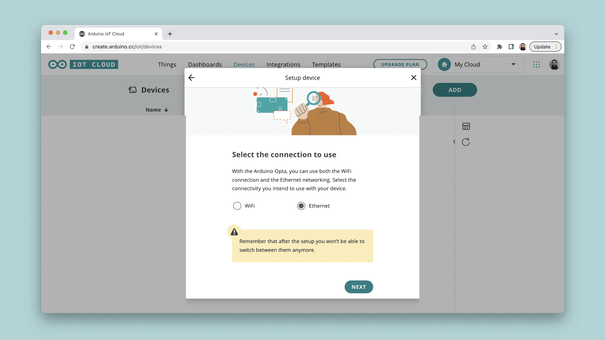

Ethernet is used when Wi-Fi® isn't practical — industrial settings, reliability
requirements, or locations without wireless coverage. A wired board provisions
the same way as its Wi-Fi® counterpart; only the connection type differs.

## Supported Boards

Per [ArduinoIoTCloud](https://github.com/arduino-libraries/ArduinoIoTCloud):

- **Portenta H7** with the Vision Shield Ethernet, Portenta Max Carrier,
  Portenta Breakout, or Portenta Machine Control.
- **Opta Wi-Fi®**, **Opta RS485**, and **Opta Lite**.
- **Portenta C33** with the Vision Shield Ethernet.

Authentication uses the same certificate + private key method as the equivalent
Wi-Fi® boards in the same family.

## Provisioning the Board

1. Connect the board over USB with the
   [Cloud Agent](/arduino-cloud/devices/cloud-agent) installed.
2. Go to **Devices → + Device → Automatic Setup** and select your board.
3. When prompted for the connection type, choose **Ethernet**.



<Alert type="warning">

Needs verification: the exact wizard screenshots for the Ethernet path were
not re-walked against real Portenta/Opta + Ethernet hardware in this pass.
Confirm the steps against a physical setup before publishing.

</Alert>

## Sketch Pattern

```arduino
#include "thingProperties.h"

void setup() {
  Serial.begin(9600);
  initProperties();
  ArduinoCloud.begin(ArduinoIoTPreferredConnection);
}

void loop() {
  ArduinoCloud.update();
}
```

Here `ArduinoIoTPreferredConnection` is an `EthernetConnectionHandler` rather
than a `WiFiConnectionHandler`, generated automatically from the connectivity
type you select for the device.

## Next Steps

- [Add a Wi-Fi Board](/arduino-cloud/devices/add-wifi-board)
- [Network Configuration](/arduino-cloud/devices/network-configuration)
- [Arduino C++ Library](/arduino-cloud/device-libraries/arduino-cpp)
