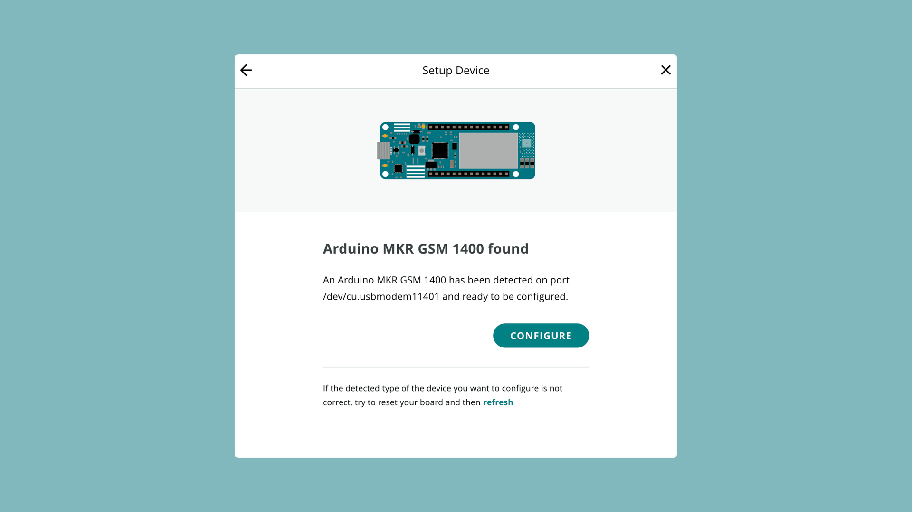

Cellular connectivity lets a board reach Arduino Cloud over a mobile network
instead of Wi-Fi® or Ethernet — ideal for remote or mobile deployments that
have SIM coverage but no local network.

## Supported Boards

Per [ArduinoIoTCloud](https://github.com/arduino-libraries/ArduinoIoTCloud):

- **GSM**: MKR GSM 1400.
- **NB-IoT (5G-ready, low-power)**: MKR NB 1500.

Both authenticate with the certificate + private key method.

## Requirements

A SIM card with an active data plan is required. During provisioning you'll
enter the SIM's **APN** and, if set, its **PIN**.



<Alert type="warning">

Needs verification: a working SIM and physical hardware are needed to confirm
the provisioning screenshots for this connectivity type. Capture them against
real hardware before publishing.

</Alert>

## Provisioning the Board

1. Connect the board over USB with the
   [Cloud Agent](/arduino-cloud/devices/cloud-agent) installed.
2. Go to **Devices → + Device → Automatic Setup** and select your board.
3. Choose the cellular connection type and enter the APN (and PIN, if any).

## Sketch Pattern

```arduino
#include "thingProperties.h"

void setup() {
  Serial.begin(9600);
  initProperties();
  ArduinoCloud.begin(ArduinoIoTPreferredConnection);
}

void loop() {
  ArduinoCloud.update();
}
```

`ArduinoIoTPreferredConnection` becomes a `GSMConnectionHandler` or
`NBConnectionHandler` depending on the board, generated automatically once the
network credentials are set.

## Next Steps

- [Add a Wi-Fi Board](/arduino-cloud/devices/add-wifi-board)
- [Network Configuration](/arduino-cloud/devices/network-configuration)
- [Troubleshoot Device Connections](/arduino-cloud/devices/troubleshoot-device-connections)
