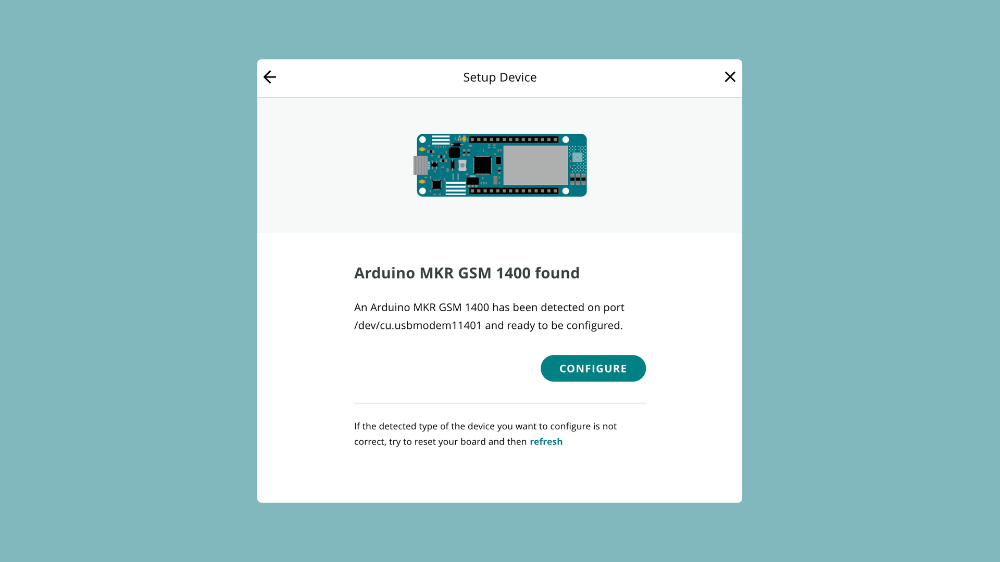

Cellular connectivity lets a board reach Arduino Cloud over a mobile network instead of Wi-Fi® or Ethernet. Consider it for remote areas without Wi-Fi®, or for mobile projects such as cargo tracking.

## Supported Boards

Per [ArduinoIoTCloud](https://github.com/arduino-libraries/ArduinoIoTCloud?tab=readme-ov-file#what):

- **GSM**: [MKR GSM 1400](https://docs.arduino.cc/hardware/mkr-gsm-1400).
- **LTE-M (Cat-M1) and NB-IoT**: [MKR NB 1500](https://docs.arduino.cc/hardware/mkr-nb-1500).

Both authenticate with the certificate + private key method.

<Alert type="warning">

A secured connection uses a lot of memory, which leaves little memory for your application (around 2.6 kB on the MKR GSM 1400). Using many Cloud Variables may cause the sketch to run out of memory and crash on boards that don't offload the SSL stack.

</Alert>

## Requirements

- A SIM card with an active data plan that supports the board's network technology.
- The SIM's **PIN** (if set) and the provider's **APN**, plus a user name and password if your provider requires them.
- A USB cable that supports data transfer and the [Cloud Agent](/arduino-cloud/devices/cloud-agent) installed.

## Provisioning the Board

1. Insert the SIM card and connect the antenna, then connect the board to your computer over USB.
2. Go to **Devices**, select **+ Device**, and choose **Arduino boards** under **Automatic Setup**.
3. When the board is detected, select **Configure** and name the device.
4. Wait while the wizard uploads a provisioning sketch and configures the board's secure element. Keep the board connected until the wizard finishes.



## Network Settings

After you associate the device with a [Thing](/arduino-cloud/things-data/things), open the **Network** section on the device page and enter the SIM's PIN, the APN, and the user name and password if your provider requires them. The values are added to the sketch's secrets file.

## Sketch Pattern

```arduino
#include "thingProperties.h"

void setup() {
  Serial.begin(9600);
  initProperties();
  ArduinoCloud.begin(ArduinoIoTPreferredConnection);
}

void loop() {
  ArduinoCloud.update();
}
```

`ArduinoIoTPreferredConnection` becomes a `GSMConnectionHandler` or `NBConnectionHandler` depending on the board, generated automatically once the network credentials are set.

## Next Steps

- [Add a Wi-Fi Board](/arduino-cloud/devices/add-wifi-board)
- [Provisioning & Network Configuration](/arduino-cloud/devices/network-configuration)
- [Troubleshoot Device Connections](/arduino-cloud/devices/troubleshoot-device-connections)
