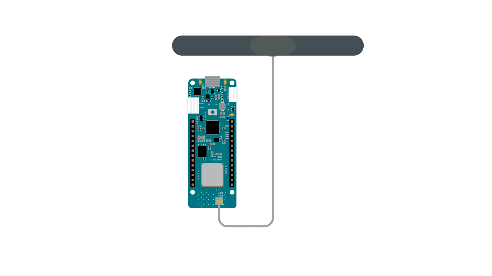
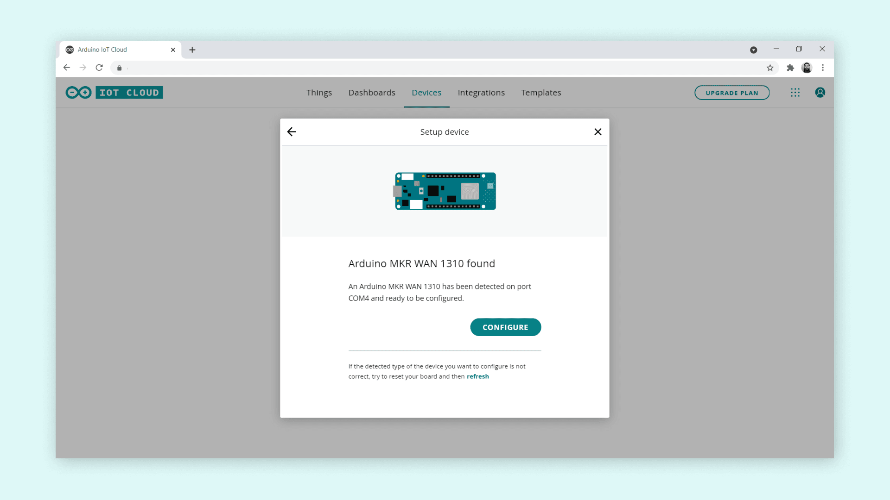
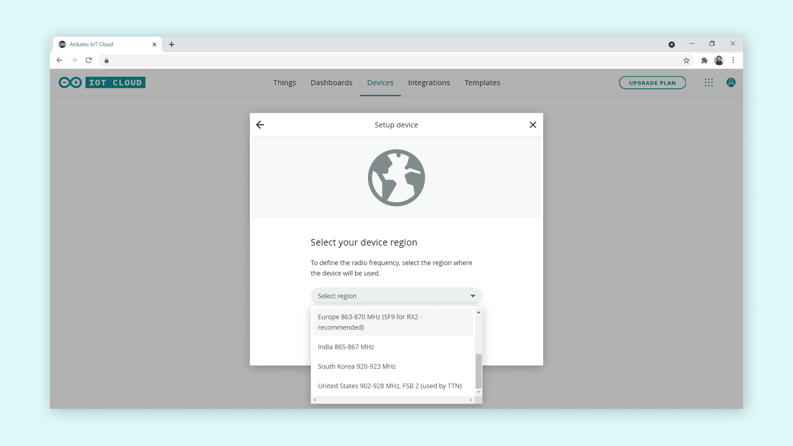
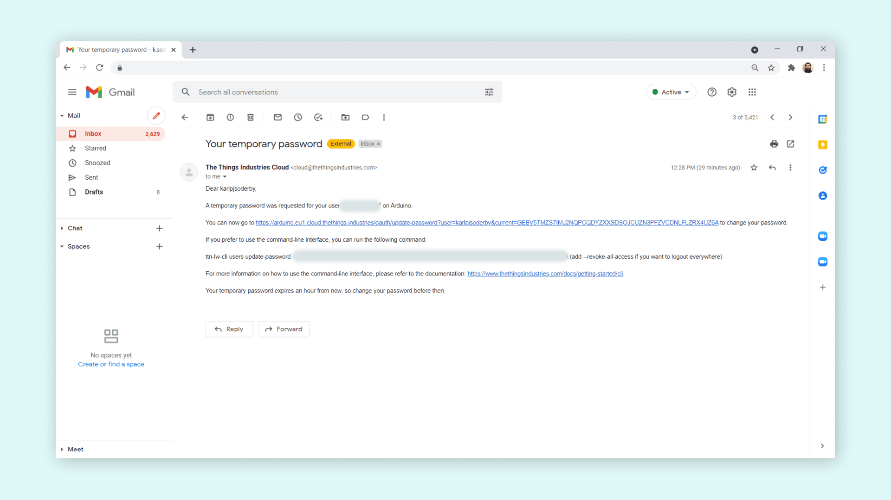

**LoRa®** connectivity is for long-range, low-power devices that communicate over a LoRaWAN® network through a gateway. When you provision a LoRaWAN® board in Arduino Cloud, it is automatically registered on [The Things Stack](https://www.thethingsindustries.com/stack/) (TTS), giving your device access to the network's thousands of public gateways. End devices can be placed in remote locations without an internet connection; they send data to a nearby gateway, which forwards it to Arduino Cloud through TTS. Data can also be sent in the opposite direction, from Arduino Cloud to the device.

## Terminology

- **LoRa®**: short for **Lo**ng **Ra**nge, a modulation technique for sending and receiving data over low-power, wide-area networks (LPWAN).
- **LoRa® gateway**: a network router that sends and receives LoRa® RF packets and forwards them to the internet.
- **End device (node)**: a deployed device, such as the MKR WAN 1310, that reads and processes sensor data.
- **The Things Network (TTN)**: a nonprofit association providing a public LoRa®-based network.
- **The Things Industries (TTI)**: the company that runs The Things Network and offers private network services.
- **The Things Stack (TTS)**: the network server platform used by TTN and TTI.
- **The Things Stack Console**: the web console where you can see registered devices and incoming or outgoing data.
- **Device EUI (DevEUI)**: a code that identifies your device.
- **App EUI (AppEUI)**: a code that identifies your application.
- **App Key (AppKey)**: the key used to encrypt and decrypt the payload.
- **Frequency band**: LoRa® uses license-free frequencies that differ by region, for example 868 MHz in Europe and 915 MHz in North America.

Arduino Cloud stores the DevEUI, AppEUI and AppKey for you. You can also view them in The Things Stack Console.

## Supported Boards

Per [ArduinoIoTCloud](https://github.com/arduino-libraries/ArduinoIoTCloud?tab=readme-ov-file#what): [MKR WAN 1300](https://docs.arduino.cc/hardware/mkr-wan-1300) and [MKR WAN 1310](https://docs.arduino.cc/hardware/mkr-wan-1310). They authenticate with `APP_EUI` + `APP_KEY` (LoRaWAN's own join credentials), defined in `thingProperties.h`.

Third-party LoRaWAN® devices are also supported via **Devices → + Device → Compatible device → LoRaWAN**.

<Alert type="note">

LoRaWAN® data rates are limited. Restrict messages from a device to roughly once every several minutes. See [The Things Network limitations](https://www.thethingsnetwork.org/docs/lorawan/limitations/).

</Alert>

LoRaWAN® devices don't report an online/offline device status in Arduino Cloud. Check data flow with the **Last Value / Last Update** of the Thing's variables instead (see [Device Status & Lifecycle](/arduino-cloud/devices/device-status-lifecycle)).

## Connect the Antenna

Follow the wiring diagram below to connect the antenna to the MKR WAN 1300/1310 board before you start the setup.



## Provisioning the Device

1. Connect the board over USB with the antenna attached and the [Cloud Agent](/arduino-cloud/devices/cloud-agent) installed.
2. Go to **Devices → + Device** and start the setup for your board. When detected, select **Configure**.

   

3. Select the **frequency band** for your region, e.g. Europe (868 MHz) or America (915 MHz).

   

<Alert type="warning">

Select the correct band for your country. Transmitting on the wrong frequency may have legal consequences — it is your responsibility to choose correctly. See [frequencies by country](https://www.thethingsnetwork.org/docs/lorawan/frequencies-by-country/).

</Alert>

4. Name the device and finish. Arduino Cloud registers it on The Things Stack automatically.

### If the Setup Fails

Check the following:

- The [Cloud Agent](/arduino-cloud/devices/cloud-agent) is installed and running.
- The board is an MKR WAN 1300 or MKR WAN 1310.
- The board is connected to the computer with a USB cable that supports data transfer.

Then try the following:

- Reset the board by quickly double-tapping the reset button, then start the setup again.
- Upload a simple sketch, such as Blink, to confirm that the board can be programmed.
- Reinstall the Cloud Agent.

The equivalent CLI flow uses a mandatory frequency plan:

```bash
arduino-cloud-cli device list-frequency-plans
arduino-cloud-cli device create-lora --name <deviceName> --frequency-plan <freqID> --port <port> --fqbn <deviceFqbn>
```

See [Managing Devices from the CLI](/arduino-cloud/apis-cli/cli-devices).

## The Things Stack Account

After the device is configured, an email is sent to your account address and a Things Stack account is created automatically. Follow the link to set a password. You do not need to change anything in The Things Console — the app and Arduino Cloud integration are created for you — but access is useful for checking whether data is flowing.



If the activation link expires, use **Forgot Password** on the Things Stack login to restart activation.

To open your application in the console:

1. Log in to The Things Stack with the account name from the email and your new password.
2. Select **Go to the Console** and choose your region (for example Europe, North America or Australia).
3. Select **Go to Applications** and open the `[username]-app` application.

The application overview shows the DevEUI, AppEUI and AppKey, and the live data sent to and from your device.

## Verifying Data

Before you test, make sure the device is within reach of a gateway registered to The Things Network. Check the coverage in your area on the [TTN Map](https://www.thethingsnetwork.org/map) or [TTN Mapper](https://ttnmapper.org/).

Add a read-only `int` variable, for example `test`, to your [Thing](/arduino-cloud/things-data/things) and upload a sketch that updates it on a slow interval to respect the network limits:

```arduino
#include "thingProperties.h"

unsigned long previousMillis = 0;
const long interval = 180000; // 3 minutes

void setup() {
  Serial.begin(9600);
  delay(1500);
  initProperties();
  ArduinoCloud.begin(ArduinoIoTPreferredConnection, false);
  setDebugMessageLevel(2);
  ArduinoCloud.printDebugInfo();
}

void loop() {
  ArduinoCloud.update();

  unsigned long currentMillis = millis();
  if (currentMillis - previousMillis >= interval) {
    previousMillis = currentMillis;
    test += 1;
  }
}
```

Then check that data is arriving:

- In Arduino Cloud, the **Last Value / Last Update** column of the Thing shows the new value every 3 minutes.
- In The Things Stack Console, go to **Applications > [your app] > End Devices**. The first sign of a working connection is an **Accept join-request** message in the live data. The **Last Seen** column shows a blue circle and the time since the device was last seen.
- If the console shows a yellow circle with **Unknown**, the device has not sent any data recently. If no data reaches the console, it is not passing through a gateway to The Things Stack.

### If No Data Arrives

- Check the gateway coverage with [TTN Mapper](https://ttnmapper.org/). Even within range, transmission can fail.
- Place the device close to a window with the antenna attached. A clear line of sight to the gateway improves the chance of transmitting data.
- Confirm that you uploaded the sketch to the board.
- Confirm that you selected the correct frequency band for your region.

## Next Steps

- [Managing Devices from the CLI](/arduino-cloud/apis-cli/cli-devices)
- [Things & Data](/arduino-cloud/things-data/things)
- [Troubleshoot Device Connections](/arduino-cloud/devices/troubleshoot-device-connections)

## Trademark Acknowledgments

- **LoRa®** is a registered trademark of Semtech Corporation.
