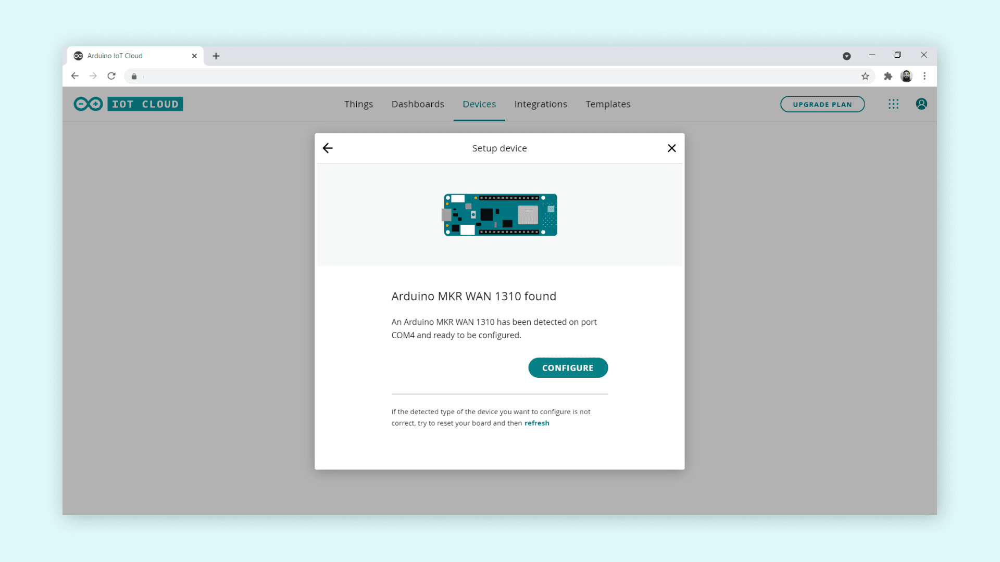
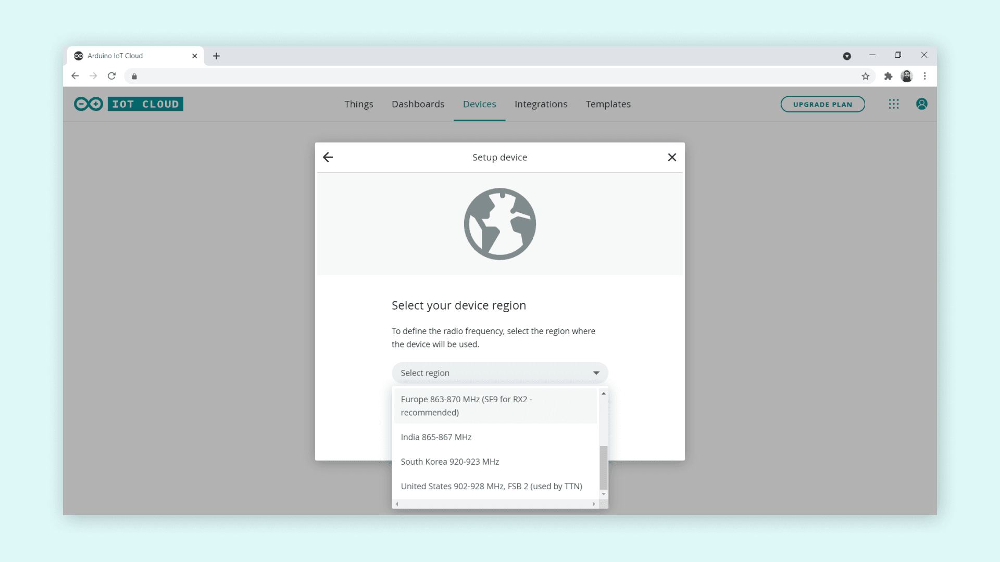
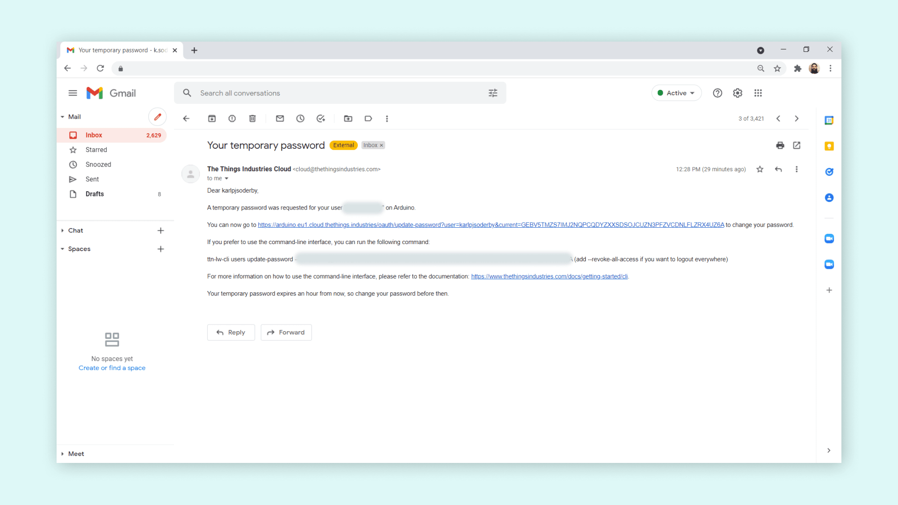

**LoRa®** connectivity is for long-range, low-power devices that communicate
over a LoRaWAN® network through a gateway. When you provision a LoRaWAN® board
in Arduino Cloud, it is automatically registered on
[The Things Stack](https://www.thethingsindustries.com/stack/) (TTS), giving
your device access to the network's thousands of public gateways.

## Supported Boards

Per [ArduinoIoTCloud](https://github.com/arduino-libraries/ArduinoIoTCloud):
MKR WAN 1300 and MKR WAN 1310. They authenticate with `APP_EUI` + `APP_KEY`
(LoRaWAN's own join credentials), defined in `thingProperties.h`.

Third-party LoRaWAN® devices are also supported via
**Devices → + Device → Compatible device → LoRaWAN**.

<Alert type="note">

LoRaWAN® data rates are limited. Restrict messages from a device to roughly
once every several minutes. See
[The Things Network limitations](https://www.thethingsnetwork.org/docs/lorawan/limitations/).

</Alert>

## Provisioning the Device

1. Connect the board over USB with the antenna attached and the
   [Cloud Agent](/arduino-cloud/devices/cloud-agent) installed.
2. Go to **Devices → + Device** and start the setup for your board. When
   detected, select **Configure**.

   

3. Select the **frequency band** for your region, e.g. Europe (868 MHz) or
   America (915 MHz).

   

<Alert type="warning">

Select the correct band for your country. Transmitting on the wrong frequency
may have legal consequences — it is your responsibility to choose correctly.

</Alert>

4. Name the device and finish. Arduino Cloud registers it on The Things Stack
   automatically.

The equivalent CLI flow uses a mandatory frequency plan:

```bash
arduino-cloud-cli device list-frequency-plans
arduino-cloud-cli device create-lora --name <deviceName> --frequency-plan <freqID> --port <port> --fqbn <deviceFqbn>
```

See [Managing Devices from the CLI](/arduino-cloud/apis-cli/cli-devices).

## The Things Stack Account

After the device is configured, an email is sent to your account address and a
Things Stack account is created automatically. Follow the link to set a
password. You do not need to change anything in The Things Console — the app
and Arduino Cloud integration are created for you — but access is useful for
checking whether data is flowing.



If the activation link expires, use **Forgot Password** on the Things Stack
login to restart activation.

## Verifying Data

Add a read-only variable to your [Thing](/arduino-cloud/things-data/things) and
upload a sketch that updates it on a slow interval (e.g. every 3 minutes to
respect network limits). In the Thing overview, the **Last Value / Last
Update** column confirms data is arriving. In the Things Stack Console, a
device's live-data section showing **"Accept join-request"** and a recent
**Last Seen** time confirms it is reaching a gateway.

## Next Steps

- [Managing Devices from the CLI](/arduino-cloud/apis-cli/cli-devices)
- [Things & Data](/arduino-cloud/things-data/things)
- [Troubleshoot Device Connections](/arduino-cloud/devices/troubleshoot-device-connections)

## Trademark Acknowledgments

- **LoRa®** is a registered trademark of Semtech Corporation.
