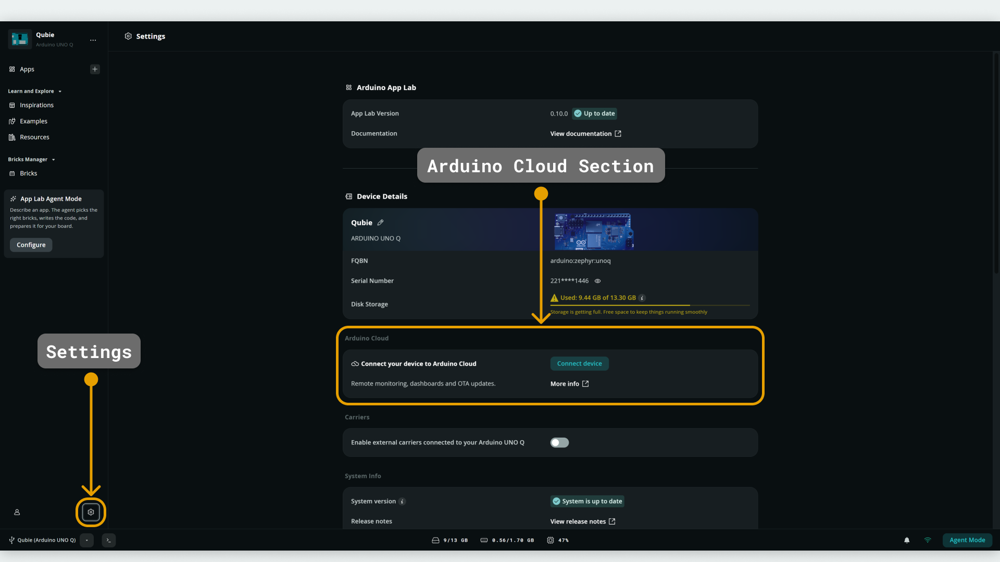

The Arduino® [UNO Q](https://docs.arduino.cc/hardware/uno-q) and [VENTUNO Q](https://docs.arduino.cc/hardware/ventuno-q) run a full Linux® OS and connect to Arduino Cloud through the [arduino-cloud-connector](https://github.com/arduino/arduino-cloud-connector) service rather than an Arduino sketch. You connect the board to Arduino Cloud directly from **Arduino App Lab**. Once connected to your Cloud space, the board is provisioned automatically and is ready to exchange data with your apps. You don't need to copy a Device ID or Secret Key.

The communication with Arduino Cloud runs on the board's microprocessor (MPU) and is programmed in Python®. Data to and from the microcontroller (MCU) is handled by the [Bridge](/software/app-lab/getting-started/quickstart/#bridge-tool) tool.

## Hardware & Software Needed

- An [Arduino UNO Q](https://store.arduino.cc/products/uno-q) or [Arduino VENTUNO Q](https://store.arduino.cc/products/ventuno-q).
- An [Arduino account](https://login.arduino.cc/login).
- [Arduino App Lab](https://www.arduino.cc/en/software) installed on your computer.

## Add the Device

You can start the setup from Arduino Cloud or directly from Arduino App Lab:

1. *Optional:* In [Arduino Cloud](https://app.arduino.cc/), go to **Devices**, select **+ Device**, and choose **Arduino UNO Q** (or the matching Q device). Arduino Cloud asks you to open Arduino App Lab, or to download it if it is not installed.
2. Open Arduino App Lab, go to the device settings, and select **Connect** in the **Cloud** section.

   

3. If you are not logged in to Arduino App Lab with your Arduino account, a web login page opens. Log in, and Arduino App Lab reopens automatically.
4. Select the Cloud space to add the device to. You can choose your personal space or an organization space.
5. A confirmation message appears, and the device is listed in **Devices** in the selected space.

The device is now provisioned and ready to use. Associate it with a [Thing](/arduino-cloud/things-data/things) to exchange [Cloud Variables](/arduino-cloud/things-data/cloud-variables) with your Arduino App Lab apps through the **Arduino Cloud** Brick.

<Alert type="info">

For a complete example, including a Thing, a dashboard and the **Blinking LED from Arduino Cloud** app, see [Connect UNO Q to the Arduino Cloud](/tutorials/uno-q/arduino-cloud/).

</Alert>

## Related Articles

- [Connect UNO Q to the Arduino Cloud](/tutorials/uno-q/arduino-cloud/)
- [Devices Overview](/arduino-cloud/devices/devices-overview)
- [Things](/arduino-cloud/things-data/things)
- [Use Your Phone With Arduino App Lab](/arduino-cloud/iot-remote-app/arduino-app-lab)
