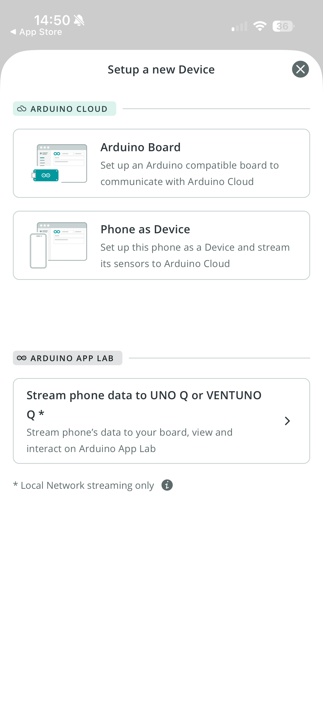
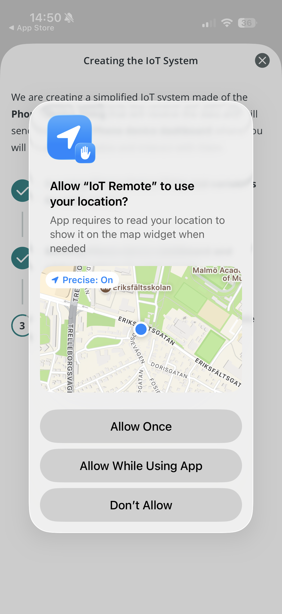
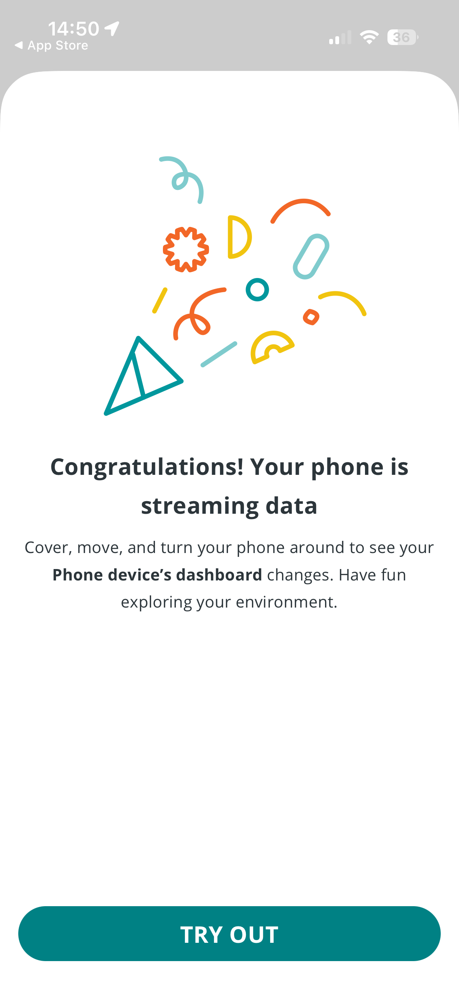

You don't need dedicated hardware to start streaming data to Arduino® Cloud: your smartphone can act as a device. The IoT Remote app adds your phone as a device and sends its built-in sensor readings, such as location and acceleration, to [Cloud Variables](/arduino-cloud/things-data/cloud-variables). The whole setup happens in the app, in a few taps.

## Hardware & Software Needed

- An Android phone or iPhone with the [IoT Remote app](/arduino-cloud/iot-remote-app/iot-remote-app-overview) installed.
- An [Arduino account](https://login.arduino.cc/login).
- Your personal account selected in the app. Adding your phone as a device is not available in shared spaces (see [Spaces](/arduino-cloud/spaces-plans-account/spaces)).

## Adding Your Phone

1. Open the IoT Remote app and log in with your Arduino account.
2. Open the **Devices** tab and add a new device.
3. In **Setup a new Device**, select **Phone as Device**.

   

4. Allow the permissions the app asks for, such as access to your location.

   

5. Wait while the app creates the device, Thing, variables, and dashboard, then close the wizard.

   

## What Gets Created

- A **device** for your phone, listed in the **Devices** tab of the app and in **Devices** in the browser.
- A **[Thing](/arduino-cloud/things-data/things)** with one Cloud Variable for each sensor value.
- A **[dashboard](/arduino-cloud/dashboards/dashboards)** named after your phone, for example `<phone name> Dashboard`, listed in the **Dashboards** tab.

The Thing created for your phone cannot be programmed like a regular board. To use the phone's data with a board, [sync its variables](/arduino-cloud/things-data/sync-variables) with another Thing.

For the list of sensors, the background data collection and streaming settings, and an example that controls a board with your phone, see [Use Your Phone as a Device](/arduino-cloud/iot-remote-app/use-phone-as-device).

## Related Articles

- [Use Your Phone as a Device](/arduino-cloud/iot-remote-app/use-phone-as-device)
- [IoT Remote App Overview](/arduino-cloud/iot-remote-app/iot-remote-app-overview)
- [Set Up a Device Over Bluetooth](/arduino-cloud/devices/bluetooth-device-setup)
- [Devices Overview](/arduino-cloud/devices/devices-overview)
