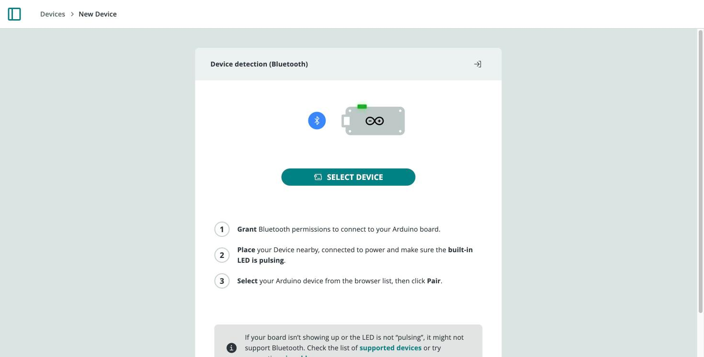
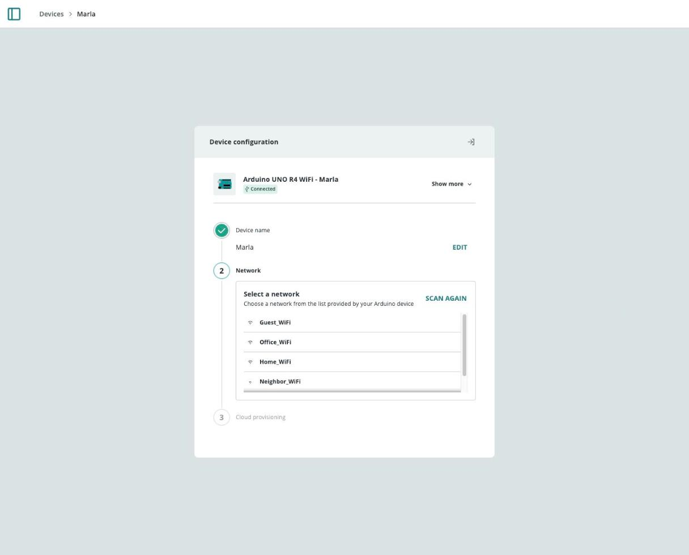
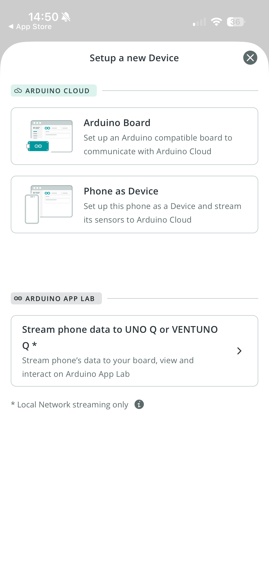

Supported Arduino® boards can be added to Arduino Cloud wirelessly over Bluetooth® Low Energy, without a USB cable or the [Cloud Agent](/arduino-cloud/devices/cloud-agent). During the setup, you send the board the Wi-Fi® network it should join. The credentials are stored on the board ([Provisioning 2.0](/arduino-cloud/devices/network-configuration#provisioning-10-vs-20)).

You can run the Bluetooth setup from two places:

- **The Arduino Cloud website**, on a computer with Bluetooth.
- **The IoT Remote app**, on your phone or tablet.

## Hardware & Software Needed

- An [Arduino account](https://login.arduino.cc/login).
- A supported board (see below), powered on.
- A computer with Bluetooth and a supported browser, or a phone or tablet with the [IoT Remote app](/arduino-cloud/iot-remote-app/iot-remote-app-overview) installed.
- The name (SSID) and password of a 2.4 GHz Wi-Fi® network.

## Supported Boards

| Board | Notes |
|---|---|
| UNO R4 WiFi | Requires Wi-Fi® firmware 0.6.0 or later |
| GIGA R1 WiFi | |
| Opta® | |
| Portenta H7 | May first need to be [made compatible with Bluetooth® setup](#make-a-board-compatible-with-bluetooth-setup) |
| Nicla Vision | May first need to be made compatible with Bluetooth setup |
| MKR WiFi 1010 | May first need to be made compatible with Bluetooth setup |
| Nano 33 IoT | May first need to be made compatible with Bluetooth setup |
| Nano RP2040 Connect | May first need to be made compatible with Bluetooth setup |

A board ready for Bluetooth setup runs a provisioning sketch and shows a pulsing LED (or a Bluetooth icon on the LED matrix, for UNO R4 WiFi). Newer boards ship with this sketch already installed. If the board doesn't show the pulsing LED, set it up over USB instead, or follow [Make a Board Compatible With Bluetooth Setup](#make-a-board-compatible-with-bluetooth-setup).

## Set Up From the Arduino Cloud Website

1. Go to **Devices**, select **+ Device**, choose **Arduino board**, and select the Bluetooth option.
2. Follow the steps on the page to connect to the board.

   

3. Once connected, choose the Wi-Fi® network the board should join and enter its password. You can also change the device name here.

   

4. The board connects to the network, and the device page opens. From here, you can attach a [Thing](/arduino-cloud/things-data/things) to the device.

## Set Up From the IoT Remote App

1. Open the IoT Remote app and sign in with your Arduino account.
2. Open the **Devices** tab and add a new device.
3. In **Setup a new Device**, select **Arduino Board**.

   

4. Follow the steps in the app to connect to the board over Bluetooth. Allow the app to use Bluetooth if your phone asks for permission.
5. Choose the Wi-Fi® network the board should join and enter its password.
6. When the setup is complete, the board is listed in the app's **Devices** tab and in **Devices** on the Arduino Cloud website.

## After the Setup

The board's Bluetooth LE interface turns off automatically when the setup completes, and stays off until you run the [reconfiguration procedure](/arduino-cloud/devices/network-configuration#resetting-the-board-configuration). To change the Wi-Fi® network later, see [Updating a Stored Configuration](/arduino-cloud/devices/network-configuration#updating-a-stored-configuration).

Associate the device with a [Thing](/arduino-cloud/things-data/things) to start exchanging data.

## Make a Board Compatible With Bluetooth Setup

This procedure prepares a board for Bluetooth provisioning if it is not already configured for it. Afterwards, you can set the board up from the web interface or the mobile app over Bluetooth LE.

<Alert type="note">

If you are preparing a UNO R4 WiFi, update its Wi-Fi® firmware to version 0.6.0 or later first. With older firmware, the procedure fails.

</Alert>

1. Install [arduino-cloud-cli](/arduino-cloud/apis-cli/cli-install-credentials) version 0.5.0 or later and set up its credentials.
2. Connect the board to your computer over USB.
3. Run:

   ```bash
   arduino-cloud-cli device provisioning migrate
   ```

The procedure takes about a minute. When it finishes, the board starts pulsing its LED and is ready for Bluetooth provisioning.

## Related Articles

- [Provisioning & Network Configuration](/arduino-cloud/devices/network-configuration)
- [Add a Wi-Fi® Board](/arduino-cloud/devices/add-wifi-board)
- [IoT Remote App Overview](/arduino-cloud/iot-remote-app/iot-remote-app-overview)
