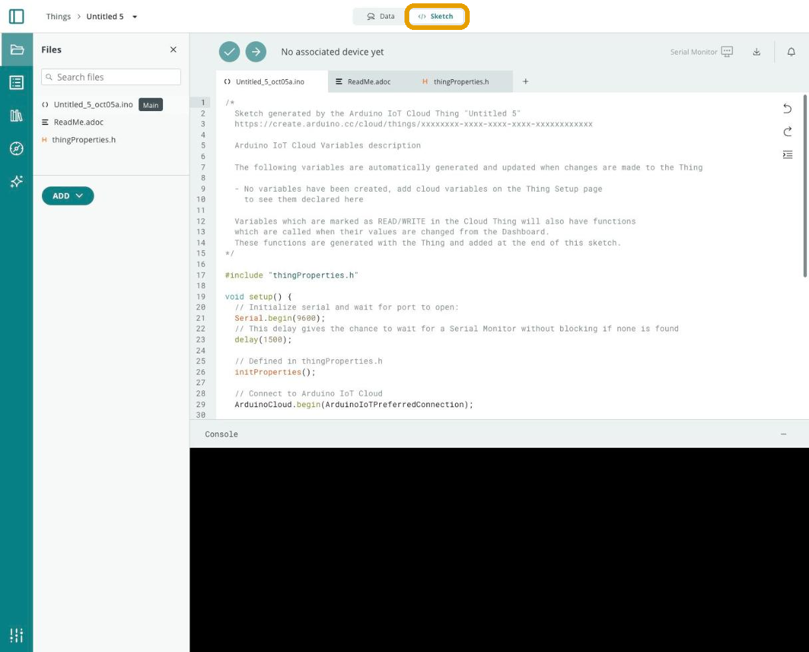
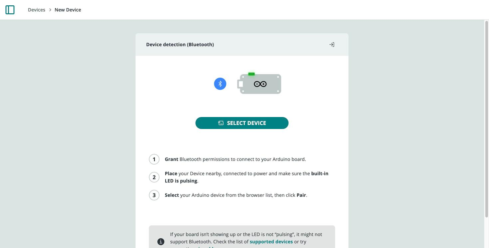
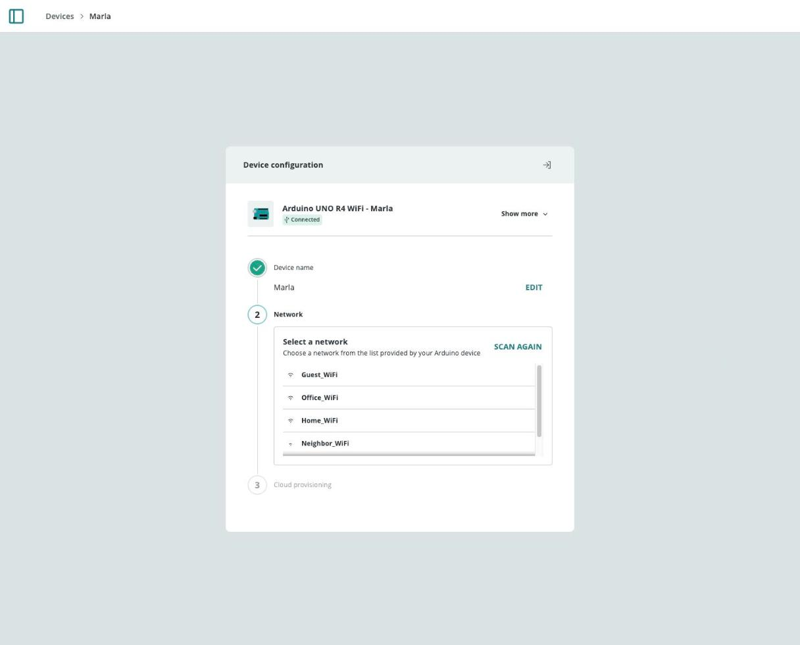
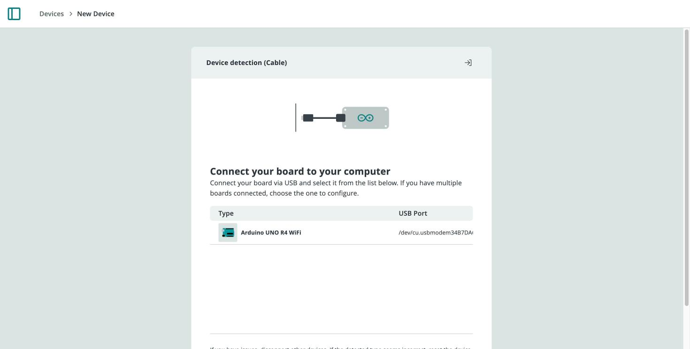
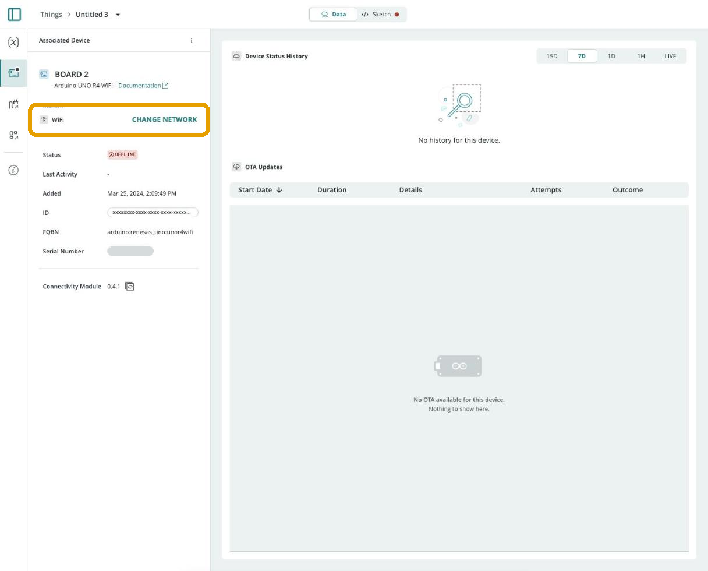
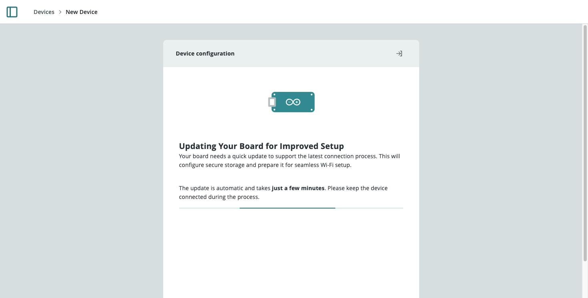

**Provisioning** registers a board with Arduino Cloud and gives it the credentials it needs to connect. This page covers the two provisioning versions, the Bluetooth® LE and USB provisioning flows, where network credentials are stored, and how to update, clear, or migrate a board's stored network configuration.

To provision a board, you need an [Arduino account](https://login.arduino.cc/login). A free account is enough.

## Provisioning 1.0 vs. 2.0

The two provisioning versions differ in **where network credentials are stored**:

| Version | Credentials stored |
|---|---|
| **1.0** | In the sketch's **Secret** tab, visible in the Thing's Sketch tab. When you open the sketch in Arduino IDE, this file is named `arduino_secrets.h`. |
| **2.0** | On the board itself, in non-volatile storage. They are not visible in the sketch, and can be changed over Bluetooth® LE or USB without uploading a new sketch. |



### Compatible Boards

Per [ArduinoIoTCloud](https://github.com/arduino-libraries/ArduinoIoTCloud)'s `Provisioning_2.0` example:

| Board | Provisioning |
|---|---|
| UNO R4 Wi-Fi® | 2.0 |
| GIGA R1 Wi-Fi® | 2.0 |
| Opta (Wi-Fi®/RS485/Lite) | 2.0 |
| Portenta H7 | 2.0 |
| Nicla Vision | 2.0 |
| MKR Wi-Fi® 1010 | 2.0 |
| Nano 33 IoT | 2.0 |
| Nano RP2040 Connect | 2.0 |
| MKR 1000 Wi-Fi® | 1.0 |
| MKR GSM 1400 | 1.0 |
| MKR NB 1500 | 1.0 |
| MKR WAN 1300 / 1310 | 1.0 |
| Nano ESP32 | 1.0 |
| Portenta C33 | 1.0 |
| Portenta X8 | 1.0 |

## Bluetooth Provisioning

The following boards support provisioning over Bluetooth® LE:

| Board | Notes |
|---|---|
| UNO R4 WiFi | Requires Wi-Fi® firmware 0.6.0 or later |
| GIGA R1 WiFi | |
| Opta | |
| Portenta H7 | May first need to be [made compatible with BLE provisioning](#make-a-board-compatible-with-ble-provisioning) |
| Nicla Vision | May first need to be made compatible with BLE provisioning |
| MKR WiFi 1010 | May first need to be made compatible with BLE provisioning |
| Nano 33 IoT | May first need to be made compatible with BLE provisioning |
| Nano RP2040 Connect | May first need to be made compatible with BLE provisioning |

A board ready for Bluetooth® provisioning runs a provisioning sketch and shows a pulsing LED (or a Bluetooth® icon on the LED matrix, for UNO R4 WiFi). Newer boards ship with this sketch already installed. If the board doesn't show the pulsing LED, use USB provisioning, or follow [Make a Board Compatible With BLE Provisioning](#make-a-board-compatible-with-ble-provisioning).

To provision over Bluetooth®:

1. Go to **Devices**, select **+ Device**, choose **Arduino board**, and select the Bluetooth® option.
2. Follow the steps on the page to connect to the board.

   

3. Once connected, choose the Wi-Fi® network the board should join and enter its password. You can also change the device name here.

   

4. The board connects to the network, and the device page opens. From here, you can attach a [Thing](/arduino-cloud/things-data/things) to the device.

The board's Bluetooth® LE interface turns off automatically when provisioning completes, and stays off until you run the [reconfiguration procedure](#resetting-the-board-configuration).

## USB Provisioning

Works for every board, regardless of provisioning version. Requires the [Cloud Agent](/arduino-cloud/devices/cloud-agent) the first time, so the browser can talk to the board over USB.

1. Go to **Devices**, select **+ Device**, choose **Arduino board**, and select the USB option.
2. Select the board you want to set up.

   

3. Wait while the board connects, then select **Continue**.
4. Pick the network type (Wi-Fi®, Ethernet, Cellular, or CAT-M1/NB-IoT, depending on the board) and enter its credentials.

The device page then opens. From here you can rename the board, attach it to a [Thing](/arduino-cloud/things-data/things), and change its network configuration later.



## Migrating from 1.0 to 2.0

If your board supports Provisioning 2.0 but was set up with 1.0, you can migrate it. After the migration, the network credentials are stored on the board and can be changed over Bluetooth® LE. You can migrate in two ways:

- **From the web interface**: delete the device from **Devices**, then add it again over USB. The board is updated to Provisioning 2.0 during the setup.
- **From the terminal**: run the `migrate` command described in the next section.



## Make a Board Compatible With BLE Provisioning

This procedure prepares a board for Bluetooth® provisioning if it is not already configured for it. Afterwards, you can set the board up from the web interface or the mobile app over Bluetooth® LE.

<Alert type="note">

If you are preparing a UNO R4 WiFi, update its Wi-Fi® firmware to version 0.6.0 or later first. With older firmware, the procedure fails.

</Alert>

1. Install [arduino-cloud-cli](/arduino-cloud/apis-cli/cli-install-credentials) version 0.5.0 or later and set up its credentials.
2. Connect the board to your computer over USB.
3. Run:

   ```bash
   arduino-cloud-cli device provisioning migrate
   ```

The procedure takes about a minute. When it finishes, the board starts pulsing its LED and is ready for Bluetooth® provisioning.

## Updating a Stored Configuration

Both methods require the Cloud-generated sketch to be running on the board. You can start from the device page on the Arduino Cloud website or in the mobile app.

### Over Bluetooth® LE

The sketch must have `BLEAgent` enabled in `thingProperties.h`. It is enabled by default for boards set up with Provisioning 2.0. During this process, the current network configuration is wiped so that the board's Bluetooth® LE interface can restart.

1. Power on the board.
2. Open **Devices** on the website or in the mobile app, and select the device.
3. Select **Change** in the **Network** section. On the website, select the Bluetooth® method.
4. Reset the board's configuration with the [reconfiguration procedure](#resetting-the-board-configuration) for your board.
5. The board reboots and its LED starts pulsing. Connect to the board.
6. Enter the new network configuration. The board validates it and, if it is correct, closes the connection.

### Over USB (Serial)

The sketch must have `SerialAgent` enabled in `thingProperties.h`. It is enabled by default for boards set up with Provisioning 2.0. This method only works from the Arduino Cloud website, not the mobile app, and no reset is needed.

1. Connect the board to your computer over USB.
2. Open **Devices** and select the device.
3. Select **Change** in the **Network** section.
4. Enter the new network configuration. The board validates it and, if it is correct, closes the connection.

## Resetting the Board Configuration

The **reconfiguration procedure** clears the stored network configuration and restarts the board's Bluetooth® LE interface. It is provided by the [Arduino_NetworkConfigurator](https://github.com/arduino-libraries/Arduino_NetworkConfigurator) library and requires the Cloud-generated sketch to be running. Use the method for your board:

| Board | Reconfiguration procedure |
|---|---|
| Opta | Press and hold the user button (BTN_USER) until the user LED (LED_USER) turns off |
| MKR WiFi 1010 | Short pin 7 to GND until the LED turns off |
| GIGA R1 WiFi | Short pin 7 to GND until the LED turns off |
| Nicla Vision | Short pin PA_13 to GND until the LED turns off |
| Portenta H7 | Short pin 0 to GND until the LED turns off |
| Portenta C33 | Short pin 0 to GND until the LED turns off |
| Portenta Machine Control | Not available |
| Other boards, including UNO R4 WiFi | Short pin 2 to GND until the LED turns off |

If you changed the reconfiguration pin in your sketch, use that pin instead. To change the pin, or to disable the procedure, add one of the following lines to the `NetworkConfigurator` setup in `thingProperties.h`. The new pin must support interrupts:

```arduino
NetworkConfigurator.setReconfigurePin(YOUR_PIN);    // use another pin
NetworkConfigurator.setReconfigurePin(DISABLE_PIN); // disable the procedure
```

To run your own code when the reconfiguration pin changes state, or to remove the `BLEAgent`, `SerialAgent`, or the whole NetworkConfigurator to save memory, see [NetworkConfigurator](/arduino-cloud/reference/generated-sketch-files#networkconfigurator) in the generated sketch files reference.

## Deleting a Stored Configuration

Two ways to clear saved credentials without setting new ones:

- **Reconfiguration procedure**: follow [Resetting the Board Configuration](#resetting-the-board-configuration).
- **`DeleteConfiguration` sketch**: in Arduino IDE, install the [`Arduino_NetworkConfigurator`](https://github.com/arduino-libraries/Arduino_NetworkConfigurator) library from the Library Manager, open **File > Examples > Arduino_NetworkConfigurator > Utility > DeleteConfiguration**, select your board and port, and upload it. Progress is shown in the Serial Monitor.

## Next Steps

- [Cloud Agent](/arduino-cloud/devices/cloud-agent)
- [Troubleshoot Device Connections](/arduino-cloud/devices/troubleshoot-device-connections)
- [Managing Devices from the CLI](/arduino-cloud/apis-cli/cli-devices)

## Trademark Acknowledgments

- **LoRa®** is a registered trademark of Semtech Corporation.
