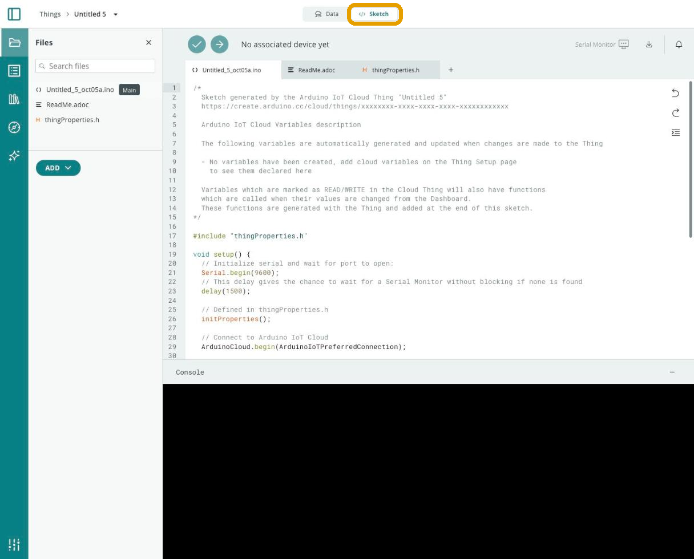
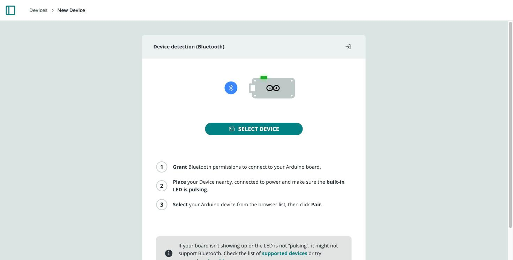
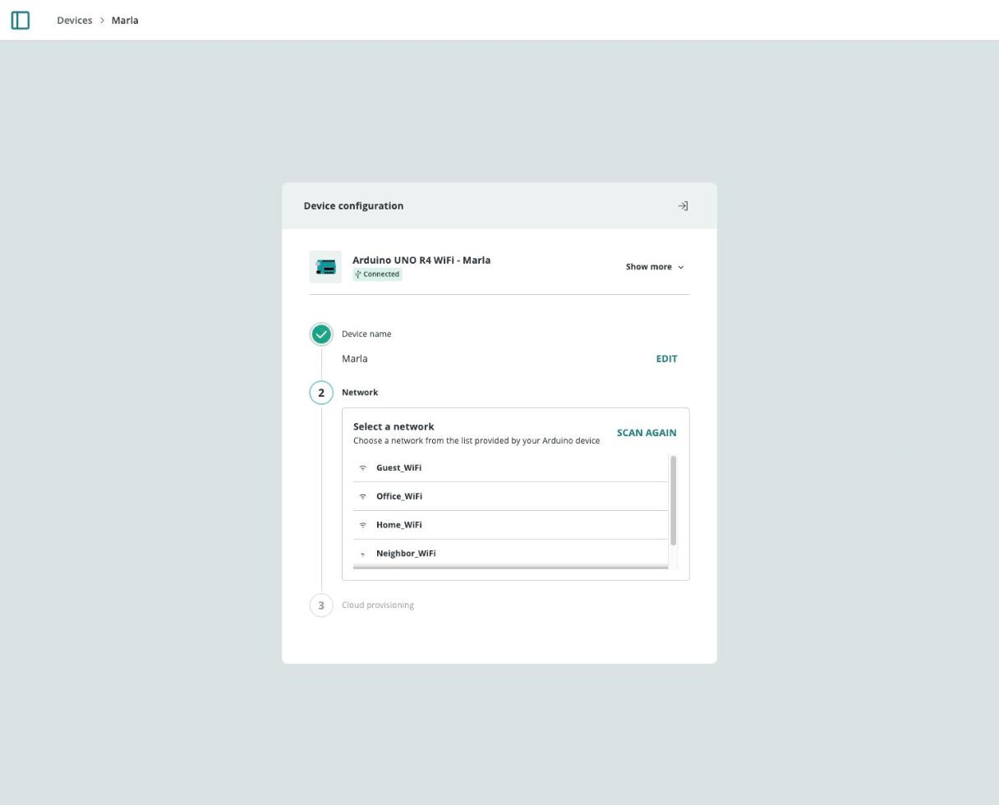
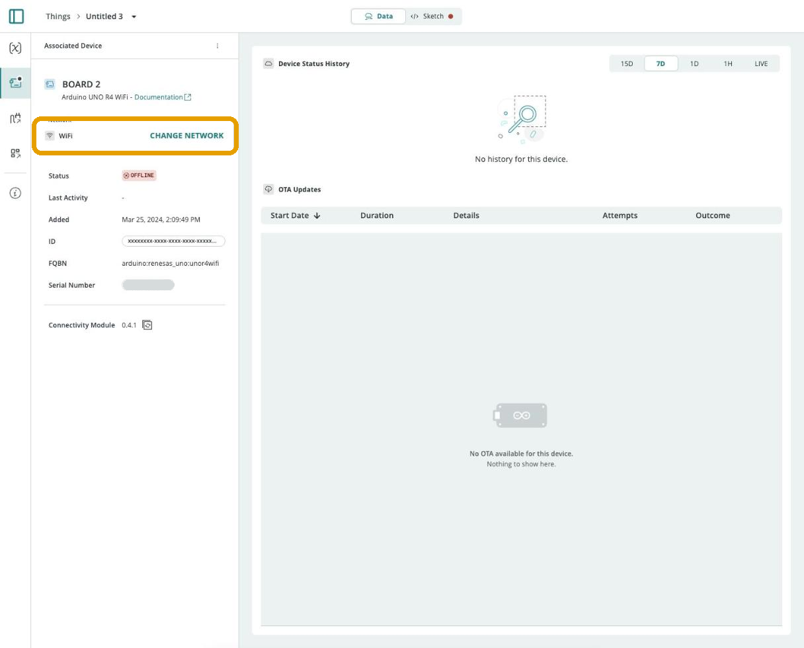
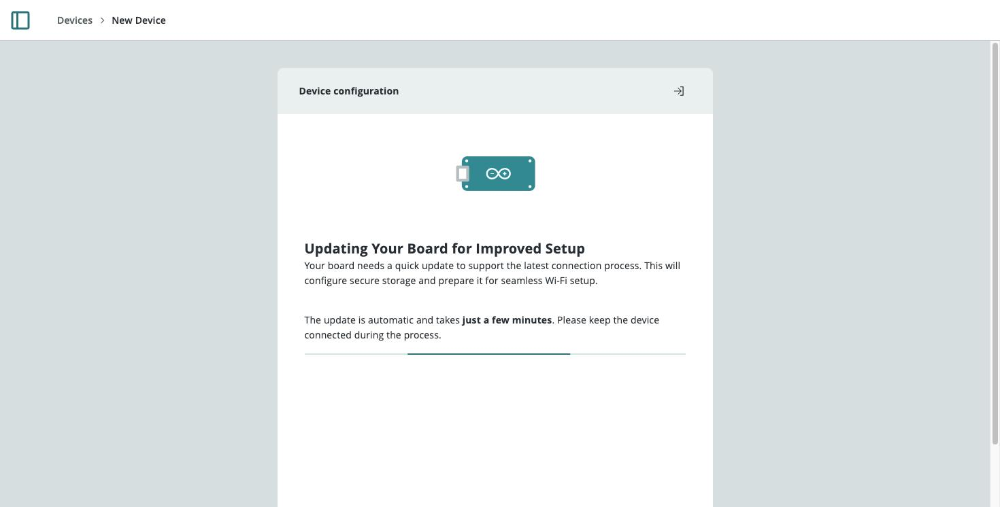

**Provisioning** registers a board with Arduino Cloud and gives it the credentials it needs to connect. This page covers where those credentials are stored, the Bluetooth® LE and USB provisioning flows, and how to update, clear, or migrate a board's stored network configuration.

## Provisioning 1.0 vs. 2.0

The two generations differ in **where network credentials are stored**:

| Version | Credentials stored |
|---|---|
| **1.0** | In an `arduino_secrets.h` file, visible in the Thing's Sketch tab |
| **2.0** | On the board itself (secure storage/KVStore), not visible in the sketch, and reconfigurable over Bluetooth® LE or serial without re-uploading a sketch |



### Compatible Boards

Per [ArduinoIoTCloud](https://github.com/arduino-libraries/ArduinoIoTCloud)'s `Provisioning_2.0` example:

| Board | Provisioning |
|---|---|
| UNO R4 Wi-Fi® | 2.0 |
| GIGA R1 Wi-Fi® | 2.0 |
| Opta (Wi-Fi®/RS485/Lite) | 2.0 |
| Portenta H7 | 2.0 |
| Nicla Vision | 2.0 |
| MKR Wi-Fi® 1010 | 2.0 |
| Nano 33 IoT | 2.0 |
| Nano RP2040 Connect | 2.0 |
| MKR 1000 Wi-Fi® | 1.0 |
| MKR GSM 1400 | 1.0 |
| MKR NB 1500 | 1.0 |
| MKR WAN 1300 / 1310 | 1.0 |
| Nano ESP32 | 1.0 |
| Portenta C33 | 1.0 |
| Portenta X8 | 1.0 |

## Bluetooth Provisioning

Only boards on Provisioning 2.0 support this path. A board ready for Bluetooth® provisioning shows a pulsing LED (or a Bluetooth® icon on the LED matrix, for UNO R4 Wi-Fi®). Newer boards ship with the provisioning sketch already installed.



Once paired, choose the Wi-Fi® network and password the board should join — the device name can also be changed here. The board's BLE interface turns off automatically once provisioning completes.



## USB Provisioning

Works for every board, regardless of provisioning version. Requires the [Cloud Agent](/arduino-cloud/devices/cloud-agent) the first time, so the browser can talk to the board over USB.


After the board connects, pick its network type (Wi-Fi®, Ethernet, Cellular, or CAT-M1/NB-IoT) and enter its credentials. From the resulting device page you can rename the board, attach it to a [Thing](/arduino-cloud/things-data/things), and revisit its network configuration later.



## Migrating from 1.0 to 2.0

Upgrading moves credential storage onto the board itself (and unlocks BLE reconfiguration) without a full re-provision. Requires `arduino-cloud-cli` ≥ 0.5.0 and the board connected over USB:

```bash
arduino-cloud-cli device provisioning migrate
```

It takes about a minute; when it finishes, the board starts pulsing its LED, ready for the Bluetooth flow above.



<Alert type="note">

If migrating a UNO R4 Wi-Fi®, update its Wi-Fi® firmware to ≥ 0.6.0 first — an older firmware version makes this procedure fail.

</Alert>

## Updating a Stored Configuration

Both interfaces require the Cloud-generated sketch to already be running on the board:

- **Over Bluetooth® LE** — needs `BLEAgent` enabled in `thingProperties.h` (on by default for Provisioning 2.0 boards). From the device page, choosing to change the network resets the board's reconfiguration procedure; once it's pulsing again, connect and enter the new credentials.
- **Over serial** — needs `SerialAgent` enabled. Only works from the Arduino Cloud website (not the app): connect over USB, open the device page, choose to change the network, and enter new credentials — no reset step needed.

## Deleting a Stored Configuration

Two ways to clear saved credentials without setting new ones:

- **Board reset procedure** — trigger the reconfiguration reset described above.
- **`DeleteConfiguration` sketch** — install the [`Arduino_NetworkConfigurator`](https://github.com/arduino-libraries/Arduino_NetworkConfigurator) library, then open **File > Examples > Arduino_NetworkConfigurator > Utility > DeleteConfiguration** and upload it. Progress is shown in the Serial Monitor.

## Next Steps

- [Cloud Agent](/arduino-cloud/devices/cloud-agent)
- [Troubleshoot Device Connections](/arduino-cloud/devices/troubleshoot-device-connections)
- [Managing Devices from the CLI](/arduino-cloud/apis-cli/cli-devices)

## Trademark Acknowledgments

- **LoRa®** is a registered trademark of Semtech Corporation.
