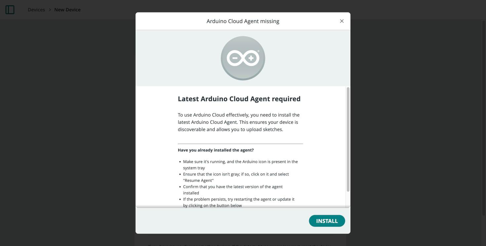

The **Cloud Agent** (also called the **Arduino Create Agent** in its underlying
messages) is a small background app you install once per computer. It lets the
browser-based Cloud Editor and the device provisioning wizard talk to a board
over USB — browsers can't access serial ports directly, so the agent bridges
that gap.

## When You Need It

- Uploading a sketch to a board over USB from the
  [Cloud Editor](/arduino-cloud/sketches-editor/cloud-editor-overview) — a
  reminder banner appears if the agent isn't detected.
- Provisioning a device over USB or serial from the
  [Setup Device wizard](/arduino-cloud/devices/devices-overview#adding-a-device).

You do **not** need it for:

- OTA uploads, once a board has done one initial USB upload.
- Manual/generic devices (Python, MicroPython, Node.js), which never use the
  browser's serial bridge.
- Bluetooth®-only provisioning.

## Installing

You're prompted to install the agent automatically the first time you need it.

Once installed and running, a connected board appears in the board-selection
menu of the Cloud Editor and the provisioning wizard.

For manual, per-OS install instructions, see the
[Help Center article](https://support.arduino.cc/hc/en-us/articles/360014869820-Install-the-Arduino-Cloud-Agent).

## Troubleshooting

- **Board not detected** — confirm the agent is installed and running, then
  reconnect the USB cable. Try a different cable or port; some cables are
  power-only.
- **Connection-refused errors in the browser console** — the browser looks for
  the agent on local ports `127.0.0.1:8991`–`9000`. These errors are harmless
  if the agent isn't running or isn't needed for what you're doing.
- **Agent installed but still not found** — restart the browser, and make sure
  no firewall or security software is blocking the local ports above.

## Next Steps

- [Network Configuration](/arduino-cloud/devices/network-configuration)
- [Troubleshoot Device Connections](/arduino-cloud/devices/troubleshoot-device-connections)
- [Cloud Editor Overview](/arduino-cloud/sketches-editor/cloud-editor-overview)
