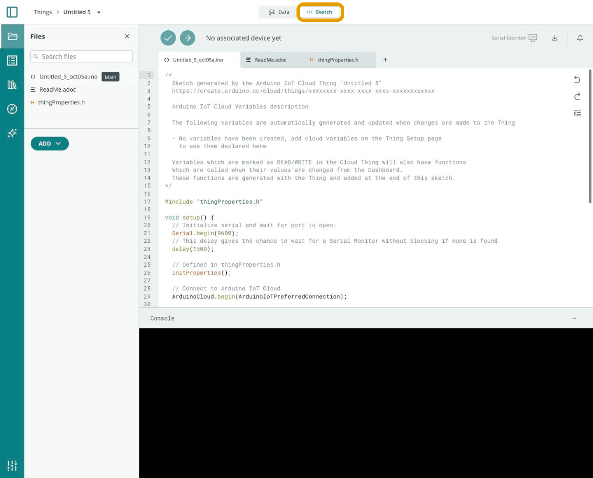
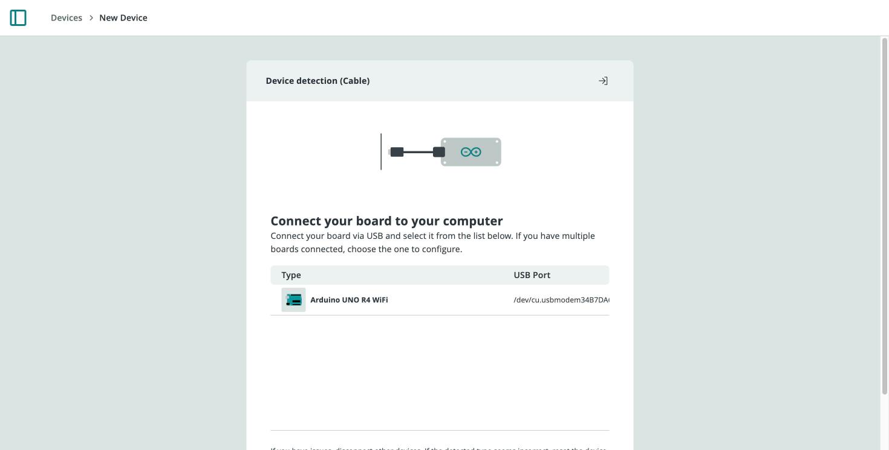
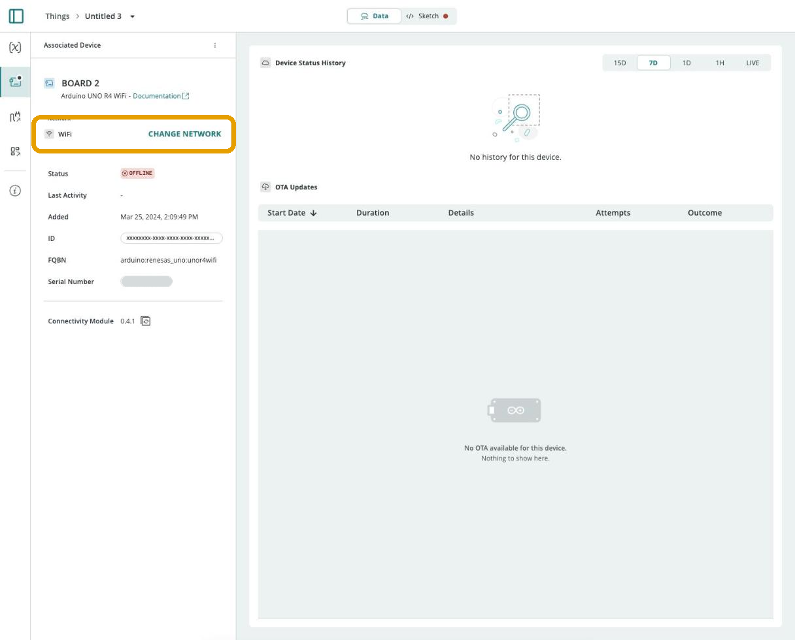
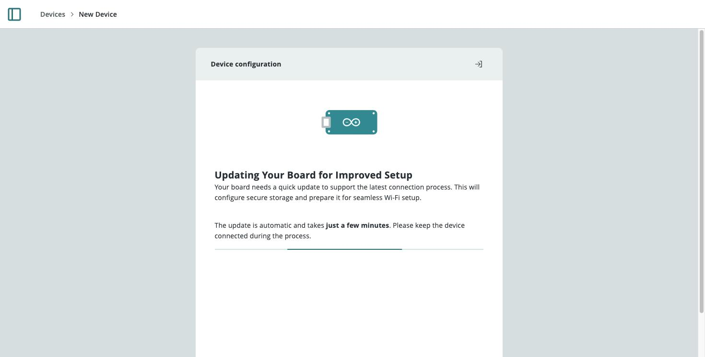

**Provisioning** registers a board with Arduino® Cloud and gives it the credentials it needs to connect. This page covers the two provisioning versions, the Bluetooth® LE and USB provisioning flows, where network credentials are stored, and how to update, clear, or migrate a board's stored network configuration.

To provision a board, you need an [Arduino account](https://login.arduino.cc/login). A free account is enough.

## Provisioning 1.0 vs. 2.0

The two provisioning versions differ in **where network credentials are stored**:

| Version | Credentials stored |
|---|---|
| **1.0** | In the sketch's **Secret** tab, visible in the Thing's Sketch tab. When you open the sketch in Arduino IDE, this file is named `arduino_secrets.h`. |
| **2.0** | On the board itself, in non-volatile storage. They are not visible in the sketch, and can be changed over Bluetooth LE or USB without uploading a new sketch. |



### Compatible Boards

Per [ArduinoIoTCloud](https://github.com/arduino-libraries/ArduinoIoTCloud)'s `Provisioning_2.0` example:

| Board | Provisioning |
|---|---|
| UNO R4 WiFi | 2.0 |
| GIGA R1 WiFi | 2.0 |
| Opta® (WiFi/RS485/Lite) | 2.0 |
| Portenta H7 | 2.0 |
| Nicla Vision | 2.0 |
| MKR WiFi 1010 | 2.0 |
| Nano 33 IoT | 2.0 |
| Nano RP2040 Connect | 2.0 |
| MKR 1000 WiFi | 1.0 |
| MKR GSM 1400 | 1.0 |
| MKR NB 1500 | 1.0 |
| MKR WAN 1300 / 1310 | 1.0 |
| Nano ESP32 | 1.0 |
| Portenta C33 | 1.0 |
| Portenta X8 | 1.0 |

## Bluetooth Provisioning

Boards on Provisioning 2.0 can be set up wirelessly over Bluetooth LE, from the Arduino Cloud website or from the IoT Remote app. See [Set Up a Device Over Bluetooth](/arduino-cloud/devices/bluetooth-device-setup) for the supported boards and the step-by-step flow.

## USB Provisioning

Works for every board, regardless of provisioning version. Requires the [Cloud Agent](/arduino-cloud/devices/cloud-agent) the first time, so the browser can talk to the board over USB.

1. Go to **Devices**, select **+ Device**, choose **Arduino board**, and select the USB option.
2. Select the board you want to set up.

   

3. Wait while the board connects, then select **Continue**.
4. Pick the network type (Wi-Fi®, Ethernet, Cellular, or CAT-M1/NB-IoT, depending on the board) and enter its credentials.

The device page then opens. From here you can rename the board, attach it to a [Thing](/arduino-cloud/things-data/things), and change its network configuration later.



## Migrating from 1.0 to 2.0

If your board supports Provisioning 2.0 but was set up with 1.0, you can migrate it. After the migration, the network credentials are stored on the board and can be changed over Bluetooth LE. You can migrate in two ways:

- **From the web interface**: delete the device from **Devices**, then add it again over USB. The board is updated to Provisioning 2.0 during the setup.
- **From the terminal**: run the `migrate` command described in the next section.



## Updating a Stored Configuration

Both methods require the Cloud-generated sketch to be running on the board. You can start from the device page on the Arduino Cloud website or in the mobile app.

### Over Bluetooth® LE

The sketch must have `BLEAgent` enabled in `thingProperties.h`. It is enabled by default for boards set up with Provisioning 2.0. During this process, the current network configuration is wiped so that the board's Bluetooth LE interface can restart.

1. Power on the board.
2. Open **Devices** on the website or in the mobile app, and select the device.
3. Select **Change** in the **Network** section. On the website, select the Bluetooth method.
4. Reset the board's configuration with the [reconfiguration procedure](#resetting-the-board-configuration) for your board.
5. The board reboots and its LED starts pulsing. Connect to the board.
6. Enter the new network configuration. The board validates it and, if it is correct, closes the connection.

### Over USB (Serial)

The sketch must have `SerialAgent` enabled in `thingProperties.h`. It is enabled by default for boards set up with Provisioning 2.0. This method only works from the Arduino Cloud website, not the mobile app, and no reset is needed.

1. Connect the board to your computer over USB.
2. Open **Devices** and select the device.
3. Select **Change** in the **Network** section.
4. Enter the new network configuration. The board validates it and, if it is correct, closes the connection.

## Resetting the Board Configuration

The **reconfiguration procedure** clears the stored network configuration and restarts the board's Bluetooth LE interface. It is provided by the [Arduino_NetworkConfigurator](https://github.com/arduino-libraries/Arduino_NetworkConfigurator) library and requires the Cloud-generated sketch to be running. Use the method for your board:

| Board | Reconfiguration procedure |
|---|---|
| Opta | Press and hold the user button (BTN_USER) until the user LED (LED_USER) turns off |
| MKR WiFi 1010 | Short pin 7 to GND until the LED turns off |
| GIGA R1 WiFi | Short pin 7 to GND until the LED turns off |
| Nicla Vision | Short pin PA_13 to GND until the LED turns off |
| Portenta H7 | Short pin 0 to GND until the LED turns off |
| Portenta C33 | Short pin 0 to GND until the LED turns off |
| Portenta Machine Control | Not available |
| Other boards, including UNO R4 WiFi | Short pin 2 to GND until the LED turns off |

If you changed the reconfiguration pin in your sketch, use that pin instead. To change the pin, or to disable the procedure, add one of the following lines to the `NetworkConfigurator` setup in `thingProperties.h`. The new pin must support interrupts:

```arduino
NetworkConfigurator.setReconfigurePin(YOUR_PIN);    // use another pin
NetworkConfigurator.setReconfigurePin(DISABLE_PIN); // disable the procedure
```

## Deleting a Stored Configuration

Two ways to clear saved credentials without setting new ones:

- **Reconfiguration procedure**: follow [Resetting the Board Configuration](#resetting-the-board-configuration).
- **`DeleteConfiguration` sketch**: in Arduino IDE, install the [`Arduino_NetworkConfigurator`](https://github.com/arduino-libraries/Arduino_NetworkConfigurator) library from the Library Manager, open **File > Examples > Arduino_NetworkConfigurator > Utility > DeleteConfiguration**, select your board and port, and upload it. Progress is shown in the Serial Monitor.

## Related Articles

- [Cloud Agent](/arduino-cloud/devices/cloud-agent)
- [Troubleshoot Device Connections](/arduino-cloud/devices/troubleshoot-device-connections)
- [CLI Commands: Devices](/arduino-cloud/apis-cli/cli-commands#devices)
