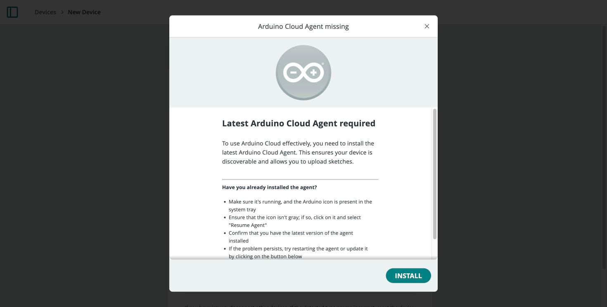
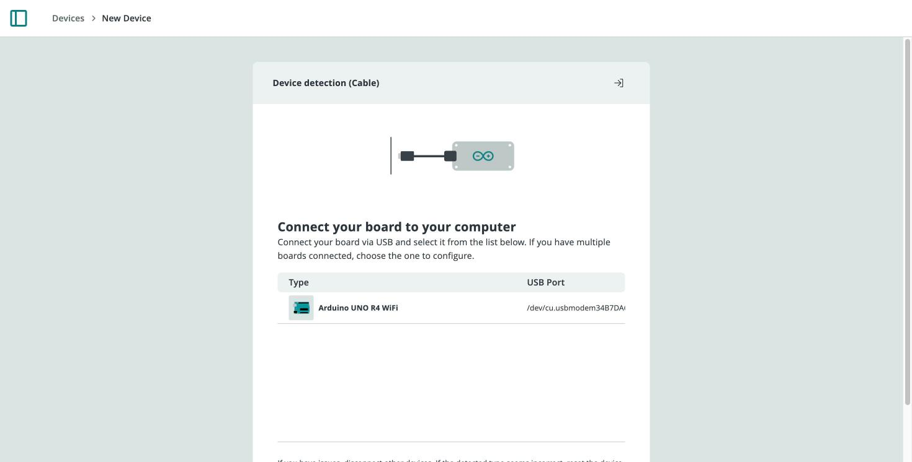

The **Cloud Agent** is a small piece of software that you download and install on your computer. It runs in the background and connects your web browser to the boards plugged into your computer's USB ports. Web browsers can't access USB or serial ports directly, so without the Cloud Agent, Arduino® Cloud can't detect, set up, or upload sketches to a board over USB.

You install the Cloud Agent once per computer. It is available for Windows, macOS and Linux®.

## When You Need It

- Uploading a sketch to a board over USB from the [Cloud Editor](/arduino-cloud/sketches-editor/cloud-editor-overview) — a reminder banner appears if the agent isn't detected.
- Provisioning a device over USB or serial from the [Setup Device wizard](/arduino-cloud/devices/devices-overview#adding-a-device).

You do **not** need it for:

- OTA uploads, once a board has done one initial USB upload.
- Manual/generic devices (Python®, MicroPython, Node.js), which never use the browser's serial bridge.
- Bluetooth®-only provisioning.

## Installing

You're prompted to install the agent automatically the first time you need it.

Once installed and running, a connected board appears in the board-selection menu of the Cloud Editor and the provisioning wizard.

For manual, per-OS install instructions, see the [Help Center article](https://support.arduino.cc/hc/en-us/articles/360014869820-Install-the-Arduino-Cloud-Agent).

## Troubleshooting

- **Board not detected** — confirm the agent is installed and running, then reconnect the USB cable. Try a different cable or port; some cables are power-only.
- **Connection-refused errors in the browser console**: the browser looks for the agent on local ports `127.0.0.1:8991` to `9000`. If you don't need the agent for what you're doing, for example a manual device or Bluetooth-only provisioning, you can ignore these errors. If you do need it, start the agent.
- **Agent installed but still not found**: restart the browser, and make sure no firewall or security software is blocking the local ports above.
- **"Failed to open serial port"**: close the Serial Monitor in Arduino IDE or any other application using the board, then restart the agent.

For more help, see [Install the Arduino Cloud Agent](https://support.arduino.cc/hc/en-us/articles/360014869820-Install-the-Arduino-Cloud-Agent) in the Help Center and [Troubleshoot Device Connections](/arduino-cloud/devices/troubleshoot-device-connections).

## Source Code

The source code for the Cloud Agent is in the [arduino-create-agent](https://github.com/arduino/arduino-create-agent) GitHub repository. Report issues and suggest improvements there.

## Related Articles

- [Provisioning & Network Configuration](/arduino-cloud/devices/network-configuration)
- [Troubleshoot Device Connections](/arduino-cloud/devices/troubleshoot-device-connections)
- [Cloud Editor Overview](/arduino-cloud/sketches-editor/cloud-editor-overview)
