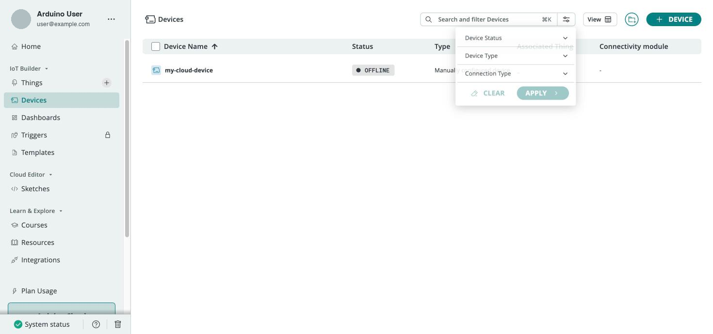

Once you move past a handful of boards, managing devices one at a time through the wizard becomes slow. Arduino Cloud provides **tags** for organizing and filtering devices, **fleet-management** views for monitoring them, and the **CLI** for scripting bulk provisioning — features geared toward professional and [business](/arduino-cloud/business) deployments.

## Tags and Filtering

Tags are key/value labels you attach to devices (and Things) to group and filter them:

- **Key** — the filter name, e.g. `location` or `purpose`.
- **Value** — the value for that device, e.g. `rome` or `docs-demo`.

You can add any number of tags, then filter the Devices and Things lists by them. Tagging every device created for a given purpose makes later bulk cleanup straightforward.



## Fleet Management

Fleet-management views let you filter devices and Things by status, search across boards, and sort them. The device page shows each board's status (connected / not connected), ID, type, FQBN, firmware version, associated Thing, and latest activity — so you can spot an offline device across a large deployment quickly.

## Bulk Provisioning From the CLI

The [CLI](/arduino-cloud/apis-cli/cli-devices) is the right tool when provisioning many devices at once or automating device management. Tags make scripted create/clean-up flows repeatable:

```bash
# Provision a board
arduino-cloud-cli device create --name <deviceName> --port <port> --fqbn <deviceFqbn>

# Tag it
arduino-cloud-cli device create-tags --id <deviceID> --tags purpose=fleet-a,location=rome

# List only devices matching all given tags
arduino-cloud-cli device list --tags purpose=fleet-a

# Bulk-delete every device matching the tags
arduino-cloud-cli device delete --tags purpose=fleet-a
```

See [Managing Devices from the CLI](/arduino-cloud/apis-cli/cli-devices) for the full command reference.

## Next Steps

- [Managing Devices from the CLI](/arduino-cloud/apis-cli/cli-devices)
- [Arduino Cloud for Business](/arduino-cloud/business)
- [Device Status & Lifecycle](/arduino-cloud/devices/device-status-lifecycle)
