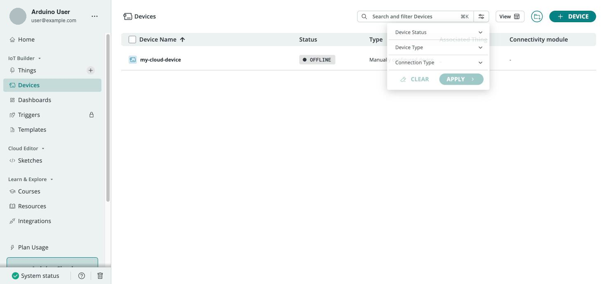

Once you move past a handful of boards, managing devices one at a time through the wizard becomes slow. Arduino Cloud provides **tags** for organizing and filtering resources, **search and filters** for monitoring them, and the **CLI** and **API** for scripting bulk provisioning and updates. These features are geared toward professional deployments in [shared spaces](/arduino-cloud/spaces-plans-account/spaces).

## Tags and Filtering

Tags are key/value labels that you attach to resources to group and filter them:

- **Key**: the filter name, which appears among the available filtering options. For example, `location` or `purpose`.
- **Value**: the value of the tag for that resource. For example, `rome` or `docs-demo`.

Where you can add tags depends on the resource:

- **Things**: in the web interface, open the Thing, open its **Metadata** panel, and under **Tags** select **Create new**. Enter a key and a value. You can add as many tags as you need to each Thing, then filter the Things list by them. See [Things](/arduino-cloud/things-data/things#metadata-and-tags).
- **Devices**: device tags are added and removed with [arduino-cloud-cli](/arduino-cloud/apis-cli/cli-devices#tags) or the [Devices API](https://docs.arduino.cc/cloud-api/devices-api). Use them to select devices for scripted operations, such as listing, deleting or updating many devices at once.

Tagging every resource created for a given purpose makes later bulk operations and cleanup straightforward. To keep a filtered view one click away, save your filters as a [Smart Folder](/arduino-cloud/things-data/smart-folders), which updates automatically as resources are added or change.



## Search and Filters

The **Devices** and **Things** lists let you search across boards, filter by status and other properties, and sort the results. The device page shows each board's status, ID, type, FQBN, firmware version, associated Thing and latest activity, so you can spot an offline device in a large deployment quickly.

## Bulk Provisioning From the CLI

The [CLI](/arduino-cloud/apis-cli/cli-devices) is the right tool when provisioning many devices at once or automating device management. Tags make scripted create/clean-up flows repeatable:

```bash
# Provision a board
arduino-cloud-cli device create --name <deviceName> --port <port> --fqbn <deviceFqbn>

# Tag it
arduino-cloud-cli device create-tags --id <deviceID> --tags purpose=fleet-a,location=rome

# List only devices matching all given tags
arduino-cloud-cli device list --tags purpose=fleet-a

# Bulk-delete every device matching the tags
arduino-cloud-cli device delete --tags purpose=fleet-a
```

See [Managing Devices from the CLI](/arduino-cloud/apis-cli/cli-devices) for the full command reference.

## Update Many Devices Over the Air

To send the same firmware to many devices at once, use a mass OTA upload with arduino-cloud-cli. You can select the target devices by ID or by tag. See [OTA & Mass Upload](/arduino-cloud/apis-cli/cli-ota-mass-upload) and [Upload Over the Air](/arduino-cloud/sketches-editor/upload-over-the-air).

## Next Steps

- [Managing Devices from the CLI](/arduino-cloud/apis-cli/cli-devices)
- [Spaces](/arduino-cloud/spaces-plans-account/spaces)
- [Device Status & Lifecycle](/arduino-cloud/devices/device-status-lifecycle)
