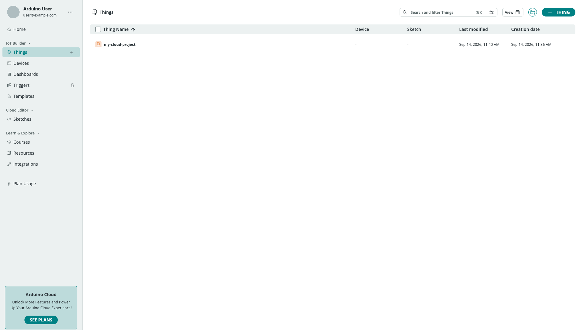
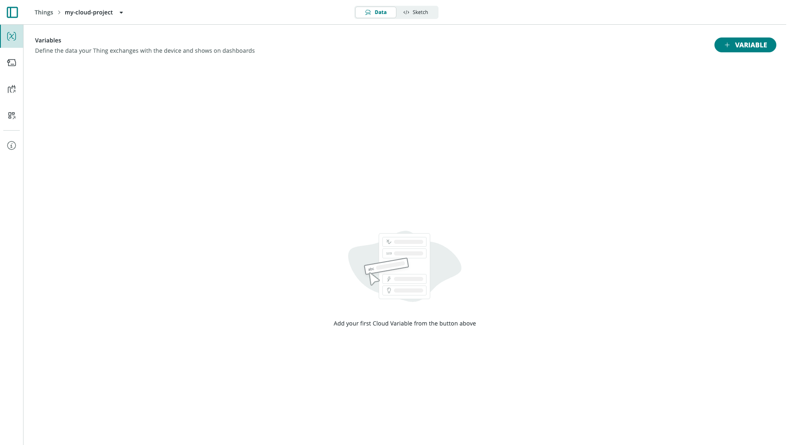
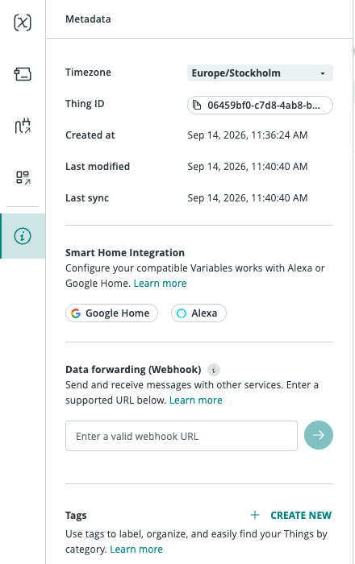

A **Thing** is the virtual twin of a connected object in Arduino Cloud. It holds the [Cloud Variables](/arduino-cloud/things-data/cloud-variables) your project exchanges with the cloud, links to the physical (or virtual) [device](/arduino-cloud/devices/devices-overview) that runs the code, and — for Arduino/C++ projects — the sketch that gets generated for you.

You create and manage every Thing from **Things** in the left navigation (`/things`).

## Creating a Thing

Go to **Things** and select **+ Thing** (or open `/things/new` directly). A new Thing is created immediately named "Untitled" and you land on its **Data** tab. Rename it from the breadcrumb's dropdown menu, which also offers **Duplicate** and **Delete**.

## The Thing Workspace

A Thing has two tabs at the top plus a few icon-only panels on the left rail:

| Area | How to reach it | What it's for |
|---|---|---|
| **Data** | Top tab (default) | The Cloud Variables table — see [Cloud Variables](/arduino-cloud/things-data/cloud-variables) |
| **Sketch** | Top tab | The generated code — see [Sketchbook & Sketches](/arduino-cloud/sketches-editor/sketchbook-and-sketches) |
| **Device** | Left rail icon | Associate a physical or virtual device with this Thing |
| **Metadata** | Left rail "info" icon | Timezone, Thing ID, timestamps, Smart Home integration, webhook, tags |

Network configuration is no longer a Thing tab — it lives entirely on the [Devices](/arduino-cloud/devices/network-configuration) page.

## Associating a Device

Open the **Device** panel from the left rail. A new Thing starts with **No Device Associated**:

From here you can:

- **New Device** — set up a new device over cable or Bluetooth®, using the same wizard as the [Devices](/arduino-cloud/devices/devices-overview) page.
- **Choose from your list** — link an already-provisioned device.

A Thing can only be linked to one device at a time. Associating an Arduino/C++ device generates credentials and a starter sketch automatically; see [Devices Overview](/arduino-cloud/devices/devices-overview) for the full provisioning flow per connectivity type.

## Metadata

Open the **info** icon on the left rail to reach the Metadata panel:

- **Timezone** — used by time-based features such as the Scheduler widget.
- **Thing ID** — a UUID used to reference this Thing from the [REST API](/arduino-cloud/apis-cli/rest-api-sdks) or the CLI.
- **Created at / Last modified / Last sync** — timestamps for the Thing record and its last successful sync with a device.
- **Smart Home Integration** — toggle Google Home and/or Alexa support for compatible variable types.
- **Data forwarding (Webhook)** — forward variable updates to an external URL.
- **Tags** — key/value labels (e.g. `location=London`) used to organize and filter Things. Combine tags with [Smart Folders](/arduino-cloud/things-data/smart-folders) to group tagged Things automatically.

## Next Steps

- [Cloud Variables](/arduino-cloud/things-data/cloud-variables)
- [Sync Variables](/arduino-cloud/things-data/sync-variables)
- [Sketchbook & Sketches](/arduino-cloud/sketches-editor/sketchbook-and-sketches)
