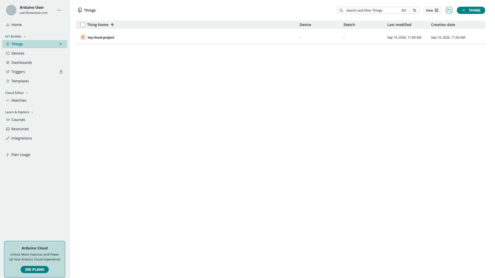
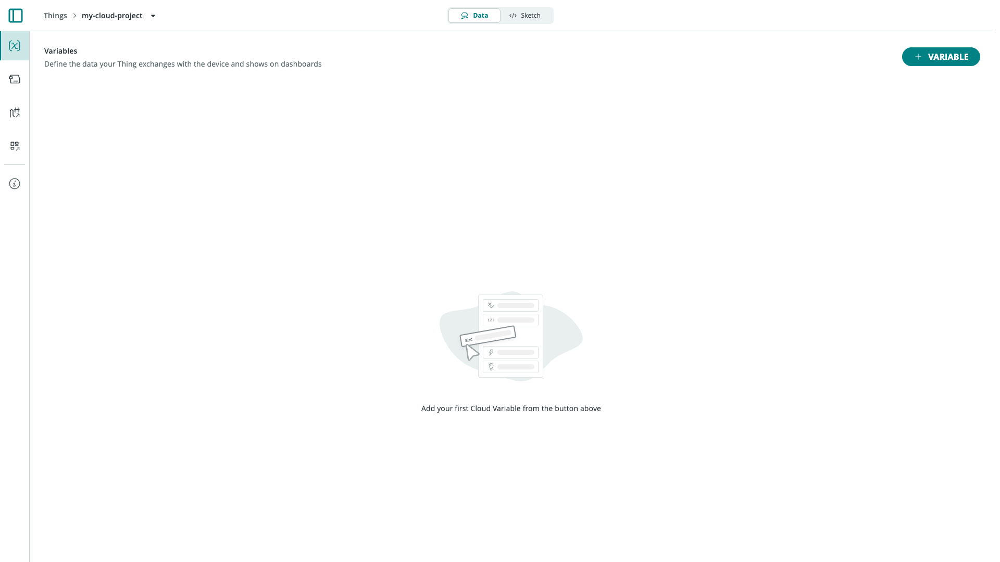
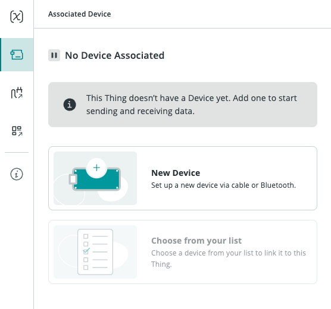
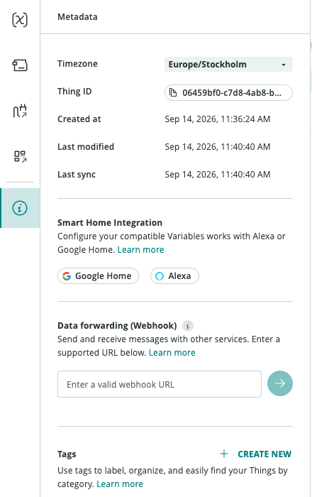

A **Thing** is the virtual twin of a connected object in Arduino Cloud. It holds the [Cloud Variables](/arduino-cloud/things-data/cloud-variables) your project exchanges with the cloud, links to the physical (or virtual) [device](/arduino-cloud/devices/devices-overview) that runs the code, and — for Arduino/C++ projects — the sketch that gets generated for you.

You create and manage every Thing from **Things** in the left navigation.

In a Thing, you can:

- create Cloud Variables that sync between the device and Arduino Cloud, and with other Things,
- associate the device that runs your code,
- edit and upload the sketch to your board,
- set a webhook that fires whenever data changes,
- set the timezone and tags.

## Creating a Thing

Go to **Things** and select **+ Thing**. A new Thing is created immediately named "Untitled" and you land on its **Data** tab. Rename it from the breadcrumb's dropdown menu, which also offers **Duplicate** and **Delete**.



## The Thing Workspace

A Thing has two tabs at the top plus a few icon-only panels on the left rail:

| Area | How to reach it | What it's for |
|---|---|---|
| **Data** | Top tab (default) | The Cloud Variables table — see [Cloud Variables](/arduino-cloud/things-data/cloud-variables) |
| **Sketch** | Top tab | The generated code — see [Sketchbook & Sketches](/arduino-cloud/sketches-editor/sketchbook-and-sketches) |
| **Device** | Left rail icon | Associate a physical or virtual device with this Thing |
| **Metadata** | Left rail "info" icon | Timezone, Thing ID, timestamps, Smart Home integration, webhook, tags |

Network configuration is not a Thing tab: it is in the **Network** section of the device page. See [Provisioning & Network Configuration](/arduino-cloud/devices/network-configuration).



## Associating a Device

Open the **Device** panel from the left rail. A new Thing starts with **No Device Associated**:



From here you can:

- **New Device**: set up a new device over cable or Bluetooth®, using the same wizard as the [Devices](/arduino-cloud/devices/devices-overview) page.
- **Choose from your list**: link an already-provisioned device.

A Thing can only be linked to one device at a time. Once associated, the device and the Thing stay linked until you detach the device from the Thing's **Device** panel. Detaching the device does not delete the device or the Thing. The panel also shows the device's status (online or offline).

You can associate these types of devices:

- [Arduino Wi-Fi® boards](/arduino-cloud/devices/add-wifi-board), [Ethernet boards](/arduino-cloud/devices/add-ethernet-board) and [Cellular boards](/arduino-cloud/devices/add-cellular-board).
- [Arduino LoRaWAN® devices](/arduino-cloud/devices/add-lorawan-device).
- [Third-party ESP32/ESP8266 boards](/arduino-cloud/devices/add-esp32-esp8266).
- [Manual devices](/arduino-cloud/devices/add-manual-device) running Python, MicroPython or JavaScript. These devices have no generated sketch.

See [Devices Overview](/arduino-cloud/devices/devices-overview) for the full provisioning flow per connectivity type.

## Automatic Sketch Generation

Things that use Arduino / C++ (the default) benefit from **automatic sketch generation**. Whenever you change the Thing's configuration, the change is reflected in the sketch files:

- **Associating a device** sets the connection method in `thingProperties.h`, for example Wi-Fi®, Ethernet, Cellular or LoRaWAN®.
- **Creating a variable** adds it to `thingProperties.h`, with its type, permission and update policy. You don't need to declare it again in your sketch.
- **Creating a variable with Read & Write permission** also adds a callback function, for example `onTemperatureChange()`, at the bottom of the main sketch. It runs every time the value changes from Arduino Cloud.
- **Changing the network credentials** updates the sketch's **Secret** tab (`arduino_secrets.h`), if the board uses [Provisioning 1.0](/arduino-cloud/devices/network-configuration#provisioning-10-vs-20). On Provisioning 2.0 boards, the credentials are stored on the board instead.

This means the connection and synchronization between the board and Arduino Cloud are handled for you, and you don't need to write any networking code. For example, to send a temperature reading to Arduino Cloud, you only assign the variable:

```arduino
temperature = sensor.readTemperature();
```

For a description of each generated file, see [Generated Sketch Files](/arduino-cloud/reference/generated-sketch-files).

<Alert type="note">

Automatic sketch generation only applies to the Cloud Editor. If you work offline in [Arduino IDE](/software/ide-v2), Thing changes are not applied to your local files, and you need to update them manually. You can use [sketch synchronization](/software/ide-v2/tutorials/ide-v2-cloud-sketch-sync) to push and pull your Cloud sketches from Arduino IDE. Things associated with a manual device have no sketch.

</Alert>

## Metadata and Tags

Open the **info** icon on the left rail to reach the Metadata panel:



- **Timezone**: used by time-based features such as the Scheduler widget. Select it from the dropdown menu.
- **Thing ID**: a UUID, for example `cd628fe4-31d1-42a8-bf33-a627997ce602`, used to reference this Thing from the [REST API](/arduino-cloud/apis-cli/rest-api-sdks) or the [CLI](/arduino-cloud/apis-cli/cli-things).
- **Created at / Last modified / Last sync**: timestamps for the Thing record and its last successful sync with a device.
- **Smart Home Integration**: toggle Google Home and/or Alexa support for compatible variable types.
- **Data forwarding (Webhook)**: forward variable updates to an external URL.
- **Tags**: key/value labels used to organize and filter Things, which is useful when you have many devices in different locations. Under **Tags**, select **Create new** and enter a **Key**, for example `location`, and a **Value**, for example `London`. You can add as many tags as you need, then filter the Things list by them. Combine tags with [Smart Folders](/arduino-cloud/things-data/smart-folders) to group tagged Things automatically.

## Next Steps

- [Cloud Variables](/arduino-cloud/things-data/cloud-variables)
- [Sync Variables Between Things](/arduino-cloud/things-data/sync-variables)
- [Sketchbook & Sketches](/arduino-cloud/sketches-editor/sketchbook-and-sketches)
