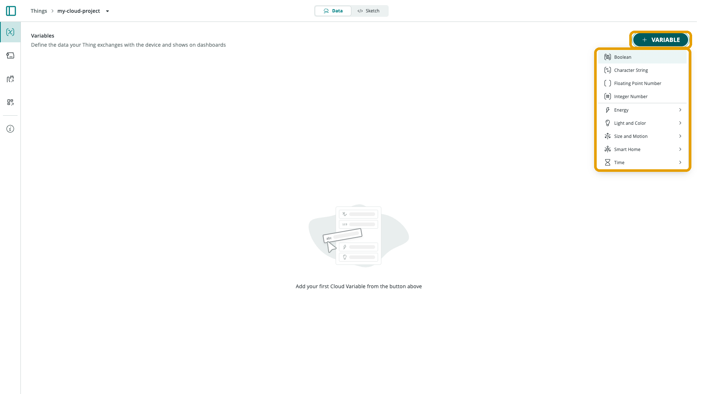
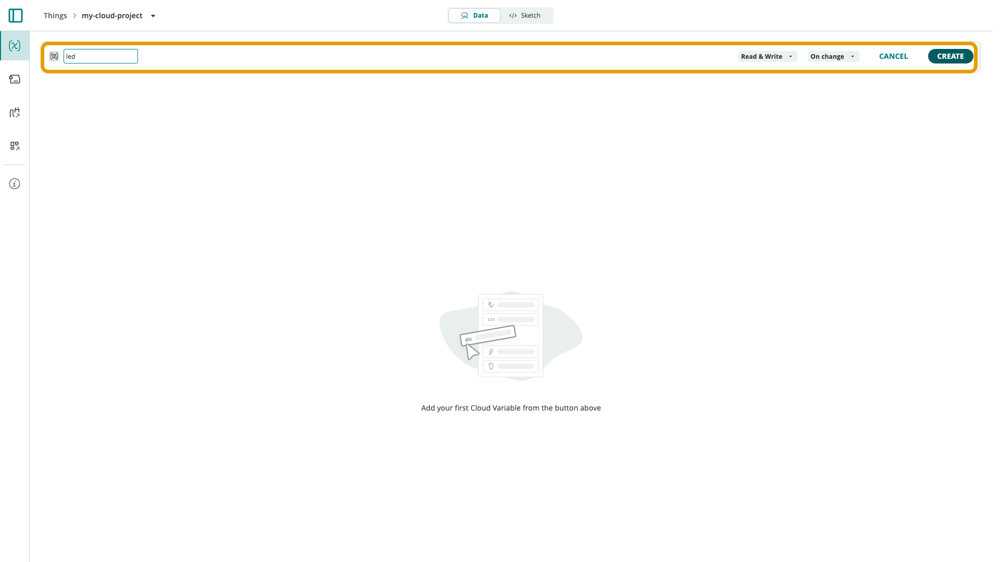
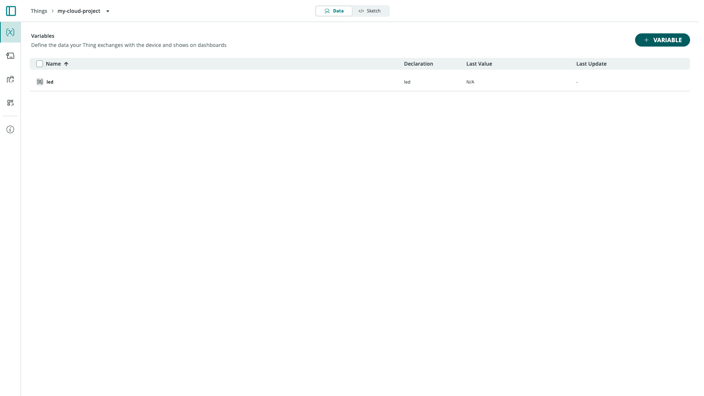

**Cloud Variables** are the data points a [Thing](/arduino-cloud/things-data/things) exchanges between a device and Arduino Cloud. Each variable keeps a synced value on both sides: the device updates it (a sensor reading, a status flag) and/or the cloud updates it (a dashboard control), depending on how it's configured.

Manage a Thing's variables from its **Data** tab.

## Creating a Variable

Select **+ Variable** and pick a type from the picker:



Variables come in **basic types** (Boolean, Character String, Floating Point Number, Integer Number) and **specialized types** grouped by category (Energy, Light and Color, Size and Motion, Smart Home, Time) that carry structured data instead of a single primitive. For the full list, see [Cloud Variable Types](/arduino-cloud/reference/cloud-variable-types).

After picking a type, name the variable and set its **Permission** and **Update Policy** before creating it. The name can't contain spaces or special characters, except underscores. It is also the declaration name you use in your sketch.



### Permission

| Permission | Behavior |
|---|---|
| **Read & Write** | The variable can be updated from both the board and Arduino Cloud. A dashboard can change the value and the device reacts to it, and vice versa. |
| **Read Only** | The variable can only be updated from the board. Dashboards can display it but can't change it. |

### Update Policy

| Policy | Behavior |
|---|---|
| **On change** | The device publishes a new value only when it changes by more than a threshold (default `0`, i.e. any change). |
| **Periodically** | The device publishes every `x` seconds regardless of change. |

A variable's sync between a device and the cloud is limited to two messages per second (500 ms).

Once created, the variable appears in the Data tab with its declaration name, last known value, and last update time:



## Using Variables in a Sketch

For Arduino/C++ Things, every variable is automatically declared in the generated `thingProperties.h`, so you can use it in your sketch without declaring it. For example, an integer variable called `test_value` can be set directly:

```arduino
test_value = 1;
```

Each **Read & Write** variable also gets a callback function at the bottom of the sketch. For example, a boolean variable named `button_switch` generates `onButtonSwitchChange()`, which runs every time the value is changed from Arduino Cloud, for example from a dashboard:

```arduino
void onButtonSwitchChange() {
  if (button_switch) {
    digitalWrite(LED_BUILTIN, HIGH);
  } else {
    digitalWrite(LED_BUILTIN, LOW);
  }
}
```

See [Arduino C++ Library](/arduino-cloud/device-libraries/arduino-cpp) for more on callbacks. For examples using basic, Colored Light, and Television variables, see [Cloud Variable Types](/arduino-cloud/reference/cloud-variable-types#examples).

<Alert type="note">

For Things linked to a [manual device](/arduino-cloud/devices/add-manual-device) (Python, MicroPython, JavaScript), there is no generated sketch — you read and write variables directly through the client library instead.

</Alert>

## Cloud Updates

Data between a board and Arduino Cloud is synchronized every time `ArduinoCloud.update()` runs. The generated sketch calls it in `loop()`.

Avoid `delay()` in a Cloud sketch: it blocks `loop()`, so `ArduinoCloud.update()` can't run and the board stops synchronizing. Use [millis()](https://www.arduino.cc/reference/en/language/functions/time/millis/) to run code at an interval without blocking:

```arduino
unsigned long previousMillis = 0;
const long interval = 1000; // milliseconds

void loop() {
  ArduinoCloud.update();

  unsigned long currentMillis = millis();
  if (currentMillis - previousMillis >= interval) {
    previousMillis = currentMillis;
    // code here runs every second without blocking the Cloud update
  }
}
```

A variable's sync between a board and Arduino Cloud is limited to two messages per second (500 ms).

## The Variable Lifecycle

A variable exists for the life of the Thing. You can edit its name, permission, and update policy at any time, or delete it from its row.

On the board, Cloud Variables are only synchronized with Arduino Cloud while the connection is in the **Synchronized** state. In any other state, changes to the variable are local, and they are overwritten by the Arduino Cloud value as soon as the board is synchronized.

| State | Behavior |
|---|---|
| **Disconnected** | The variable has its local value. Any change is overwritten once synchronized. |
| **Connecting** | The variable has its local value. Any change is overwritten once synchronized. |
| **Connected** | The variable has its local value. Any change is overwritten once synchronized. |
| **Synchronized** | The variable is synced with Arduino Cloud. A local change is sent to Arduino Cloud. A change made in Arduino Cloud, from a dashboard or a synced variable, updates the local value (Read & Write variables only). |

To run code when the connection state changes, use the connection events described in [Arduino C++ Library](/arduino-cloud/device-libraries/arduino-cpp#connection-events--callbacks).

## Syncing a Variable Across Devices

Variables of the same type can be linked so multiple devices or Things share one live value. That's a topic of its own — see [Sync Variables Between Things](/arduino-cloud/things-data/sync-variables).

## Next Steps

- [Cloud Variable Types](/arduino-cloud/reference/cloud-variable-types)
- [Sync Variables Between Things](/arduino-cloud/things-data/sync-variables)
- [Historical Data & Export](/arduino-cloud/things-data/historical-data-export)
