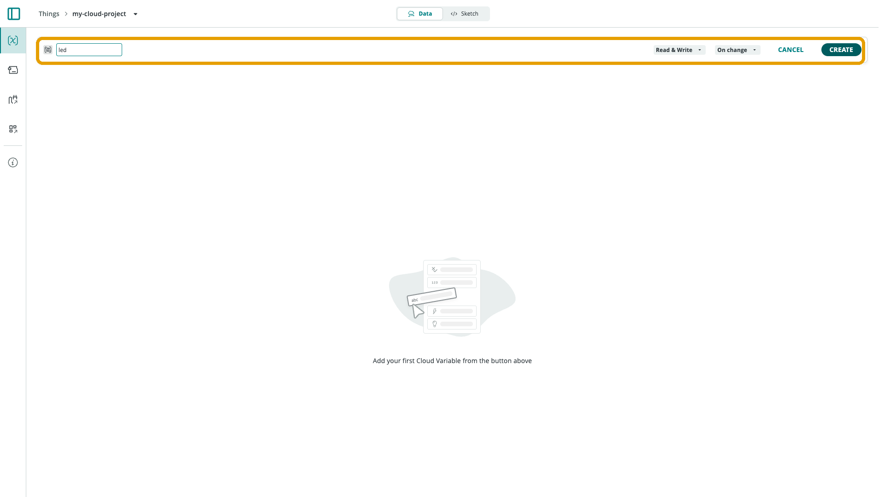
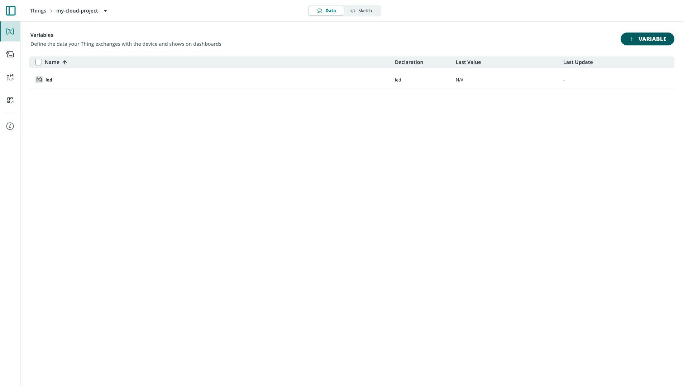

**Cloud Variables** are the data points a [Thing](/arduino-cloud/things-data/things)
exchanges between a device and Arduino Cloud. Each variable keeps a synced
value on both sides: the device updates it (a sensor reading, a status flag)
and/or the cloud updates it (a dashboard control), depending on how it's
configured.

Manage a Thing's variables from its **Data** tab.

## Creating a Variable

Select **+ Variable** and pick a type from the picker:

Variables come in **basic types** (Boolean, Character String, Floating Point
Number, Integer Number) and **specialized types** grouped by category (Energy,
Light and Color, Size and Motion, Smart Home, Time) that carry structured data
instead of a single primitive. For the full list, see
[Cloud Variable Types](/arduino-cloud/reference/cloud-variable-types).

After picking a type, name the variable and set its **Permission** and
**Update Policy** before creating it:

### Permission

| Permission | Behavior |
|---|---|
| **Read & Write** | The dashboard can change the value and the device reacts to it, and vice versa. |
| **Read Only** | The device only sends data up; dashboards can't write to it. |
| **Write Only** | The cloud can set the value but never reads it back (fire-and-forget triggers). |

### Update Policy

| Policy | Behavior |
|---|---|
| **On change** | The device publishes a new value only when it changes by more than a threshold (default `0`, i.e. any change). |
| **Periodically** | The device publishes every `x` seconds regardless of change. |

A variable's sync between a device and the cloud is limited to two messages
per second (500 ms).

Once created, the variable appears in the Data tab with its declaration name,
last known value, and last update time:

## The Variable Lifecycle

A variable exists for the life of the Thing. You can edit its name,
permission, and update policy at any time, or delete it from its row. For
Arduino/C++ Things, every variable is automatically declared in the generated
`thingProperties.h` and kept in sync by `ArduinoCloud.update()` — you write no
networking code. Each read/write variable also gets an `on...Change()`
callback that fires when the cloud-side value changes; see
[Arduino C++ Library](/arduino-cloud/device-libraries/arduino-cpp) for how
those callbacks work.

<Alert type="note">

For Things linked to a [manual device](/arduino-cloud/devices/add-manual-device)
(Python, MicroPython, JavaScript), there is no generated sketch — you read and
write variables directly through the client library instead.

</Alert>

## Syncing a Variable Across Devices

Variables of the same type can be linked so multiple devices or Things share
one live value. That's a topic of its own — see
[Sync Variables](/arduino-cloud/things-data/sync-variables).

## Next Steps

- [Cloud Variable Types](/arduino-cloud/reference/cloud-variable-types)
- [Sync Variables](/arduino-cloud/things-data/sync-variables)
- [Historical Data & Export](/arduino-cloud/things-data/historical-data-export)
