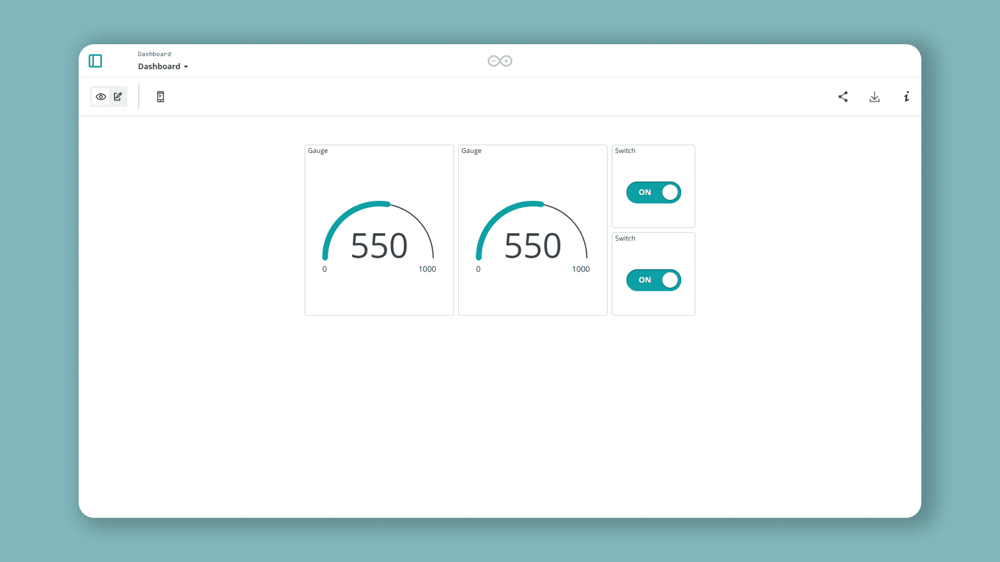

Arduino Cloud can keep a [Cloud Variable](/arduino-cloud/things-data/cloud-variables) **synchronized across multiple devices or Things**. Update the value on one side — from a device or a dashboard — and every variable linked to it updates automatically, everywhere. This turns Arduino Cloud itself into the communication layer between boards: no direct radio link, no custom protocol.

A typical use: one board's button press turns on an LED on a second, physically separate board. Both boards run the same kind of sketch; the sync does the cross-talk.

## Linking Variables Between Things

Each board links to its own [Thing](/arduino-cloud/things-data/things), so a two-board setup needs two Things (and two devices). On the second Thing, when adding a variable of the same type as one that already exists on the first Thing, choose **Sync with other Things** instead of creating an unrelated variable:


Repeat for every variable that needs to cross over. In a two-way remote-control setup each Thing ends up with two variables: one it owns and updates locally, and one that mirrors the other Thing's variable.

Synchronization works between any variables of a **compatible type** — not just Booleans. An integer or float reading on one Thing can mirror onto another just as easily.

## Reacting to a Synced Variable in a Sketch

Once linked, a synced variable behaves exactly like any other Cloud Variable in the generated sketch — the sync itself needs no glue code. Each board writes to its **own** variable, and reacts to the **other** Thing's mirrored variable via the auto-generated `on...Change()` callback.

```arduino
void loop() {
  ArduinoCloud.update();

  if (digitalRead(buttonPin) == LOW) {
    switch_1 = !switch_1;  // this board's own variable
    delay(500);
  }
}

// Called when the synced variable from the OTHER board changes
void onSwitch2Change() {
  digitalWrite(ledPin, switch_2 ? HIGH : LOW);
}
```

The second board runs the mirror image: its button writes `switch_2`, and `onSwitch1Change()` drives its LED.

## Visualizing Synced Values on a Dashboard

Because each linked variable exists independently on its own Thing, a single dashboard can add one widget per Thing and link each to its own copy — a Gauge per Thing for a synced reading, or a Switch per Thing for a shared Boolean. Both widgets track the same underlying value with a short propagation delay.



<Alert type="info">

If the two sides don't react to each other, check that both devices are online (watch the Serial Monitor), the correct sketch went to the correct board, and the variables are genuinely linked — a variable created independently on each Thing will **not** stay in sync.

</Alert>

## Next Steps

- [Cloud Variables](/arduino-cloud/things-data/cloud-variables)
- [Dashboards](/arduino-cloud/dashboards/dashboards)
- [Things](/arduino-cloud/things-data/things)
