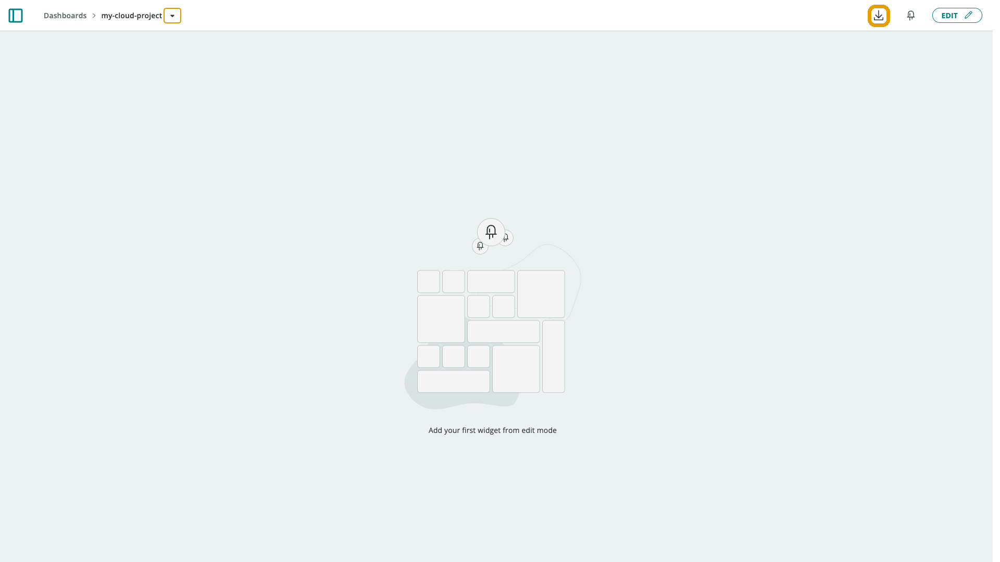
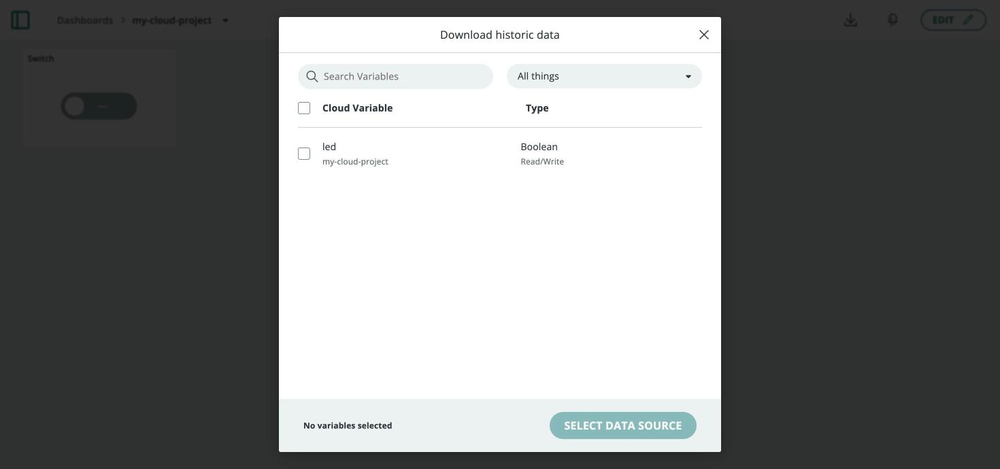

Every [Cloud Variable](/arduino-cloud/things-data/cloud-variables) update is stored as a timeseries point. This is what the Chart widget displays, what you can download as CSV, and what you can query directly through the API for custom analysis or long-term storage. You don't need an active board to download historical data, but you need a connected device to collect it in the first place.

## Data Retention

How long historical data is kept depends on your plan. See the [Arduino Cloud plans page](https://cloud.arduino.cc/plans) for the retention period of each plan, [Plans, Limits & Quotas](/arduino-cloud/spaces-plans-account/plans-limits-quotas) for how plan limits work, and [Plan Usage](https://app.arduino.cc/plan-usage) for your current plan.

### Choosing the Right History for Your Project

How much history you need depends on the project:

- **Real-time control**, such as home automation that turns on the lights when it's dark, works with current data. A short history is enough, because you don't act on yesterday's light levels.
- **Trend monitoring**, such as a weather station measuring temperature, rainfall or daylight hours, benefits from several days or weeks of data to compare recent changes.
- **Long-term analysis**, such as a greenhouse, an aquarium, or an industrial project monitoring equipment for predictive maintenance, may require weeks or months of data.

You can also tune how often data is sent with the variable's [update policy](/arduino-cloud/things-data/cloud-variables#update-policy). For example, a battery-powered sensor at the end of the garden that sends its Wi-Fi® signal strength once a minute instead of every second uses much less power, and the history is just as useful for spotting when and why the signal drops.

## Exporting to CSV

You can download the history of a dashboard's variables:

1. Open a dashboard and select the **Download** icon in the upper-right corner.

   

2. Select the variables you want to download by checking their boxes. If the dashboard uses several Things, switch between them from the dropdown at the top. Choose the time frame to export.

   

3. Select **Select Data Source**.
4. In the next window, select **Get Data**.
5. A download link is sent to the email address of your account. Open the email and download the data, which is exported in CSV format.

<Alert type="info">

In shared spaces, whether a member can download historical data depends on the permissions of their role. See [Members, Roles & Permissions](/arduino-cloud/spaces-plans-account/members-roles).

</Alert>

<Alert type="note">

Deleting a dashboard or a widget doesn't affect how your Thing and device work, but it removes the historical data shown by that widget.

</Alert>

## Exporting to Amazon S3

For continuous, long-term retention outside Arduino Cloud, the [AWS S3 Exporter](/arduino-cloud/integrations/aws-s3) streams your variable history into your own S3 bucket on a schedule — useful when you need data beyond the in-platform retention window or want it in your own data lake.

## Querying History Through the API

Every recorded point is queryable through the Series API, which backs the Chart widget. It supports raw queries (every point in a range), sampled queries (downsampled for long ranges), batch queries (multiple variables at once), and last-value queries. Call it from the Go, Python, or JavaScript client libraries — see [REST API & SDKs](/arduino-cloud/apis-cli/rest-api-sdks).

## Next Steps

- [AWS S3 Exporter](/arduino-cloud/integrations/aws-s3)
- [REST API & SDKs](/arduino-cloud/apis-cli/rest-api-sdks)
- [Cloud Variables](/arduino-cloud/things-data/cloud-variables)
