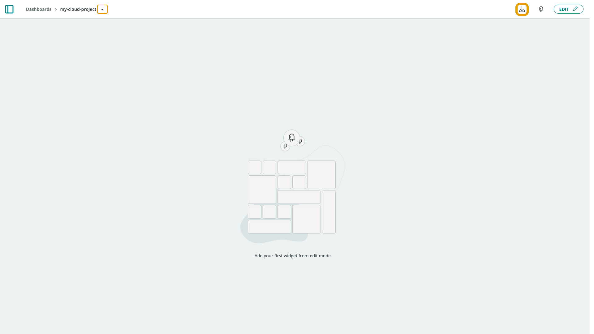
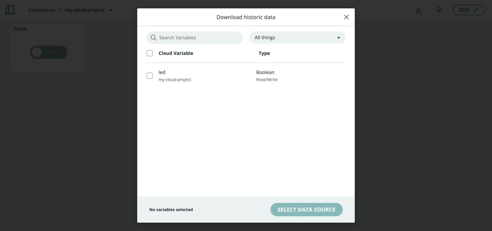

Every [Cloud Variable](/arduino-cloud/things-data/cloud-variables) update is stored as a timeseries point. This is what the Chart widget displays, what you can download as a CSV, and what you can query directly through the API for custom analysis or long-term storage.

## Data Retention

How long historical data is kept depends on your plan. The Business plan includes **one year** of data retention by default; data stays available and downloadable from your account for that window.

<Alert type="warning">

Needs verification: the exact retention window for each free and paid tier wasn't confirmed this pass. Check your current [Plan Usage](https://app.arduino.cc/plan-usage) before quoting a specific number of days.

</Alert>

## Exporting to CSV

You can download a variable's history straight from a dashboard. Inside a dashboard, press the **Download** icon in the upper-right corner:

A dialog opens where you select the variables and the time frame to export:

Choose your data, confirm the data source, and request the export. The file is delivered in **`.csv`** format by email as a download link, ready for further analysis.

<Alert type="info">

Downloading historical data is a per-space permission. In a shared space, Admin and Editor roles can download historic data; see [Arduino Cloud for Business](/arduino-cloud/business) for the full role matrix.

</Alert>

## Exporting to Amazon S3

For continuous, long-term retention outside Arduino Cloud, the [AWS S3 Exporter](/arduino-cloud/integrations/aws-s3) streams your variable history into your own S3 bucket on a schedule — useful when you need data beyond the in-platform retention window or want it in your own data lake.

## Querying History Through the API

Every recorded point is queryable through the Series API, which backs the Chart widget. It supports raw queries (every point in a range), sampled queries (downsampled for long ranges), batch queries (multiple variables at once), and last-value queries. Call it from the Go, Python, or JavaScript client libraries — see [REST API & SDKs](/arduino-cloud/apis-cli/rest-api-sdks).

## Next Steps

- [AWS S3 Exporter](/arduino-cloud/integrations/aws-s3)
- [REST API & SDKs](/arduino-cloud/apis-cli/rest-api-sdks)
- [Cloud Variables](/arduino-cloud/things-data/cloud-variables)
