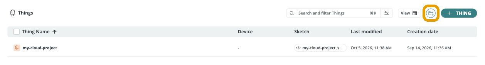
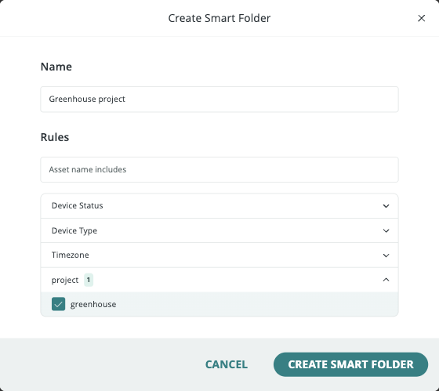
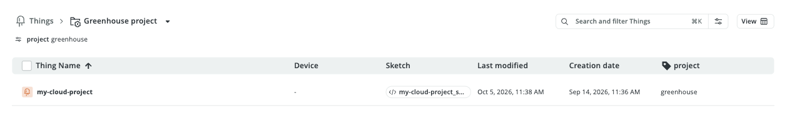
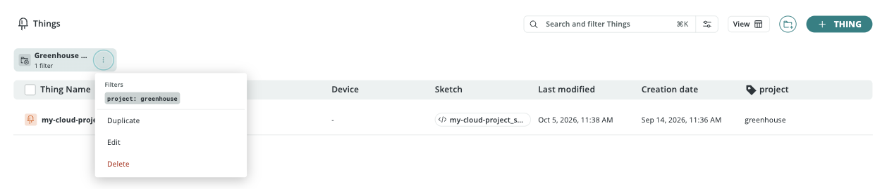

A **Smart Folder** is a saved set of search and filter rules on a list page in Arduino® Cloud, such as **Things**, **Devices**, or **Dashboards**. Instead of moving resources into a folder by hand, you describe what belongs in it, for example "all Things tagged `project: greenhouse`" or "all offline devices". Arduino Cloud fills the folder with every matching resource and keeps it up to date as your projects change:

- A **new** resource that matches the rules shows up in the folder right away.
- A resource that **stops matching**, for example because its tag or device status changed, leaves the folder on its own.
- **Deleting** a Smart Folder never deletes the resources in it. The folder is only a view of them.

Smart Folders help you keep track of a growing number of resources. Group Things by project, customer, or location, keep an eye on all offline devices, or collect the dashboards a teammate created, all without maintaining static folders by hand.

## Where Smart Folders Are Available

You create Smart Folders from the list pages under **IoT Builder** in the left navigation. Each page offers rules that fit its resources:

| Page | Available Rules |
|---|---|
| **Things** | **Asset name includes**, **Device Status**, **Device Type**, **Timezone**, and one rule per tag key used on your Things (for example **project**) |
| **Devices** | **Asset name includes**, **Device Status**, **Device Type**, **Connection Type** |
| **Dashboards** | **Asset name includes**, **Last Modified**, **Shared With**, **Created By** |
| **Triggers** | Smart Folders are also available on the **Triggers** page, which requires a paid plan |

<Alert type="note">

The rules for the **Triggers** page weren't verified for this article, because Triggers aren't available on the Free plan used for testing.

</Alert>

## Creating a Smart Folder

1. Open **Things**, **Devices**, or **Dashboards** in the left navigation.
2. Select the **Smart Folder** button (a folder with a **+**) in the top-right corner, next to **View**.

   

3. In the **Create Smart Folder** dialog, enter a **Name** for the folder, for example "Greenhouse project".
4. Add one or more **Rules**:
   - Type text in **Asset name includes** to match resources whose name contains it.
   - Expand a rule, such as **Device Status** or a tag key, and check the values to match. The number next to a rule shows how many values are selected.
5. Select **Create Smart Folder**.

Arduino Cloud opens the new folder right away, with all matching resources in it. **Create Smart Folder** stays disabled until the folder has a name and at least one rule.

## Opening and Managing a Smart Folder

Your Smart Folders are shown as cards at the top of their list page, with the folder name and the number of filters. Select a card to open the folder. Inside the folder, the breadcrumb shows its name (for example **Things > Greenhouse project**), and the active rules are listed below it.

To manage a folder, open the **⋮** menu on its card, or the dropdown next to its name in the breadcrumb. The card menu also lists the folder's **Filters**.

| Option | What It Does |
|---|---|
| **Duplicate** | Creates a copy of the folder, so you can quickly make a variation with slightly different rules |
| **Edit** | Opens the folder's rules in the **Edit Smart Folder** dialog. Change the name or rules and select **Save**. |
| **Delete** | Removes the folder after a confirmation. The resources inside it aren't deleted. |

<Alert type="info">

If a rule refers to something that no longer exists, for example a tag key that's no longer used by any Thing, the folder shows an **invalid filter** warning and may show no results. Edit the folder to update its rules.

</Alert>

## Example: Automatically Organize Things Created From a Template

Smart Folders work especially well with [tags](/arduino-cloud/things-data/things) and [custom templates](/arduino-cloud/templates/custom-templates). If every Thing you create from a template carries the same tag, a Smart Folder with a rule for that tag collects them all automatically, with no manual sorting. This is useful when you deploy the same project many times, for example one greenhouse monitor per site or one kit per classroom.

### 1. Tag the Original Thing

1. Open the Thing you want to use as a starting point.
2. Select the **info** icon at the bottom of the Thing's left rail to open the **Metadata** panel.
3. Under **Tags**, select **Create new**.
4. Enter a key and a value, for example `project` and `greenhouse`. The tag is saved when you leave the value field.

### 2. Create a Custom Template From the Tagged Thing

1. Open **Templates** in the left navigation and select **Your Templates**.
2. Select **Create template > New template**.
3. Select **Thing**, choose the tagged Thing, and select **Add to Template**. A template can contain one Thing.
4. Optionally, add the Thing's **Dashboard** and any documentation.
5. Select **Generate Template**.

See [Custom Templates](/arduino-cloud/templates/custom-templates) for more details.

<Alert type="note">

During testing, a Thing with no associated device didn't appear in the **Add a Thing** list. If your Thing is missing from the list, associate a device with it first.

</Alert>

### 3. Create a Smart Folder for the Tag

1. Open **Things** and select the **Smart Folder** button.
2. Name the folder, for example "Greenhouse project".
3. Expand the rule for your tag key (**project**), and check the value (**greenhouse**).
4. Select **Create Smart Folder**. The original Thing is listed in the folder.

### 4. Apply the Template

1. Open **Templates > Your Templates** and select the template you created.
2. Apply it to a new device, as described in [Use Templates](/arduino-cloud/templates/use-templates).

Arduino Cloud creates a new Thing from the template, including its tags.

<Alert type="note">

On the Free plan, you can have two Things at a time. Applying the template creates a new Thing, so make sure you have room for it, or upgrade your plan.

</Alert>

### 5. Check That the New Thing Is in the Smart Folder

Open the **Greenhouse project** Smart Folder on the **Things** page. The Thing you created from the template is listed next to the original, without any manual sorting. Every Thing you create from that template from now on ends up in the same folder.

<Alert type="warning">

Needs verification: steps 2, 4, and 5 of this example weren't run end to end for this article. Confirm that a Thing created from a custom template keeps the original Thing's tags and appears in the Smart Folder.

</Alert>

## Smart Folder Ideas

| Page | Folder | Rules |
|---|---|---|
| **Things** | One folder per project or customer | A tag such as `project` or `customer` |
| **Things** | Things in a specific region | **Timezone** |
| **Devices** | Devices that need attention | **Device Status**: **Offline** |
| **Devices** | All cellular devices | **Connection Type** |
| **Dashboards** | Dashboards shared with your team | **Shared With** |
| **Dashboards** | Dashboards created by a specific person | **Created By** |

## Next Steps

- [Things](/arduino-cloud/things-data/things)
- [Custom Templates](/arduino-cloud/templates/custom-templates)
- [Manage Devices at Scale](/arduino-cloud/devices/manage-devices-at-scale)
- [Working With Dashboards](/arduino-cloud/dashboards/dashboards)
