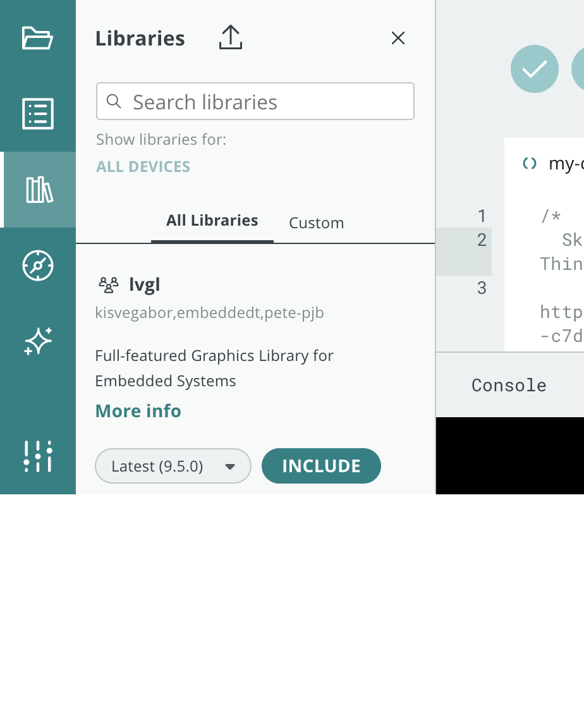

The **Cloud Editor** is the browser-based code editor embedded in a Thing's
[Sketch tab](/arduino-cloud/sketches-editor/sketchbook-and-sketches), and also
reachable standalone from **Sketches** (`/sketches`) in the left navigation. It
compiles and uploads sketches to your board without any local installation —
you only need the [Cloud Agent](/arduino-cloud/devices/cloud-agent) for USB
uploads.

## The Editor Panels

The editor has a left-hand icon rail covering the whole coding workflow:

| Panel | What it's for |
|---|---|
| **Files** | Lists the sketch's files (`.ino`, `ReadMe.adoc`, `thingProperties.h`) and lets you add new ones. |
| **Examples** | Built-in Arduino examples plus examples bundled with any library you include. |
| **Libraries** | Search and include libraries directly into the sketch. |
| **Reference** | In-editor Arduino language reference. |
| **Arduino AI Assistant** | Chat-based coding assistant scoped to your sketch. |
| **Settings** | Font size, autosave, device auto-selection, and console verbosity. |

## Verify and Upload

- **Verify** compiles the sketch without uploading — useful to catch errors
  before connecting a board.
- **Upload** compiles and pushes the sketch to the currently selected board.
  Uploading over USB needs the [Cloud Agent](/arduino-cloud/devices/cloud-agent)
  running locally — see [Upload Over USB](/arduino-cloud/sketches-editor/upload-sketch-usb).
- Boards that support it can also receive updates
  [over the air](/arduino-cloud/sketches-editor/upload-over-the-air) after the
  first USB upload.

## Serial Monitor

The Serial Monitor reads the serial data your sketch prints (e.g.
`Serial.println(...)`) — useful for debugging without a dashboard.

## Working Offline

You can also develop with the offline Arduino IDE using the same libraries —
see [Work Offline with the IDE](/arduino-cloud/sketches-editor/work-offline-ide).
Offline changes don't sync back into the Thing's configuration automatically.

## Next Steps

- [Sketchbook & Sketches](/arduino-cloud/sketches-editor/sketchbook-and-sketches)
- [Upload Over USB](/arduino-cloud/sketches-editor/upload-sketch-usb)
- [Best Practices](/arduino-cloud/sketches-editor/best-practices)
