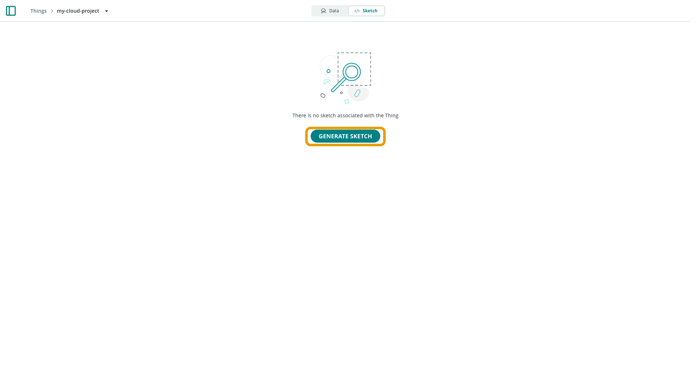

A **sketch** is a file where you write a program to run on an Arduino board,
with a `.ino` extension and the Arduino language (a variant of C++). Your
sketches live in a cloud **sketchbook** reachable from **Sketches**
(`/sketches`) in the left navigation — available from any machine and backed
up automatically.

## Accessing Your Sketchbook

Open `/sketches` to see every sketch. A sketch linked to a Thing is marked
with a small badge next to its name. Selecting a sketch opens it in the
[Cloud Editor](/arduino-cloud/sketches-editor/cloud-editor-overview). You can
organize sketches into folders using **Create → New Folder**, then drag a
sketch into it or use its **Move to folder** menu.

## Two Kinds of Sketch

| Kind | What it is |
|---|---|
| **Regular sketch** | A single `.ino` file, identical to one you'd write in the Arduino IDE — works for any board. |
| **Thing-attached sketch** | A set of files generated when you create a [Thing](/arduino-cloud/things-data/things): the `.ino`, plus `thingProperties.h` holding your variable and connection config. Only for Arduino Cloud-compatible boards. |

### Regular Sketches

A regular sketch only needs the two standard Arduino functions:

```arduino
void setup() {
  // runs once
}

void loop() {
  // loops forever
}
```

You can take a regular sketch from the Cloud Editor and compile it in the
offline IDE unchanged.

### Thing-Attached Sketches

Creating [Cloud Variables](/arduino-cloud/things-data/cloud-variables) does
**not** generate a sketch on its own. Until one is generated, the Sketch tab
shows an empty state:



A sketch is generated when you either select **Generate Sketch**, or associate
an Arduino/C++ device with the Thing. The generated sketch opens with three
files:


- **`<thing-name>_<date>.ino`** — your main file, pre-filled with
  `initProperties()`, `ArduinoCloud.begin(...)`, and `ArduinoCloud.update()`.
  Add your own logic here.
- **`thingProperties.h`** — auto-generated and auto-maintained; it declares
  every Cloud Variable and connection setting. Don't hand-edit it — it's
  regenerated whenever you change variables, device, or network settings.
- **`ReadMe.adoc`** — short notes about the sketch.

<Alert type="note">

If no device is associated yet, `thingProperties.h` can't build a real
connection handler and inserts an `#error` directive, so the sketch
intentionally fails to compile until you link a device.

</Alert>

## Next Steps

- [Cloud Editor Overview](/arduino-cloud/sketches-editor/cloud-editor-overview)
- [Cloud Variables](/arduino-cloud/things-data/cloud-variables)
- [Import Sketchbook & Libraries](/arduino-cloud/sketches-editor/import-sketchbook-libraries)
