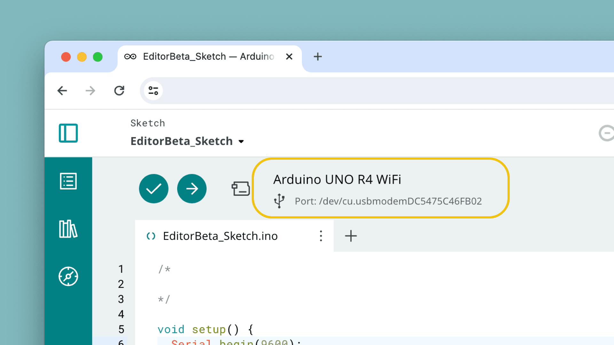

Uploading over **USB** is the standard way to flash a sketch the first time a board is connected to your computer. Because browsers can't access serial ports directly, the [Cloud Agent](/arduino-cloud/devices/cloud-agent) bridges the Cloud Editor to the board.

## Prerequisites

- The [Cloud Agent](/arduino-cloud/devices/cloud-agent) installed and running. The editor shows a reminder banner if it can't detect it.
- The board connected over USB with a data-capable cable (some cables are power-only).

## Selecting the Port and Board

Once the agent detects the board, it appears in the board-selection menu at the top of the editor. Select it so the editor knows what to compile for and where to upload.

<Alert type="warning">

Needs verification: the exact label and position of the board/port selector (e.g. "Select Other Board & Port") weren't confirmed against the current UI this pass. Confirm before publishing a precise click path.

</Alert>

## Uploading

1. Select the **Upload** button (the arrow icon) in the editor toolbar.
2. The editor compiles the sketch, then flashes it to the selected board over USB.
3. The console at the bottom shows compile and upload progress; a success message confirms the flash completed.

Use **Verify** first if you only want to compile and catch errors without uploading.

## Watching It Run

Open the **Serial Monitor** to read anything your sketch prints with `Serial.print()` / `Serial.println()`. Match the baud rate to the one in your sketch's `Serial.begin(...)` call so the output is readable.

<Alert type="info">

After one successful USB upload, a connected Wi-Fi® or Ethernet board can receive future updates wirelessly — see [Upload Over the Air](/arduino-cloud/sketches-editor/upload-over-the-air).

</Alert>

## Next Steps

- [Upload Over the Air](/arduino-cloud/sketches-editor/upload-over-the-air)
- [Cloud Agent](/arduino-cloud/devices/cloud-agent)
- [Cloud Editor Overview](/arduino-cloud/sketches-editor/cloud-editor-overview)
