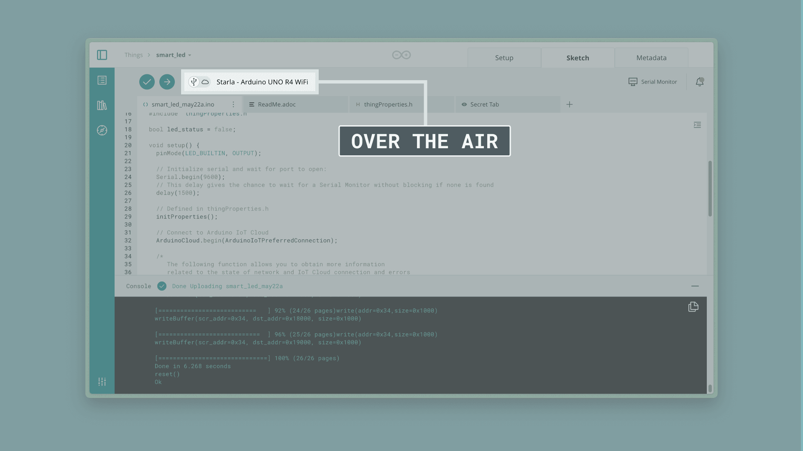
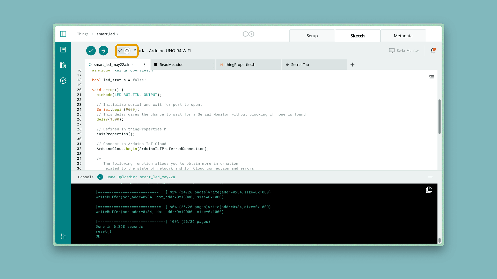

**OTA (over-the-air)** lets you upload a new sketch to a board already
connected to Arduino Cloud, without a USB cable — ideal for boards that are
hard to reach once deployed, or for updating many boards at once.

## Requirements

- An [OTA-supported board](https://github.com/arduino-libraries/ArduinoIoTCloud) —
  including UNO R4 Wi-Fi®, MKR Wi-Fi® 1010, Nano 33 IoT, Nano RP2040 Connect,
  Nano ESP32, the Portenta family, Nicla family, Opta Wi-Fi®, and GIGA R1
  Wi-Fi®.
- **One initial upload over USB** — this installs the OTA-capable partition
  layout later wireless uploads rely on. See
  [Upload Over USB](/arduino-cloud/sketches-editor/upload-sketch-usb).
- The board online in Arduino Cloud over Wi-Fi® (or Ethernet/Cellular, where
  supported).

### Verified ESP32 Boards

Beyond official Arduino boards, several third-party ESP32 dev boards are
verified for OTA — including the ESP32-S2/S3-DevKitC, NodeMCU-32S, WEMOS LOLIN
D32, and ESP32-CAM, among others. See
[Add an ESP32/ESP8266](/arduino-cloud/devices/add-esp32-esp8266) for
provisioning these boards.

## Switching a Device to OTA Uploads

Once a device has completed its first USB upload, the Sketch tab shows a
connection toggle next to the board: **USB** or the cloud icon for
**Over-the-Air**. Selecting the cloud icon sends the next upload wirelessly:

<Alert type="note">

If the board is still plugged in over USB, only that option may appear.
Disconnect the cable and power the board separately (e.g. a phone charger) to
force the Over-the-Air path:

</Alert>

Uploading over the air takes noticeably longer than USB, since compiling and
transferring the binary happens over the network.

## What Happens During an OTA Upload

1. The sketch is compiled for the target board.
2. The compiled binary is stored in cloud storage.
3. The binary's URL is associated with the target device.
4. An update flag tells the board to start downloading the file.
5. The downloaded file's length and CRC are verified on the device.
6. The verified sketch is flashed, and the board restarts running it.

## Next Steps

- [Upload Over USB](/arduino-cloud/sketches-editor/upload-sketch-usb)
- [Manage Devices at Scale](/arduino-cloud/devices/manage-devices-at-scale) — mass OTA from the CLI
- [Cloud Editor Overview](/arduino-cloud/sketches-editor/cloud-editor-overview)
