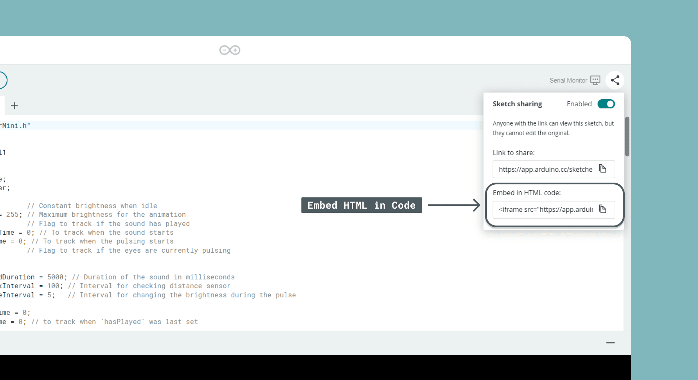
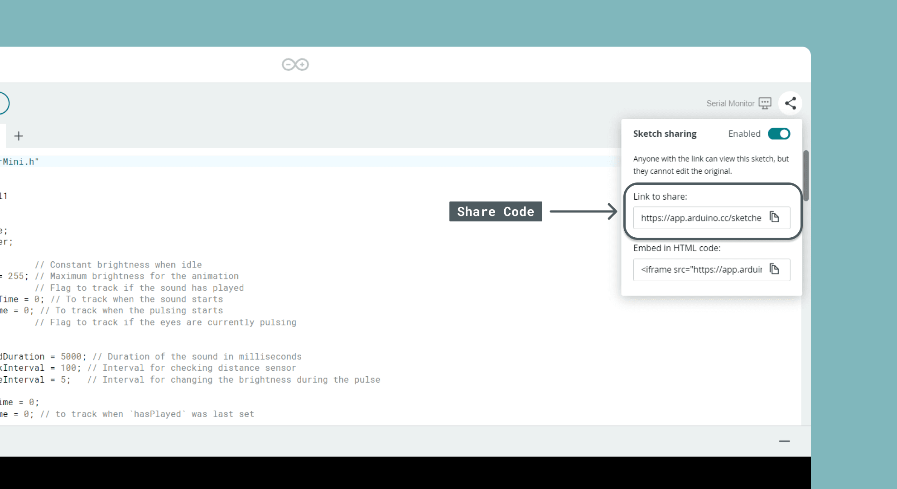

Any sketch in the [Cloud Editor](/arduino-cloud/sketches-editor/cloud-editor-overview)
can be shared via URL, or embedded as an `<iframe>` in a blog post, article, or
documentation page.

<Alert type="note">

Before sharing, make sure no credentials are hardcoded in the sketch — see
[Keep Secrets Out](/arduino-cloud/sketches-editor/keep-secrets-out).

</Alert>

## Getting the Embed Code

Open a sketch and select **Share** (next to the Serial Monitor tool). The dialog
has two fields: **link** and **embed**. Copy the embed snippet.



```html
<iframe src="https://app.arduino.cc/sketches/examples?eid=01.Basics%2FBlink&view-mode=embed" style="height:510px;width:100%;margin:10px 0" frameborder="0"></iframe>
```

## Iframe Parameters

Append parameters to the `src` URL to control how the embedded sketch renders.

| Parameter | Example | Result |
|---|---|---|
| `view-mode` | `view-mode=embed` | Full editor view with sketch name and author. |
| `view-mode` | `view-mode=snippet` | Code only, no surrounding metadata — cleaner for an article. |
| `highlight` | `highlight=L6,7` | Highlights the listed lines (here 6 and 7). |
| `highlight` | `highlight=L4,L6-L9` | Highlights line 4 and the range 6–9. |
| `scope` | `scope=L24-L37` | Shows only lines 24–37. |
| `hide-numbers` | `hide-numbers` | Hides the line numbers (flag, no value). |

Combine parameters with `&`, for example:

```html
<iframe src="https://app.arduino.cc/sketches/examples?eid=01.Basics%2FBlink&view-mode=snippet&scope=L3-L30&hide-numbers" style="height:510px;width:100%;margin:10px 0" frameborder="0"></iframe>
```

## Resizing the Iframe

The default dimensions are set in the iframe `style` attribute:

```html
style="height:510px;width:100%;margin:10px 0"
```

Change them to resize the widget, e.g. a smaller, half-width embed:

```html
<iframe src="https://app.arduino.cc/sketches/examples?eid=01.Basics%2FBlink&view-mode=snippet" style="height:200px;width:50%;margin:10px 0" frameborder="0"></iframe>
```

### Auto-resize

To let sketches resize automatically, include the resizer script once in your
HTML and add the `arduino-sketch-iframe` class to the iframe element:

```html
<script src="https://content.arduino.cc/assets/arduinoSketchIframeResizer.js"></script>
```

## Share by Link

To share code instead of embedding it, open the same **Share** dialog and copy
the **Link to share** field. The link opens a preview where others can copy the
code or add it directly to their sketchbook.



## Next Steps

- [Keep Secrets Out](/arduino-cloud/sketches-editor/keep-secrets-out)
- [Collaborative Coding](/arduino-cloud/sketches-editor/collaborative-coding)
- [Cloud Editor Overview](/arduino-cloud/sketches-editor/cloud-editor-overview)
