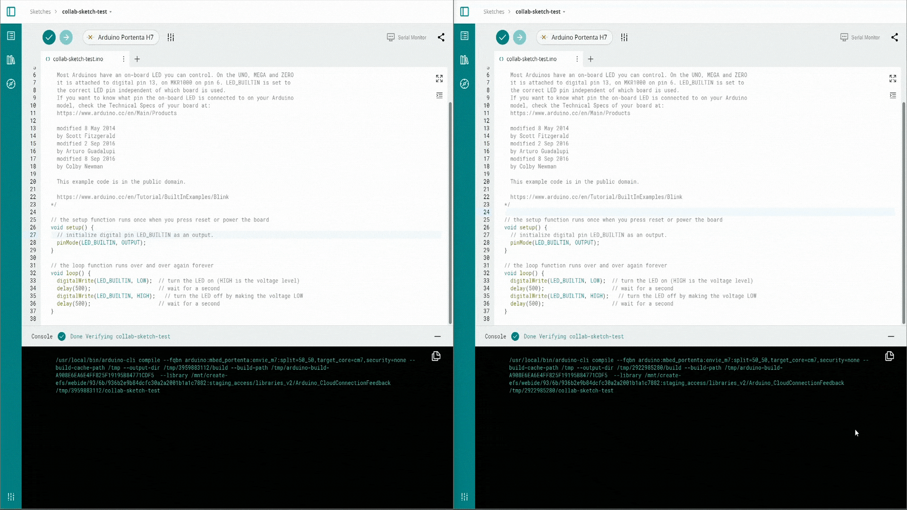
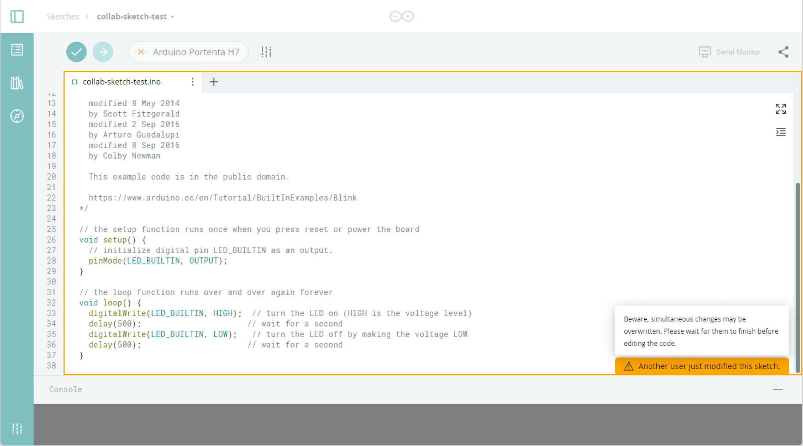

**Collaborative coding** lets multiple members of the same
[shared space](/arduino-cloud/spaces-plans-account/spaces) work together on the
same sketch. Team members can share and edit code seamlessly, so a project
stays in one place instead of being passed around as files.

<Alert type="info">

Collaborative coding is a shared-space feature — it requires a plan with
shared spaces. See [Arduino Cloud for Business](/arduino-cloud/business).

</Alert>

## How It Works

Everyone with access can open and modify the sketch. Changes are updated and
visible to all participants after the current editor finishes. The editor
highlights the region another person is editing with an **orange frame**, so
the team stays aware of each other's work.

While someone is editing a region, that area is framed in orange and a warning
block appears, signaling that you should wait before editing the same spot to
avoid losing changes.

## Avoiding Conflicts

- Wait for the orange frame to clear before editing the same region.
- Split work across different files or functions where possible, so two people
  rarely touch the same lines at once.
- Keep [secrets out](/arduino-cloud/sketches-editor/keep-secrets-out) of a
  shared sketch so credentials aren't exposed to collaborators.

## Next Steps

- [Keep Secrets Out](/arduino-cloud/sketches-editor/keep-secrets-out)
- [Share & Embed Sketches](/arduino-cloud/sketches-editor/share-embed-sketches)
- [Arduino Cloud for Business](/arduino-cloud/business)
