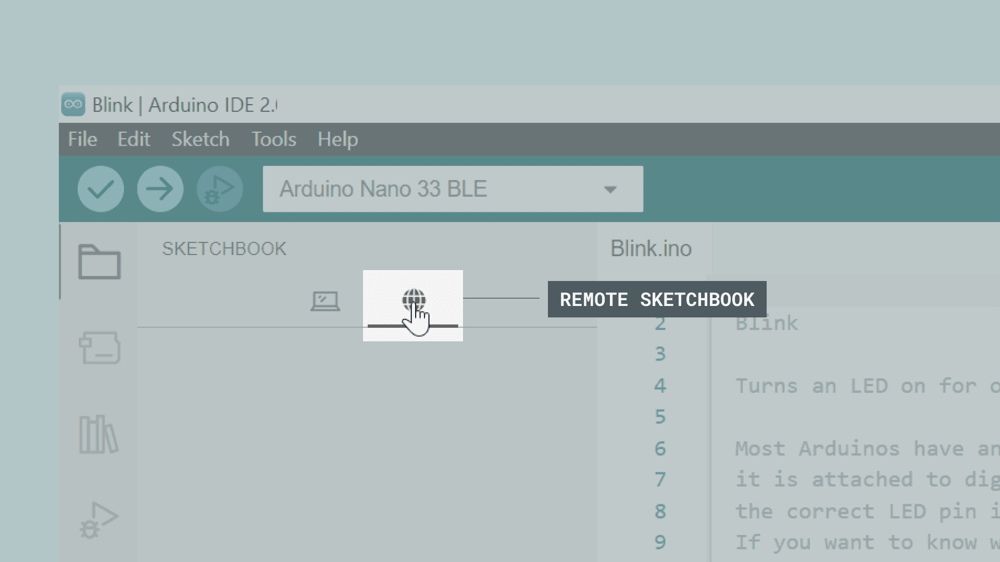
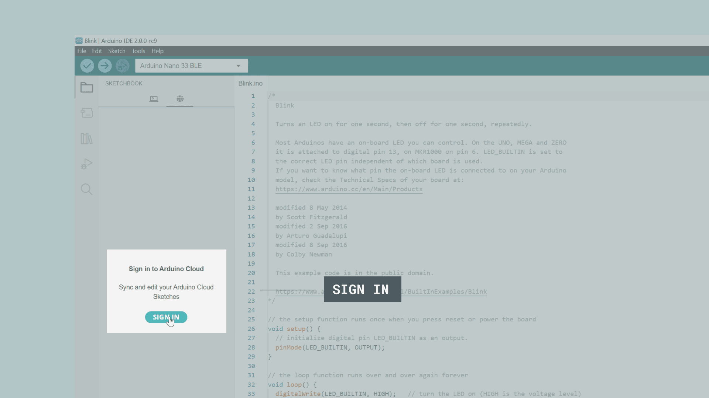
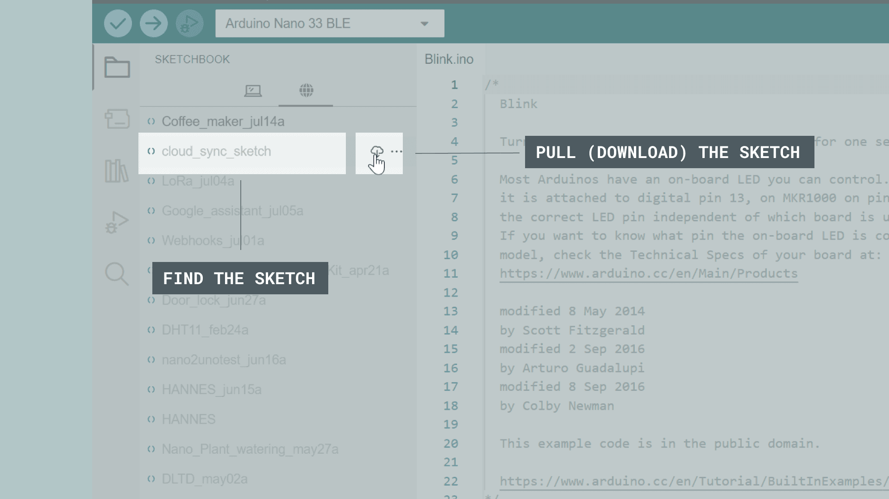
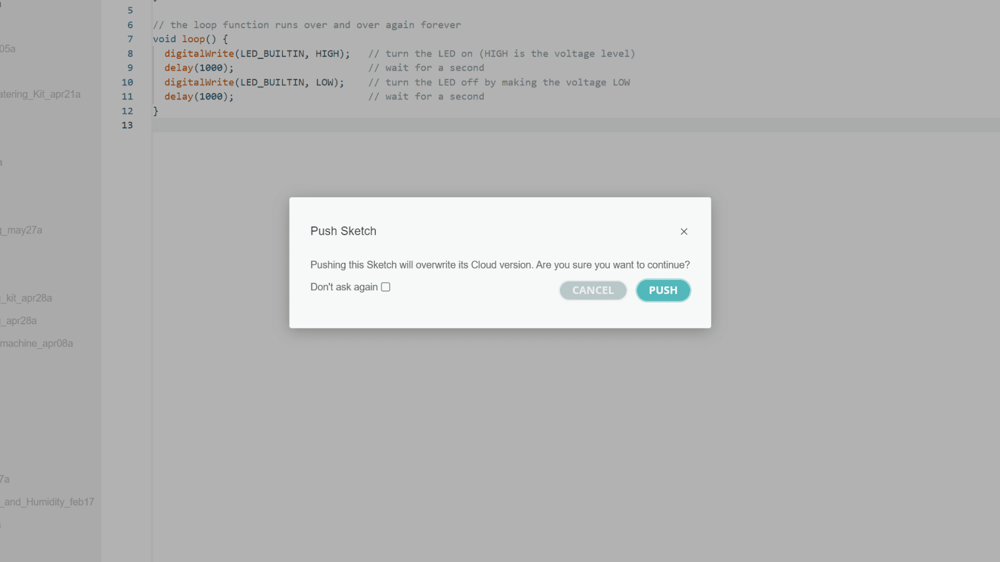

Arduino® Cloud handles configuration — Things, variables, provisioning — but you don't have to use the Cloud Editor to write code. You can develop a Cloud sketch in the offline [Arduino IDE](/software/ide-v2) and still keep it tied to your Thing.

## Hardware & Software Needed

- [Arduino IDE 2](https://www.arduino.cc/en/software), the desktop version of the Arduino IDE. If you are new to it, see [Getting Started with Arduino IDE 2](/software/ide-v2/tutorials/getting-started-ide-v2).
- An [Arduino account](https://login.arduino.cc/login), the same one you use for Arduino Cloud.
- The two device-side libraries, installed through the IDE's Library Manager:

- [ArduinoIoTCloud](https://github.com/arduino-libraries/ArduinoIoTCloud)
- [Arduino_ConnectionHandler](https://github.com/arduino-libraries/Arduino_ConnectionHandler)

These are the same libraries every generated sketch depends on; see [Arduino C++ Library](/arduino-cloud/device-libraries/arduino-cpp) for the library-level reference.

## Getting Your Sketch Offline

You have two options:

- **Download the sketch** from the Cloud Editor and move its files into your local sketchbook folder (e.g. `~/Documents/Arduino`), or
- **Use the Remote Sketchbook feature** in Arduino IDE 2 to [push and pull sketches](/software/ide-v2/tutorials/ide-v2-cloud-sketch-sync) directly between the cloud and your machine.

## Using the Remote Sketchbook

The Remote Sketchbook in Arduino IDE 2 shows the sketches stored in your Arduino Cloud sketchbook:

1. In Arduino IDE 2, open the **Remote Sketchbook** from the left sidebar.

   

2. Select **Sign in** and authorize Arduino IDE 2 to access your Arduino account.

   

3. Select the pull icon next to a sketch to download it to your computer.

   

4. Edit the sketch locally, then select the cloud icon and push your changes back to Arduino Cloud.

   

## Keeping Things in Sync

The Remote Sketchbook feature is the smoother path: if your `thingProperties.h` changes in the cloud (because you edited variables, device, or network settings), you can pull those changes down locally.

<Alert type="warning">

When you push or pull with Remote Sketchbook, it **overwrites** the existing copy — similar to a force operation in Git, but with no way to retrieve the previous version. Commit or back up anything you don't want to lose first.

</Alert>

Changes made purely offline don't automatically sync back into the Thing's configuration, so reconcile them through Remote Sketchbook rather than editing `thingProperties.h` by hand.

## Related Articles

- [Arduino C++ Library](/arduino-cloud/device-libraries/arduino-cpp)
- [Import Your Sketchbook and Libraries](/arduino-cloud/sketches-editor/import-sketchbook-libraries)
- [Best Practices](/arduino-cloud/sketches-editor/best-practices)
