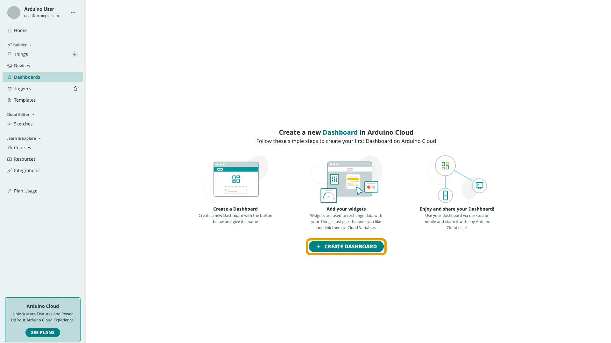
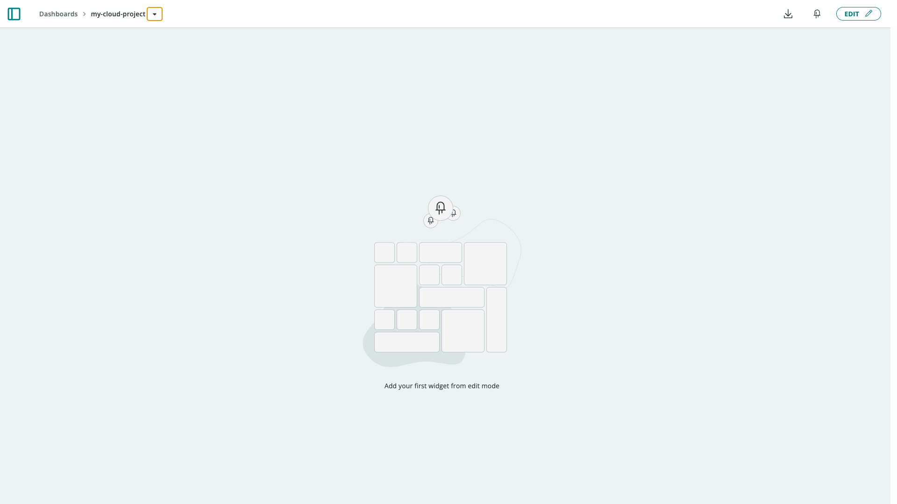

A **Dashboard** is a page of widgets bound to your [Cloud Variables](/arduino-cloud/things-data/cloud-variables) — the main way to see and control your project from a browser or the mobile app. You manage every dashboard from **Dashboards** in the left navigation (`/dashboards`).

## Creating a Dashboard

Select **Create Dashboard**. A new, empty, untitled dashboard is created immediately and opened in edit mode:

Rename it from the breadcrumb dropdown next to its name — the same Rename/Duplicate/Delete menu pattern used for [Things](/arduino-cloud/things-data/things). A freshly created dashboard prompts you to add your first widget:

## Edit Mode and View Mode

A dashboard has two modes:

- **View mode** (default) — widgets are live and interactive, but the layout is locked so you can't accidentally move anything.
- **Edit mode** — select **Edit** to unlock the canvas. Here you add, move, resize, configure, and remove widgets.

Switch back out of edit mode when you're done to return to a stable, interactive view.

## Arranging the Layout

In edit mode, drag a widget by its body to reposition it and drag a corner to resize it. Widgets snap to a grid, so neighboring widgets stay aligned. Build the layout that reads best for your project — for example, grouping controls on one side and readouts on the other.

<Alert type="info">

The layout you build in the browser is the same one the [IoT Remote app](/arduino-cloud/iot-remote-app/use-dashboards-on-phone) renders on a phone, where it reflows to fit a smaller screen.

</Alert>

## Duplicating and Deleting

Open the breadcrumb dropdown next to the dashboard's name to:

- **Duplicate** — create a full copy of the dashboard, including every widget and its variable links. Useful as a starting point for a similar project.
- **Delete** — permanently remove the dashboard. This doesn't affect the Things or Cloud Variables the widgets were linked to — only the dashboard view itself.

## Next Steps

- [Add & Link Widgets](/arduino-cloud/dashboards/add-link-widgets)
- [Share Dashboards](/arduino-cloud/dashboards/share-dashboards)
- [Widget Catalog](/arduino-cloud/reference/widget-catalog)
