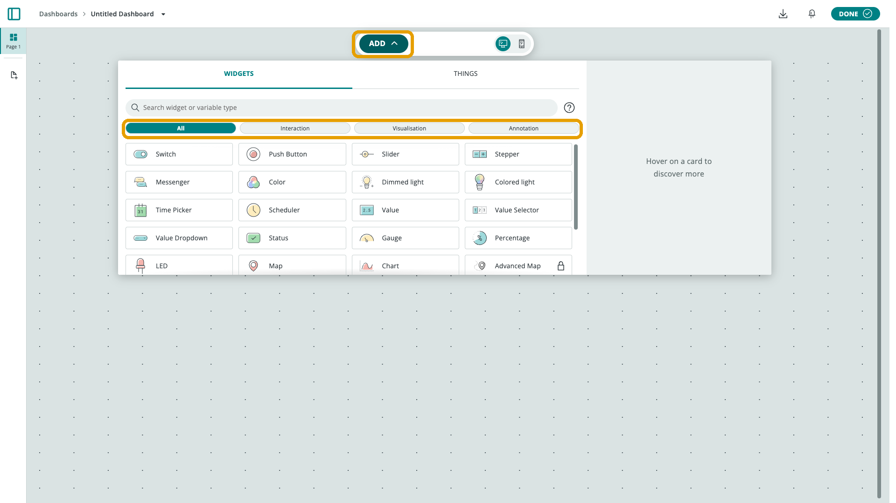
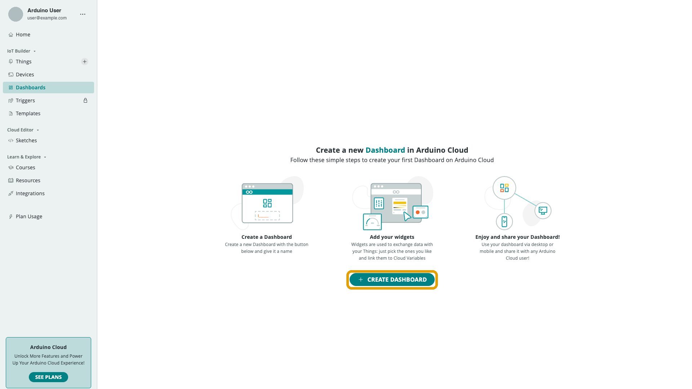
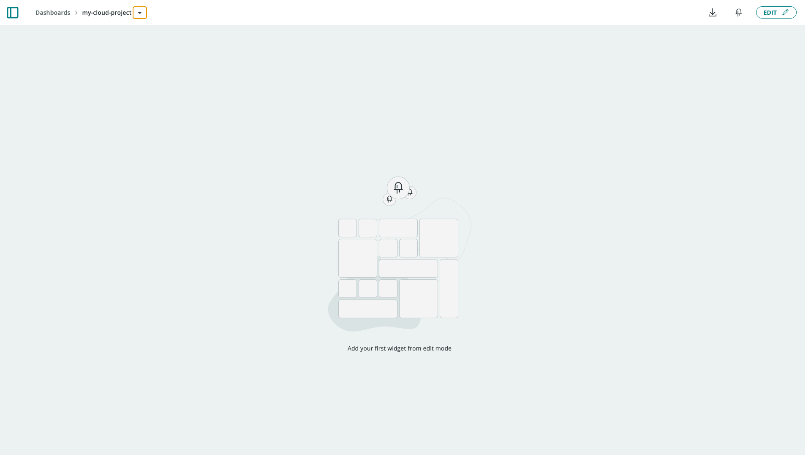

A **Dashboard** is a page of widgets bound to your [Cloud Variables](/arduino-cloud/things-data/cloud-variables) — the main way to see and control your project from a browser or the mobile app. Dashboards can combine many widget types, such as switches, sliders, gauges, charts, maps and status indicators:



For a description of each widget, see the [Widget Catalog](/arduino-cloud/reference/widget-catalog).

## Creating a Dashboard

1. Select **Dashboards** in the left navigation menu.
2. Select **Create Dashboard**. A new, empty, untitled dashboard is created and opened in edit mode:



To rename the dashboard, open the menu next to its name at the top of the page. This menu also has the **Duplicate** and **Delete** options, as for [Things](/arduino-cloud/things-data/things). An empty dashboard prompts you to add your first widget:



## Edit Mode and View Mode

A dashboard has two modes:

- **View mode** (default) — widgets are live and interactive, but the layout is locked so you can't accidentally move anything.
- **Edit mode** — select **Edit** to unlock the canvas. Here you add, move, resize, configure, and remove widgets.

Switch back out of edit mode when you're done to return to a stable, interactive view.

## Organizing a Dashboard Into Pages

A dashboard can be split into multiple pages, each with its own widgets, name, and icon. In edit mode, add pages from the left sidebar; in view mode, switch between them from the same sidebar. See [Dashboard Pages](/arduino-cloud/dashboards/dashboard-pages) for details.

## Arranging the Layout

In edit mode, drag a widget by its body to reposition it and drag a corner to resize it. Widgets snap to a grid, so neighboring widgets stay aligned. Build the layout that reads best for your project — for example, grouping controls on one side and readouts on the other.

In both edit and view mode, click the **Mobile Layout** icon to preview how the widgets appear in the IoT Remote app.

<Alert type="info">

The layout you build in the browser is the same one the [IoT Remote app](/arduino-cloud/iot-remote-app/use-dashboards-on-phone) renders on a phone, where it reflows to fit a smaller screen.

</Alert>

## Duplicating and Deleting

Open the menu next to the dashboard's name at the top of the page to:

- **Duplicate** — create a full copy of the dashboard, including every widget and its variable links. Useful as a starting point for a similar project.
- **Delete** — permanently remove the dashboard. This doesn't affect the Things or Cloud Variables the widgets were linked to — only the dashboard view itself.

## Managing Dashboards From the CLI

You can also list, extract, create and delete dashboards from the terminal with [arduino-cloud-cli](/arduino-cloud/developer-tools/cli-install-credentials). This is useful to replicate the same dashboard layout for many Things. For example, to extract a dashboard as a template and create a copy of it for another Thing:

```bash
arduino-cloud-cli dashboard extract --id <dashboardID> --format yaml > dashboard.yaml
arduino-cloud-cli dashboard create --name <dashboardName> --template dashboard.yaml --override <thing-0>=<thingID>
```

See [CLI Commands](/arduino-cloud/developer-tools/cli-commands#dashboards) for all dashboard commands.

## Related Articles

- [Dashboard Pages](/arduino-cloud/dashboards/dashboard-pages)
- [Add & Link Widgets](/arduino-cloud/dashboards/add-link-widgets)
- [Share Dashboards](/arduino-cloud/dashboards/share-dashboards)
- [Widget Catalog](/arduino-cloud/reference/widget-catalog)
- [Organize Resources With Smart Folders](/arduino-cloud/spaces-plans-account/smart-folders)
