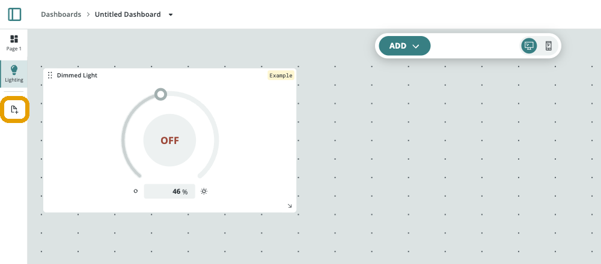
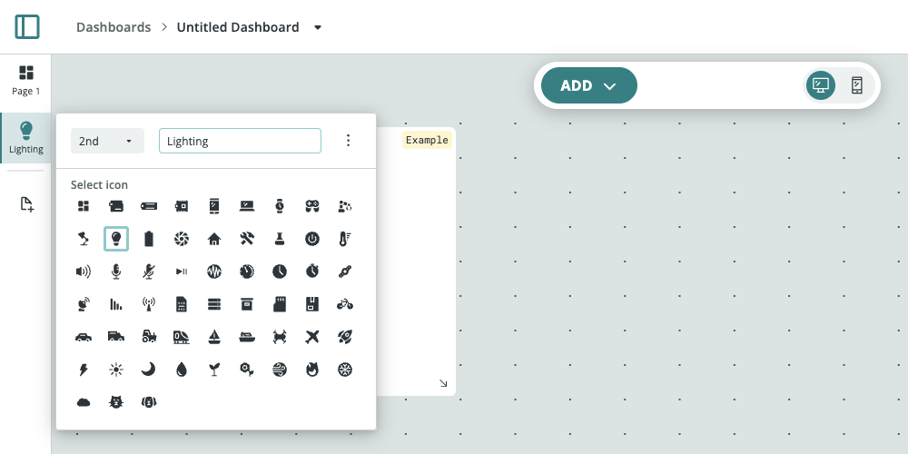
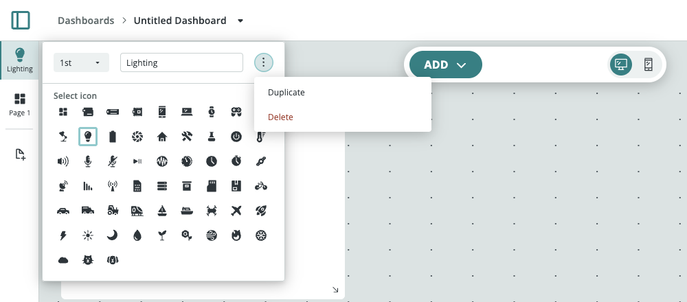
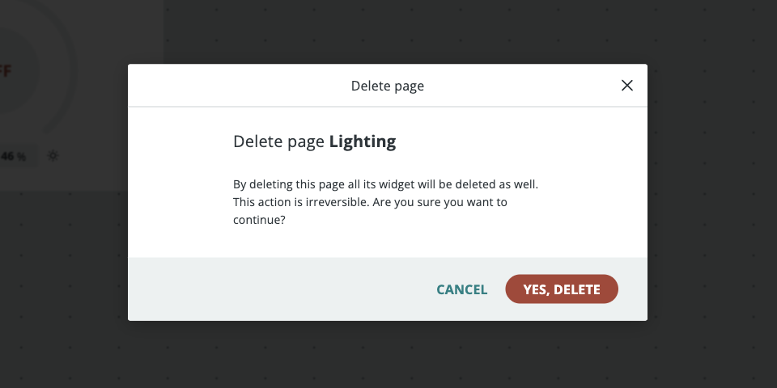
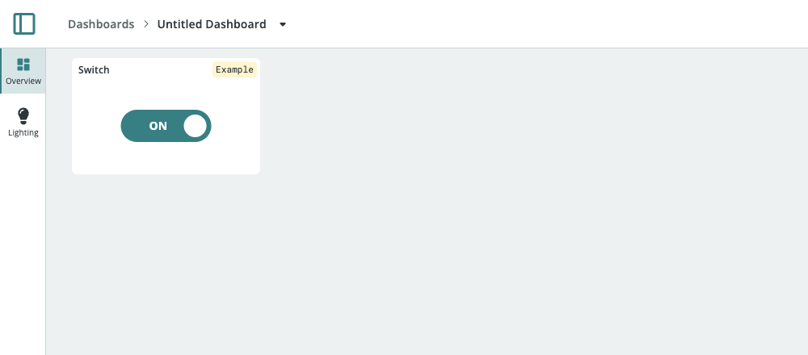

A [Dashboard](/arduino-cloud/dashboards/dashboards) can be split into multiple **pages**, each with its own set of widgets. Pages let you organize a large project into focused views, for example one page for an overview of the whole system, one for lighting controls, and one for sensor charts, instead of fitting every widget onto a single canvas. When you open the dashboard, you switch between pages to get to the view you need.

Every dashboard starts with a single page named **Page 1**. You add more pages in edit mode, and each page has its own **position**, **name**, and **icon**.

## Where You Can Manage Pages

Pages work in both the Arduino® Cloud web app and the [IoT Remote app](/arduino-cloud/iot-remote-app/use-dashboards-on-phone), but not every action is available on both:

| Action | Web App | IoT Remote App |
|---|---|---|
| Add a page | ✓ | — |
| Switch between pages | ✓ Left sidebar | ✓ Switch button at the bottom of the screen |
| Change a page's position, name, and icon | ✓ | ✓ |
| Duplicate a page | ✓ | — |
| Delete a page | ✓ | — |

## Adding a Page

Pages are added from the **left sidebar** in the web app's edit mode:

1. Open the dashboard and select **Edit** in the top-right corner.
2. In the left sidebar, select the **add page** button below the list of pages.

The new page is added at the end of the list with a default name (for example **Page 2**), and its settings open right away so you can name it. The canvas switches to the new, empty page, where you add widgets with the **ADD** button as usual. Each widget belongs to one page only.

## Customizing a Page's Position, Name, and Icon

In edit mode, select a page in the left sidebar to open its settings:

| Setting | Description |
|---|---|
| **Position** | The dropdown on the left (for example **1st**, **2nd**) sets where the page appears in the list. Selecting a new position moves the page and shifts the other pages to make room. |
| **Name** | The text field shows the page's name in the sidebar and page switcher. |
| **Select icon** | A grid of icons, such as a lightbulb, thermometer, or house. The selected icon is shown above the page's name in the sidebar. |

Changes apply immediately, so there's no separate save step. Close the settings by selecting anywhere outside them.

You can also customize pages in edit mode in the IoT Remote app.

## Duplicating and Deleting a Page

The **⋮** menu in a page's settings (web app only) has two options:

- **Duplicate**: Adds a copy of the page at the end of the list, with the same name, icon, and widgets.
- **Delete**: Removes the page. A confirmation dialog opens first.

<Alert type="warning">

Deleting a page also deletes all of the widgets on it, and it can't be undone. The Cloud Variables the widgets were linked to aren't affected.

</Alert>

## Switching Between Pages in View Mode

When a dashboard has more than one page, you switch between them while viewing it:

- **Web app**: Select a page by its icon and name in the **left sidebar**.
- **IoT Remote app**: Use the **switch button at the bottom of the screen** to change page.

A dashboard with only one page doesn't show the page sidebar in view mode. In a narrow browser window, the web app replaces the sidebar with a page selector at the bottom-left of the dashboard.

## Next Steps

- [Add & Link Widgets](/arduino-cloud/dashboards/add-link-widgets)
- [Working With Dashboards](/arduino-cloud/dashboards/dashboards)
- [Use Dashboards on Your Phone](/arduino-cloud/iot-remote-app/use-dashboards-on-phone)
