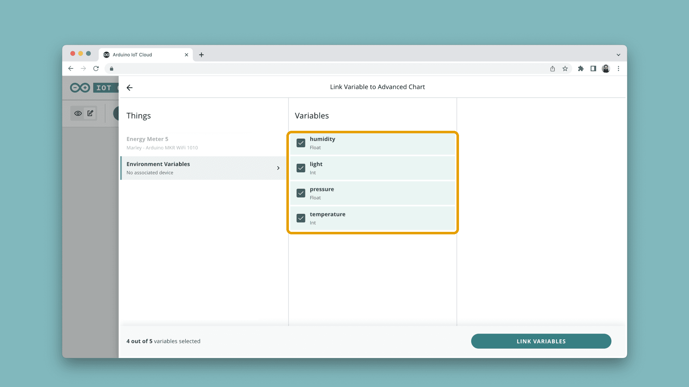
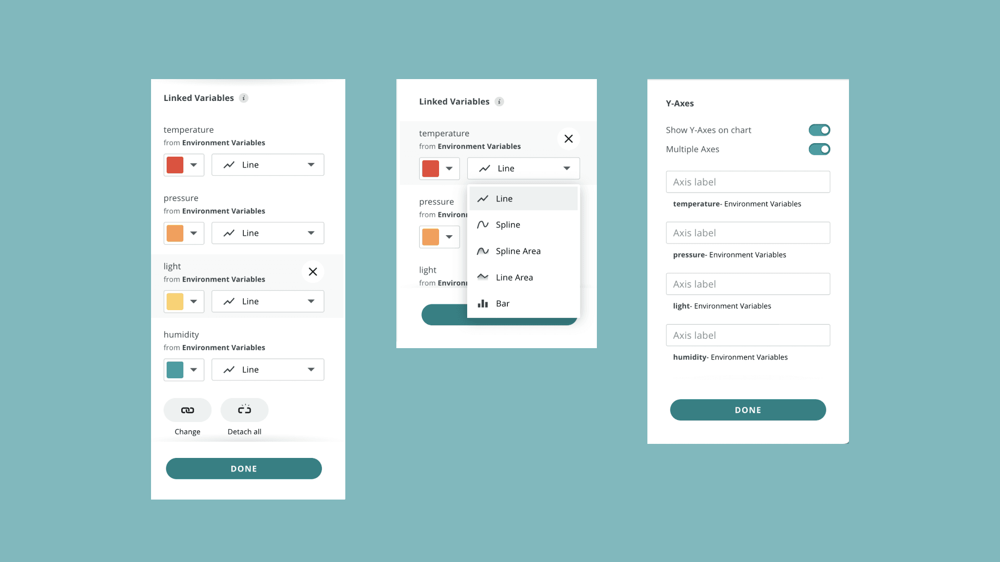

The **Advanced Chart** widget plots several
[Cloud Variables](/arduino-cloud/things-data/cloud-variables) at once on a
single chart — including variables from different
[Things](/arduino-cloud/things-data/things) — with per-series styling and
either a live view or a selectable historical time range. Reach for it
whenever a single [Chart](/arduino-cloud/reference/widget-catalog) isn't
enough to compare related readings, such as a weather station's
temperature, humidity, pressure, and light together.

<Alert type="note">

**Availability:** on a free-tier account this widget's picker card shows
"Upgrade to unlock widget" instead of being addable — it requires a paid
plan.

</Alert>

## Configuring the Widget

Add **Advanced Chart** from a dashboard's widget picker (see
[Add & Link Widgets](/arduino-cloud/dashboards/add-link-widgets)), then link
up to **5 variables** — they don't need to belong to the same Thing:

Each linked variable gets its own entry in a side panel, where its series
style can be set independently — **line**, **spline**, **spline area**,
**line area**, or **bar**:

## Supported Variable Types

Only numeric-based types can be charted: **Float**, **Int**, and any
Specialized variable type built on those two. Non-numeric types — Character
String, Schedule, Location, Color, Boolean, and the various light/sensor
types — are not supported by this widget.

## Reading the Chart

- **Toggle a series** by clicking its name in the legend to isolate or hide
  individual variables without removing them from the widget.
- **Hover** over the chart to read the exact value of every visible series at
  a specific point in time.
- **Select a time range** via the calendar icon to inspect a specific window
  instead of the live feed — useful for spotting patterns over hours or days.

No special device-side API is needed: the widget reads whatever values your
Thing's variables already carry.

## Next Steps

- [Track Location on a Map](/arduino-cloud/dashboards/track-location-map)
- [Widget Catalog](/arduino-cloud/reference/widget-catalog)
- [Historical Data & Export](/arduino-cloud/things-data/historical-data-export)
