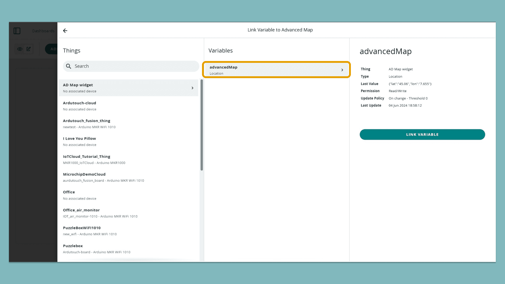
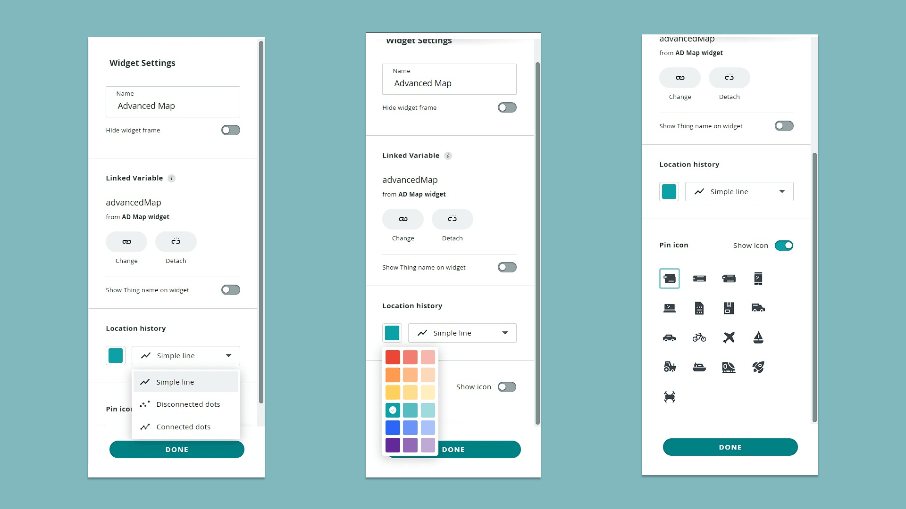

The **Advanced Map** widget tracks a [Thing's](/arduino-cloud/things-data/things)
location on a map and draws a path connecting its logged points over time —
live, or over a selected historical window. It suits weather stations,
environmental monitoring, fleet tracking, or any project where a device
moves and its path matters, not just its current position.

<Alert type="note">

**Availability:** on a free-tier account this widget's picker card shows
"Upgrade to unlock widget" instead of being addable — it requires a paid
plan.

</Alert>

## Configuring the Widget

Add **Advanced Map** from a dashboard's widget picker (see
[Add & Link Widgets](/arduino-cloud/dashboards/add-link-widgets)) and link a
single [`Location`](/arduino-cloud/things-data/cloud-variables)
(`CloudLocation`) variable:



The side panel lets you style the track drawn between logged points (line,
spline, spline area, line area, bar) and change the map pin's icon:



<Alert type="info">

This widget only supports the `Location` variable type — there's no way to
plot other variable types on the same map.

</Alert>

## Sending Location Data From a Sketch

Assign a `Location(latitude, longitude)` to the linked variable whenever a
new GPS fix is available. With an
[Arduino_MKRGPS](https://www.arduino.cc/reference/en/libraries/arduino_mkrgps/)
shield:

```arduino
#include <Arduino_MKRGPS.h>
#include "thingProperties.h"

void setup() {
  Serial.begin(9600);
  delay(1500);
  initProperties();
  ArduinoCloud.begin(ArduinoIoTPreferredConnection);
}

void loop() {
  ArduinoCloud.update();

  if (GPS.available()) {
    float latitude  = GPS.latitude();
    float longitude = GPS.longitude();
    advancedMap = Location(latitude, longitude);
  }
}
```

## Reading the Map

With the widget set to **Live**, the device's current location is marked with
a pin, and a track is drawn from its previous location to the new one as
updates arrive. Selecting a time range instead of Live shows only the
locations logged during that window — click the calendar icon to pick a
starting and ending date/time for the range to display.

## Next Steps

- [Plot Multiple Variables on One Chart](/arduino-cloud/dashboards/multiple-variable-chart)
- [Widget Catalog](/arduino-cloud/reference/widget-catalog)
