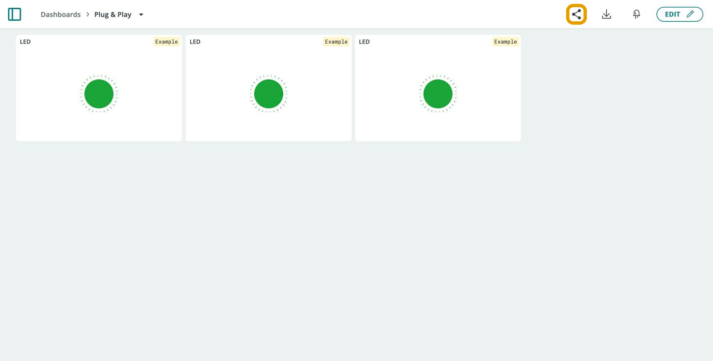
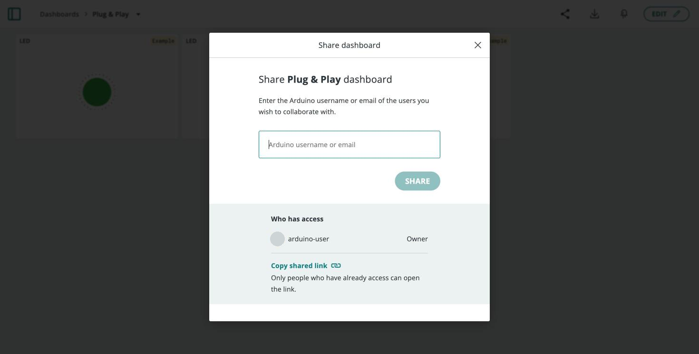

A [Dashboard](/arduino-cloud/dashboards/dashboards) can be **shared** with
other Arduino Cloud accounts — recipients get a link that lets them view,
and depending on the widgets interact with, it without ever needing your
login credentials or access to your other Things.

## Sharing a Dashboard

Every dashboard has a **share** icon in its top-right corner. Opening it lets
you search for a recipient by username or email and invite them:

Once invited, the recipient receives an email with a direct **Open
Dashboard** link, and their name is added to the dashboard's list of people
with access:

## What a Recipient Can See

<Alert type="info">

A shared dashboard only exposes that one dashboard's widgets. The recipient
never gains access to your account, your other Things, or any other
dashboard.

</Alert>

Whether a recipient can *control* a device or only watch it depends on the
widgets: interaction widgets linked to read/write variables let them send
values, while visualisation widgets are display-only.

## Revoking Access

To revoke access at any time, open the same share dialog and remove the
person from the list — their link stops working immediately.

## Sharing vs. Shared Spaces

<Alert type="note">

Dashboard sharing is scoped to a single dashboard. It is not the same as
[Shared Spaces](/arduino-cloud/spaces-plans-account/spaces), which
give a whole team ongoing access to an account's Things and dashboards. Use
sharing to hand a single dashboard to an outside viewer; use Shared Spaces
when a team needs continued access to your projects.

</Alert>

## Next Steps

- [Working With Dashboards](/arduino-cloud/dashboards/dashboards)
- [Shared Spaces](/arduino-cloud/spaces-plans-account/spaces)
