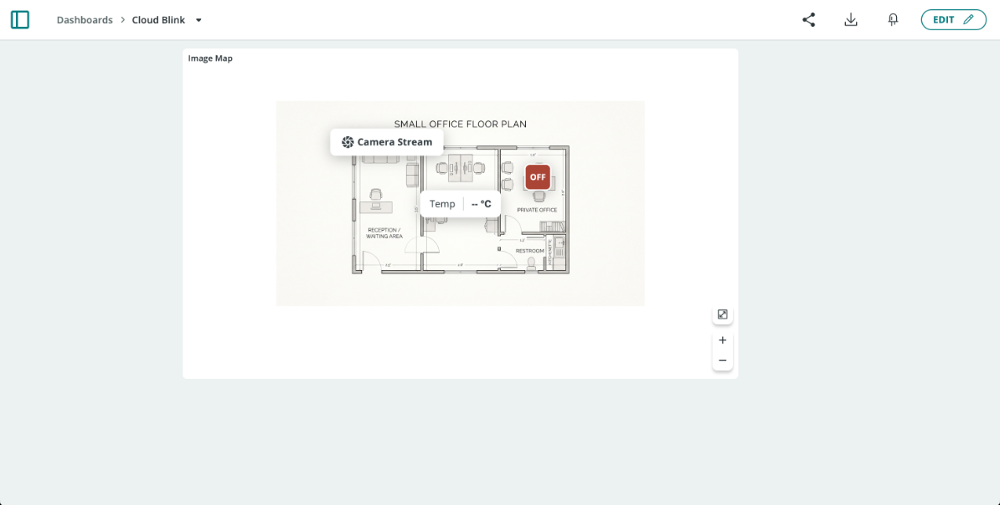
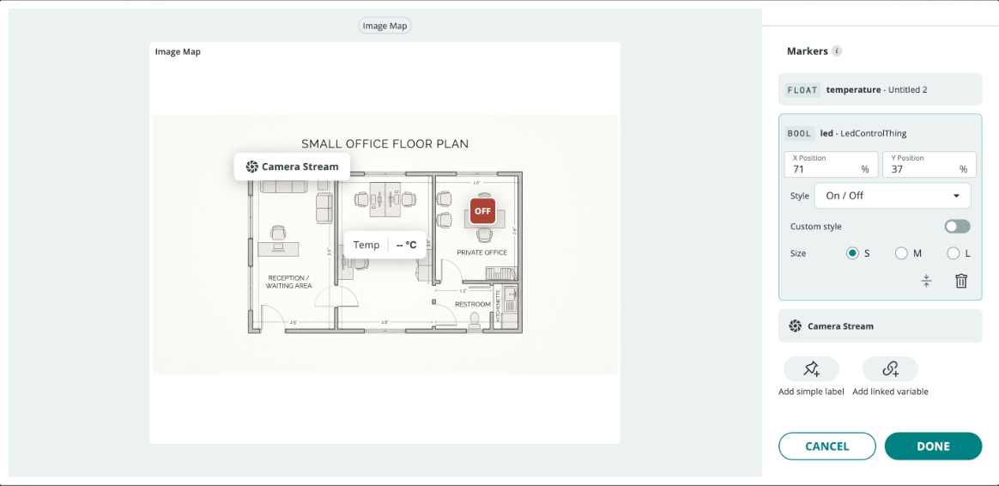

The **Image Map** widget places live data on top of an image of your choice. Upload a floor plan, a machine diagram, a greenhouse layout, or a photo, then pin **markers** to the exact spots where things happen. A temperature reading goes in the room it comes from, a light switch sits on the desk it controls, and a label links to a camera stream for that corner of the building. Instead of reading a grid of separate widgets, you see your project's status in its physical context.

<Alert type="note">

**Availability:** Image Map is one of the advanced dashboard widgets and requires a paid plan, from Maker upward (see the [Plans Feature Matrix](/arduino-cloud/reference/plans-feature-matrix)). On a Free plan, its card in the widget picker shows "Upgrade to unlock widget" and can't be added.

</Alert>

## Types of Markers

An Image Map holds any number of markers of two kinds:

| Marker | Shows | Use It For |
|---|---|---|
| **Linked variable** | The live value of a [Cloud Variable](/arduino-cloud/things-data/cloud-variables), for example a temperature reading or an ON/OFF state. Writable variables can be controlled directly from the marker. | Sensor readings and controls tied to a location on the image, such as **Temp** in a meeting room or a light switch in an office |
| **Simple label** | Static text with an optional icon, color, and URL | Room names, notes, or links to related resources, such as a **Camera Stream** label that opens a camera's video stream |

Linked-variable markers support `int`, `float`, `String`, and `bool` variables, and a single Image Map can show variables from different [Things](/arduino-cloud/things-data/things).

## Adding an Image Map to a Dashboard

1. Open a dashboard and select **Edit**.
2. Select **ADD** and choose **Image Map** from the widget picker (see [Add & Link Widgets](/arduino-cloud/dashboards/add-link-widgets)).
3. Add the background image, either by **uploading** a file or by entering an image **URL**. Supported formats are **JPG**, **PNG**, and **WEBP**, up to **5 MB**.
4. Add markers from the **Markers** section on the right side of the settings panel, as described below.
5. Select **DONE** to save the widget.

The settings panel shows a live preview of the widget on the left, so you can see each marker's position as you change it.

## Configuring Markers

The **Markers** section lists every marker on the image. Each linked-variable marker shows its variable's type (for example `FLOAT` or `BOOL`), the variable name, and the Thing it belongs to, for example **led - LedControlThing**. Select a marker in the list to expand its settings.

### Adding a Linked Variable

1. Select **Add linked variable** below the marker list.
2. Choose the Cloud Variable to show. It can come from any Thing in the space.
3. Set the marker's position, style, and size (see [Marker Settings](#marker-settings)).

### Adding a Simple Label

1. Select **Add simple label** below the marker list.
2. Enter the label's **text**, and optionally choose an **icon** and a **color**.
3. To make the label a link, add a **URL**. In view mode, selecting the label opens that address, for example a camera's video stream.
4. Set the label's position (see [Marker Settings](#marker-settings)).

### Marker Settings

| Setting | Description |
|---|---|
| **X Position** / **Y Position** | Where the marker sits on the image, as a percentage of the image's width and height, measured from the top-left corner. For example, `X 71%`, `Y 37%` places the marker about three quarters of the way across and just over a third of the way down. |
| **Style** | How a linked variable's value is shown. For example, a `bool` variable can use the **On / Off** style. |
| **Custom style** | Turn on to customize the marker's appearance beyond the selected style |
| **Size** | **S**, **M**, or **L** |

Use the collapse icon at the bottom of an expanded marker to close its settings, or the trash icon to delete the marker.

Markers are positioned only with the **X Position** and **Y Position** fields, not by dragging them on the image. Use the live preview to fine-tune the values until each marker sits where you want it.

<Alert type="info">

Because positions are percentages of the image's size, markers stay on the same spot of the image when the widget is resized.

</Alert>

## Using the Image Map in View Mode

In view mode, the widget shows the image with all of its markers:

- **Linked variables** update live as new values arrive. A dash, as in `-- °C`, means no value has been received yet.
- **Writable variables** can be controlled from their marker. For example, select an **ON/OFF** marker to toggle the linked `bool` variable and switch the device's LED.
- **Simple labels with a URL** open their link when selected.
- Use the **+** and **−** buttons in the bottom-right corner to zoom in and out of the image, and the expand button above them to view the widget full screen.

## Image Map Ideas

| Image | Markers |
|---|---|
| Office or home floor plan | Temperature and humidity per room, light switches, and links to security camera streams |
| Greenhouse or garden layout | Soil moisture per bed, and pump or valve controls next to each irrigation zone |
| Machine or production line diagram | Motor speed, status, and error values at each stage, with labels linking to maintenance documents |
| Classroom map | Sensor readings from each group's project at their table |

## Next Steps

- [Add & Link Widgets](/arduino-cloud/dashboards/add-link-widgets)
- [Widget Catalog](/arduino-cloud/reference/widget-catalog)
- [Plans Feature Matrix](/arduino-cloud/reference/plans-feature-matrix)
- [Cloud Variables](/arduino-cloud/things-data/cloud-variables)
